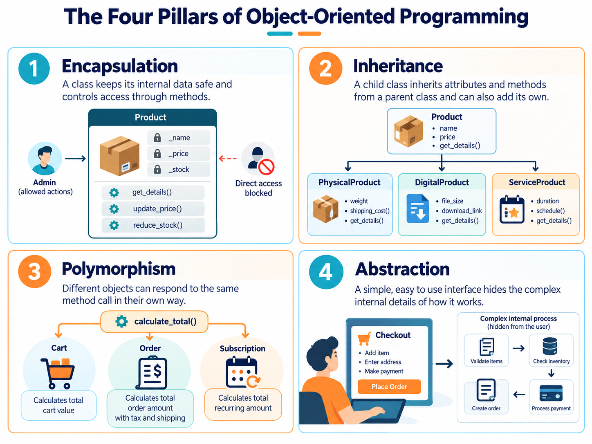
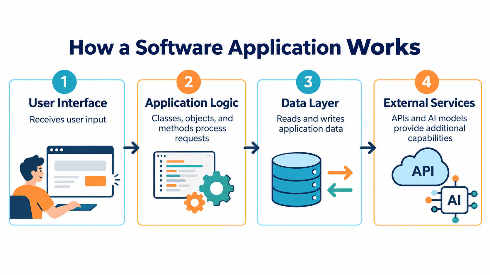

# What is OOP and Why It Matters
## eCOMMart AI Squad | Week 4

> Object-Oriented Programming is not a new syntax. It is a new way of **thinking about
> your program** — one that matches the way the real world is actually organised.

---

## What We Will Cover

1. The two styles of programming — procedural vs object-oriented
2. What is an object?
3. The four pillars of OOP — and what each one means in plain English
4. OOP in the real world — eCOMMart as a system of objects
5. Why OOP matters for AI applications
6. What Python's OOP looks like — a first look at the vocabulary
7. Tasks

---

## 1. The Two Styles of Programming

Everything you wrote in Week 3 was **procedural programming**. Procedural programs are written as a sequence of steps — do this, then do that, then do the other thing. Functions group those steps into reusable blocks, but the overall structure is a list of instructions running top to bottom.

```
Procedural thinking:
  1. Get the product from the catalog
  2. Calculate the discount
  3. Apply GST
  4. Check if stock is available
  5. Print the receipt
```

This works well for small programs. But as a program grows, you end up with dozens of functions operating on dozens of dictionaries, with no enforced relationship between them.

**Object-Oriented Programming** takes a different approach. Instead of thinking about steps, you think about the **things** your program works with — and you give each thing its own data and its own behaviour.

```
Object-oriented thinking:
  A Product knows its own price, stock, and category.
  A Product can calculate its own discounted price.
  A Product can check whether it is in stock.
  A Cart holds Products and can total them up.
  An Order is created from a Cart and belongs to a Customer.
```

The program becomes a collection of objects that talk to each other — much closer to how the real world actually works.

```
┌─────────────────────────────────────────────────────────────────┐
│  Procedural  →  a list of steps acting on data                  │
│  OOP         →  a collection of objects, each responsible for   │
│                 its own data and its own behaviour              │
└─────────────────────────────────────────────────────────────────┘
```

---

## 2. What is an Object?

An **object** is a self-contained unit that combines two things:

- **State** — the data it holds (also called attributes or fields)
- **Behaviour** — the actions it can perform (also called methods)

Everything in the real world can be thought of as an object with state and behaviour.

### Real-world example — a product on a shelf

| | State | Behaviour |
|---|---|---|
| A physical product | Name, price, weight, colour, quantity in box | Can be picked up, scanned, returned, discounted |
| An eCOMMart product | name, sku, price, category, stock, rating | apply_discount(), check_stock(), print_card() |

The physical product and the software object model the same thing. State describes **what it is**. Behaviour describes **what it can do**.

### Real-world example — a customer account

| | State | Behaviour |
|---|---|---|
| A real customer | Name, email, address, membership tier, order history | Can place an order, apply a coupon, update address |
| An eCOMMart customer object | name, email, tier, total_spent | place_order(), apply_coupon(), get_discount() |

---

## 3. The Four Pillars of OOP

OOP is built on four ideas. You do not need to memorise the names right now — but you do need to understand what each one *does for you*.



---

### Pillar 1 — Encapsulation

**What it means:** Bundle the data and the behaviour that belongs to that data together into one unit. Control what the outside world can see and change.

**Why it matters:** Without encapsulation, any part of your program can accidentally corrupt any piece of data. Encapsulation creates a protective boundary around an object's internals.

```
Without encapsulation:
  product["price"] = -500      # nothing stops this
  product["stock"] = "plenty"  # wrong type — no one notices until it crashes

With encapsulation:
  product.set_price(-500)      # the Product class can validate: price must be > 0
  product.set_stock("plenty")  # the Product class can reject: stock must be int
```

Think of it like the dashboard of a car. You interact with the steering wheel, accelerator, and brakes. You do not reach into the engine bay to change the fuel mixture directly. The car's internals are encapsulated — exposed only through safe, well-defined controls.

---

### Pillar 2 — Inheritance

**What it means:** A new class can be built on top of an existing class, automatically getting all its data and behaviour — and then adding or changing what it needs.

**Why it matters:** You write the shared logic once, in a parent class. Every child class gets it for free, and only defines what is different about itself.

```
eCOMMart example:

  Product (parent)
  ├── name, sku, price, stock
  ├── apply_discount()
  └── check_stock()

  PhysicalProduct (child of Product)
  ├── inherits everything from Product
  └── adds: weight, dimensions, shipping_cost()

  DigitalProduct (child of Product)
  ├── inherits everything from Product
  └── adds: file_size, download_link, send_download_email()
```

`PhysicalProduct` and `DigitalProduct` share all of `Product`'s logic. You write `apply_discount()` once. Both types of product can use it immediately — no copy-pasting.

---

### Pillar 3 — Polymorphism

**What it means:** Different types of objects can respond to the same action in their own way.

**Why it matters:** Code that works with a `Product` will keep working even if you later add new types of products — without changing the calling code.

```
eCOMMart example:

  mouse.print_card()    →  prints a standard product card
  watch.print_card()    →  prints a product card with wearable-specific fields
  ebook.print_card()    →  prints a product card with download info

  All three respond to print_card() — but each does it appropriately for its type.
  The calling code just says product.print_card() and does not need to know which type it is.
```

You have already seen a simple version of polymorphism in Python: `len("hello")` returns 5, `len([1, 2, 3])` returns 3, `len({"a": 1})` returns 1. The same function name — `len` — works differently depending on what type you give it. OOP extends this idea to your own types.

---

### Pillar 4 — Composition

**What it means:** Build complex objects by combining simpler ones. An object can *contain* other objects as its attributes.

**Why it matters:** Instead of trying to put everything into one giant class, you build small, focused classes and compose them together.

```
eCOMMart example:

  An Order contains:
  ├── a Customer object      (who is buying)
  ├── a list of CartItem objects   (what they are buying)
  └── an Address object      (where to deliver)

  The Order class does not duplicate Customer or Address logic —
  it simply holds references to those objects and delegates to them.
```

This is the same principle as building with Lego blocks. You build small, well-defined pieces and assemble them into larger structures. Each block does one job well.

---

## 4. OOP in the Real World — eCOMMart as a System of Objects

Let us map the entire eCOMMart platform as a system of objects. This is not code yet — it is just a way of thinking.

```
eCOMMart Platform
│
├── Product
│   ├── State  : name, sku, price, category, stock, rating, in_stock
│   └── Behaviour : apply_discount(), check_stock(), update_price(),
│                   print_card(), to_dict(), save_to_file()
│
├── Seller
│   ├── State  : name, city, gst_number, rating, is_verified, products[]
│   └── Behaviour : add_product(), remove_product(), get_rating(),
│                   print_profile(), verify()
│
├── Customer
│   ├── State  : name, email, phone, address, membership_tier, total_spent
│   └── Behaviour : place_order(), apply_coupon(), get_loyalty_discount(),
│                   upgrade_tier(), print_profile()
│
├── Cart
│   ├── State  : items[], customer, created_at
│   └── Behaviour : add_item(), remove_item(), get_subtotal(),
│                   apply_discount(), get_gst(), get_total(), checkout()
│
└── Order
    ├── State  : order_id, customer, cart, status, placed_at, delivered_at
    └── Behaviour : confirm(), ship(), deliver(), cancel(), print_receipt()
```
> **Note:** The flowchart above shows a simplified view of eCOMMart's core objects to make the OOP concepts easier to understand. In a real e-commerce platform, the system includes additional objects and workflows, such as **Request for Quotation (RFQ), quotations, payments, invoices, shipments, returns, refunds, reviews, and inventory management**. We are starting with the essential classes and will expand the model as we explore more complex business scenarios.

Look at how cleanly this maps to the real business. Every noun in the business domain becomes a class. Every verb becomes a method. The data each thing *has* becomes attributes. The actions each thing can *do* become methods.

Now compare this to the Week 3 approach, where you had 17+ free-floating functions with no clear home. In the OOP model, every function has a home — it lives inside the class it belongs to.

---

## 5. Why OOP Matters for AI Applications

> This is why Week 4 exists in this course — not just for general Python, but specifically for AI.

Modern AI frameworks are entirely built on OOP. When you use a library like the Anthropic SDK, LangChain, or any ML framework, you are working with classes and objects the entire time — even if you are not aware of it.


### Getting an Anthropic API Key :

To run this example, you need an Anthropic account and an API key. The API key allows your Python application to authenticate with Anthropic's API.

#### Step 1 — Open the Anthropic Console

Open the [Anthropic Console](https://console.anthropic.com/) in your browser and sign in or create an account.

#### Step 2 — Open the API Keys Section

In the console, navigate to **API Keys** and select **Create API Key**.


#### Step 3 — Create and Copy Your API Key

Give your key a descriptive name, such as `python-course`, and create it. Copy the generated key and store it securely. You may not be able to view the full key again.

**Important security guidelines:**

- Never share your API key with anyone.
- Never hardcode the key directly into your Python source code.
- Never commit your API key or `.env` file to Git.
- API access may require billing setup.

#### Step 4 — Prepare to Use the API Key

Before running the Python example, configure your API key using an environment variable named `ANTHROPIC_API_KEY`. The next section explains how to configure it in your development environment.

If you do not have API access, you can still read the example to understand how a Python SDK uses classes, objects, and methods. Running the example is optional.

### Example — the Anthropic SDK

```python
# This is real SDK code. Every line here is OOP.

from anthropic import Anthropic          # Anthropic is a class

client = Anthropic()                     # client is an object — an instance of Anthropic
                                         # it holds your API key, settings, and methods

message = client.messages.create(        # .messages is an attribute (another object)
    model="claude-sonnet-4-6",           # .create() is a method on that object
    max_tokens=1024,
    messages=[
        {"role": "user", "content": "What products does eCOMMart sell?"}
    ]
)

print(message.content)                   # message is an object — .content is its attribute
```

Every name with a dot after it is an object. `client`, `message`, `client.messages` — all objects. `.create()`, `.content` — methods and attributes.

If you do not understand OOP, you are reading the SDK as magic. Once you understand OOP, you can read it exactly as it is — a `client` object that has a `messages` attribute, which is itself an object with a `create()` method that returns a `message` object.

### Agent tools are methods

In Week 3 you wrote standalone functions and noted that they could be agent tools. In a real AI agent system, those tools are **methods on a class**:

```python
class EcommartAgent:
    """
    AI agent for the eCOMMart B2B platform.
    The agent can look up products, check stock, and calculate pricing.
    """

    def __init__(self, catalog):
        self.catalog = catalog              # the agent's knowledge base

    def get_product(self, sku):
        """Look up a product by SKU. Called when a user asks about a specific item."""
        return self.catalog.get(sku)

    def check_availability(self, sku, qty):
        """Check if a SKU is available in the requested quantity."""
        product = self.get_product(sku)
        if product is None:
            return False
        return product["stock"] >= qty

    def calculate_price(self, sku, qty, discount_pct=0):
        """Calculate the total price for a SKU and quantity with optional discount."""
        product = self.get_product(sku)
        if product is None:
            return None
        unit_price    = product["price"] * (1 - discount_pct / 100)
        return unit_price * qty
```

The agent is an object. Its tools are methods. Its knowledge base (the catalog) is an attribute. This is exactly the pattern used in production AI systems.

---

## 6. What Python's OOP Looks Like — First Look at the Vocabulary

Before the next file introduces the syntax in detail, here is the vocabulary you will use throughout Week 4. Read through it once — you do not need to memorise it, just let it become familiar.

```
┌──────────────────┬────────────────────────────────────────────────────┐
│  Term            │  What it means                                     │
├──────────────────┼────────────────────────────────────────────────────┤
│  Class           │  The blueprint — defines what attributes and        │
│                  │  methods every object of that type will have        │
├──────────────────┼────────────────────────────────────────────────────┤
│  Object          │  A specific instance created from a class.          │
│                  │  mouse = Product(...)  creates one Product object   │
├──────────────────┼────────────────────────────────────────────────────┤
│  Instance        │  Another word for object                            │
├──────────────────┼────────────────────────────────────────────────────┤
│  Attribute       │  A variable that belongs to an object               │
│                  │  mouse.price, mouse.name, mouse.stock               │
├──────────────────┼────────────────────────────────────────────────────┤
│  Method          │  A function that belongs to an object               │
│                  │  mouse.apply_discount(10)                           │
├──────────────────┼────────────────────────────────────────────────────┤
│  __init__        │  The special method that runs when an object is     │
│                  │  first created — sets up its initial state          │
├──────────────────┼────────────────────────────────────────────────────┤
│  self            │  Inside a method, self refers to the object itself  │
│                  │  self.price means "this object's price"             │
├──────────────────┼────────────────────────────────────────────────────┤
│  Inheritance     │  A child class that extends a parent class          │
├──────────────────┼────────────────────────────────────────────────────┤
│  Encapsulation   │  Controlling access to an object's internals        │
├──────────────────┼────────────────────────────────────────────────────┤
│  Composition     │  An object that contains other objects              │
└──────────────────┴────────────────────────────────────────────────────┘
```

### The anatomy of a class — preview

```python
class Product:                          # ← class keyword, then the class name (CamelCase)
    """A product listed on eCOMMart.""" # ← class docstring

    platform = "eCOMMart"              # ← class attribute — shared by ALL products

    def __init__(self, name, price, stock):   # ← constructor — runs on creation
        self.name  = name              # ← instance attributes — unique to each product
        self.price = price
        self.stock = stock

    def apply_discount(self, pct):     # ← method — a function belonging to this class
        """Returns the price after applying a percentage discount."""
        return self.price * (1 - pct / 100)

    def is_available(self):            # ← method with no extra arguments
        """Returns True if stock is greater than zero."""
        return self.stock > 0
```

```python
# Creating objects from the class
mouse = Product("Wireless Mouse", 499.00, 120)   # one Product object
stand = Product("Laptop Stand",   850.00,   0)   # another Product object

# Accessing attributes
print(mouse.name)                   # Wireless Mouse
print(stand.price)                  # 850.0

# Calling methods
print(mouse.apply_discount(15))     # 424.15
print(stand.is_available())         # False
print(mouse.is_available())         # True
```
```
# Output:
Wireless Mouse
850.0
424.15
False
True
```

Every detail of this syntax is explained in the files that follow. Right now, just notice:

- `Product` is the blueprint — defined once
- `mouse` and `stand` are two separate objects created from the same blueprint
- Each has its own `name`, `price`, and `stock` — they are independent
- Both can call `apply_discount()` and `is_available()` — the methods live in the class and are shared

---

## 7. Tasks

### Task 1 — Identify Objects in the Real World

Think about an online shopping platform you have used. List **five things** on that platform that could be modelled as objects. For each one, write:
- At least 3 **attributes** (state it holds)
- At least 2 **methods** (actions it can perform)

Do this without looking at the eCOMMart example above. Then compare your answer to the eCOMMart object map in Section 4.

```
Example answer format:

Object: Review
  Attributes : rating (int), comment (str), author (str), date (date), verified (bool)
  Methods    : edit(), delete(), mark_helpful(), report()
```

---

### Task 2 — Procedural vs OOP Side by Side

Below is a procedural version of a simple seller lookup. Rewrite the comment block describing what an OOP version would look like — without writing any Python syntax, just describe in plain English what the `Seller` class would contain.

```python
# --- PROCEDURAL VERSION ---

seller = {
    "name"       : "TechPro Distributors",
    "city"       : "Mumbai",
    "gst_number" : "27ABCDE1234F1Z5",
    "rating"     : 4.8,
    "is_verified": True,
    "products"   : ["WM-4021", "LS-7800", "UH-1102"]
}

def print_seller_profile(seller):
    verified = "✅ Verified" if seller["is_verified"] else "⚠️  Unverified"
    print(f"  {seller['name']} | {seller['city']} | ⭐ {seller['rating']} | {verified}")

def add_product_to_seller(seller, sku):
    if sku not in seller["products"]:
        seller["products"].append(sku)
        print(f"  Added {sku} to {seller['name']}'s catalog.")

def get_seller_badge(seller):
    if seller["rating"] >= 4.5 and seller["is_verified"]:
        return "🏅 Gold Seller"
    elif seller["rating"] >= 4.0:
        return "🥈 Silver Seller"
    else:
        return "Seller"

print_seller_profile(seller)
add_product_to_seller(seller, "SW-9001")
print(get_seller_badge(seller))
```
```
# Output:
  TechPro Distributors | Mumbai | ⭐ 4.8 | ✅ Verified
  Added SW-9001 to TechPro Distributors's catalog.
  🏅 Gold Seller
```

```
# --- YOUR OOP DESCRIPTION (plain English, no code needed) ---

# The Seller class would contain:
#   Attributes: ...
#   Methods:    ...
#   What is guaranteed about every Seller object: ...
#   What the caller does NOT need to worry about: ...
```

---

### Task 3 — Map the eCOMMart Order Terminal to OOP

Look back at the Week 3 capstone (Exercise 12 — the eCOMMart Order Terminal). It had:

- A `CATALOG` dictionary
- A `while` loop with a menu
- Several standalone functions (`add_to_cart`, `view_cart`, `checkout`, etc.)

Without writing any code, sketch out how you would redesign this as a set of classes:

- What classes would you create?
- What attributes would each class have?
- What methods would each class have?
- Which class would *contain* which other class?

```
# Suggested format:

Class: Catalog
  Attributes : products (dict of Product objects)
  Methods    : get_product(sku), list_all(), search(keyword)

Class: ...
```

There is no single correct answer. The goal is to practise thinking in objects before you start writing the syntax.

---

## Summary

| Concept | One-line definition |
|---|---|
| OOP | Organising code as objects that combine state and behaviour |
| Object | A specific instance with its own data and methods |
| Class | The blueprint that defines what every object of a type looks like |
| Encapsulation | Bundling data + behaviour and controlling access |
| Inheritance | A child class automatically gets a parent class's features |
| Polymorphism | Different object types responding to the same method name in their own way |
| Composition | Building complex objects by combining simpler objects |

> **OOP is not a rule you must follow.** It is a tool.
> For small scripts, procedural code is perfectly fine.
> For anything with multiple interacting data types — a platform, a framework,
> an AI agent system — OOP is the tool that keeps it manageable.

---

*Next: `03_Thinking_in_Objects.md`*
