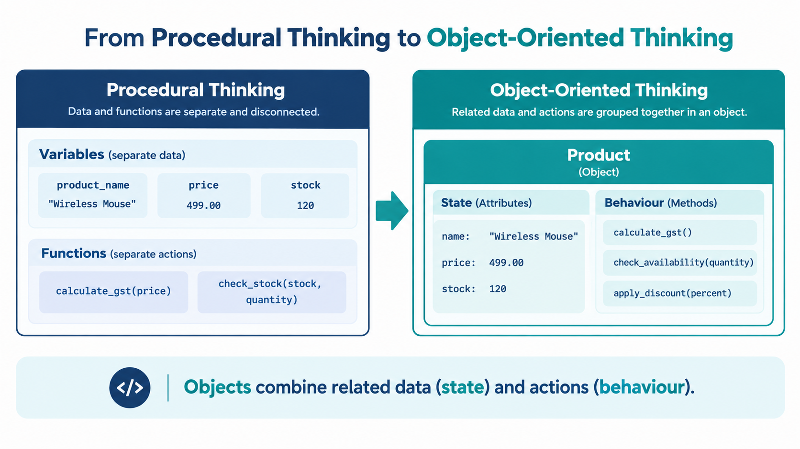
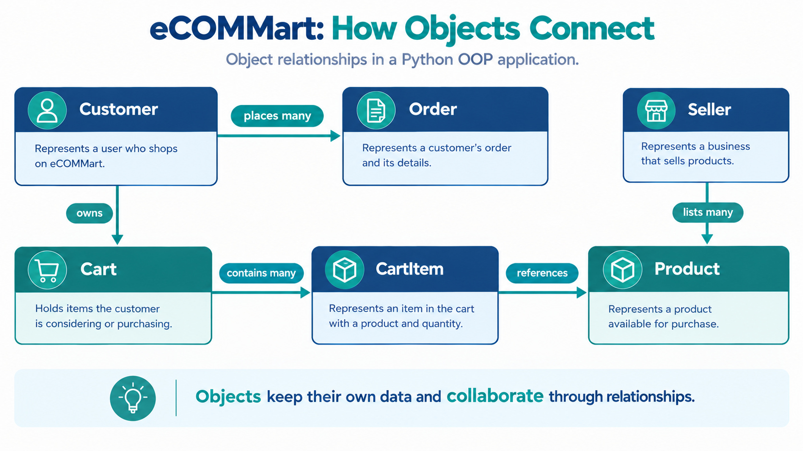

# Thinking in Objects
## eCOMMart AI Squad | Week 4

> Before you write a single line of class syntax, you need to be able to
> look at a problem and see the objects inside it. That skill — decomposing
> a system into objects — is what separates programmers who use OOP from
> programmers who truly understand it.

---

## What We Will Cover

1. How to identify objects in a system
2. Separating state from behaviour — the discipline
3. Defining object boundaries — what belongs where
4. Relationships between objects — has-a vs is-a
5. Designing the eCOMMart Order Pipeline as objects
6. Common mistakes when thinking in objects
7. Tasks

---

## 1. How to Identify Objects in a System

When you look at a new system and need to model it with OOP, start by reading
the problem description and underlining every **noun**. Nouns become objects.
**Verbs** become methods. **Adjectives** become attributes.

### eCOMMart system description

> *"A seller lists products on the eCOMMart platform. Each product has a name,
> SKU, price, category, and stock quantity. A customer browses the catalog,
> adds items to their cart, and places an order. At checkout, the system
> applies the customer's loyalty discount, calculates GST, and checks whether
> each item is still in stock. If the order is confirmed, it is assigned an
> order ID and the stock is decremented. The seller is notified and ships
> the order."*

Apply the noun/verb/adjective rule:

```
Nouns   → objects          : Seller, Product, Customer, Cart, CartItem, Order
Verbs   → methods          : list(), browse(), add_to_cart(), place_order(),
                             apply_discount(), calculate_gst(), check_stock(),
                             confirm(), decrement_stock(), notify(), ship()
Adjectives → attributes    : name, sku, price, category, stock, loyalty_discount,
                             order_id, is_confirmed, is_shipped
```

Not every noun becomes a class — some become attributes. The key question
is: **does this thing have both state and behaviour of its own?**

```
┌────────────────────────────────────────────────────────────────┐
│  Ask: Does it hold multiple pieces of data AND perform actions? │
│                                                                │
│  YES → it is probably a class                                  │
│  NO  → it is probably just an attribute on another class       │
└────────────────────────────────────────────────────────────────┘
```

| Candidate | Has multiple data fields? | Has its own behaviour? | Verdict |
|---|---|---|---|
| Product | ✅ name, sku, price, stock, category | ✅ apply_discount(), check_stock() | Class |
| Customer | ✅ name, email, tier, total_spent | ✅ get_discount(), place_order() | Class |
| Order | ✅ id, items, status, placed_at | ✅ confirm(), ship(), cancel() | Class |
| SKU | ❌ just a string | ❌ no behaviour | Attribute on Product |
| Order status | ❌ just a string | ❌ no behaviour | Attribute on Order |
| GST rate | ❌ just a float constant | ❌ no behaviour | Constant or attribute |

---

## 2. Separating State from Behaviour — The Discipline

A common mistake when starting OOP is to put everything in one place.
The discipline is to ask: *"Is this a fact about the object, or is this
something the object does?"*

### Designing the `Product` class

**State — facts about a product:**

```
name          str     "Wireless Mouse"
sku           str     "WM-4021"
price         float   499.00
category      str     "Electronics"
stock         int     120
rating        float   4.5
is_active     bool    True
```

**Behaviour — things a product can do:**

```
apply_discount(pct)     → returns the discounted price
calculate_gst()         → returns the GST amount at 18%
calculate_final_price() → returns price after discount + GST
check_availability(qty) → returns True if stock >= qty
restock(qty)            → increases stock by qty
deactivate()            → sets is_active to False
to_dict()               → returns a plain dict (for saving to JSON)
__str__()               → returns a readable string representation
```

Notice that `calculate_gst()` does not need a `gst_rate` parameter —
it already knows its own `price`. It has everything it needs internally.
This is the power of combining state and behaviour: the method operates
on data that is already part of the object.

```python
# Procedural — function needs to be told the price each time
def calculate_gst(price, gst_rate=0.18):
    return price * gst_rate

gst = calculate_gst(499.00)   # price is passed in from outside


# OOP — method already knows the price
class Product:
    def calculate_gst(self):
        return self.price * 0.18

mouse = Product(...)
gst = mouse.calculate_gst()   # price comes from self — no argument needed
```

The method is simpler to call, harder to misuse, and impossible to accidentally
pass the wrong product's price to.

---

## 3. Defining Object Boundaries — What Belongs Where

One of the most important OOP skills is knowing what **not** to put in a class.
A class should do one job well. If a class is responsible for everything,
it becomes as hard to maintain as the flat procedural code you started with.

### The Single Responsibility Principle

Each class should have **one primary reason to exist**.

```
Product    → knows about a product's data and pricing
Cart       → manages a collection of items being purchased
Order      → records a confirmed purchase and its status
Customer   → holds a customer's identity and purchase history
```

If you find yourself putting shipping logic inside `Product`, or pricing
logic inside `Customer`, that is a signal that the boundary is wrong.

### Concrete example — where does `calculate_delivery_fee()` live?

```
Candidate 1: Product.calculate_delivery_fee()
  → Wrong. A product does not know where it is being delivered to,
    or how many other items are in the cart.

Candidate 2: Customer.calculate_delivery_fee()
  → Wrong. Delivery fees depend on the cart total and the product's
    weight — neither of which belong to a Customer.

Candidate 3: Cart.calculate_delivery_fee()
  → Correct. The Cart knows the total value and can access each item.
    Delivery fee is a property of the entire purchase, not one item or one customer.

Candidate 4: Order.calculate_delivery_fee()
  → Also acceptable, once an Order is confirmed. But a Cart calculates
    it before confirmation, so Cart is the better home.
```

Getting boundaries right is not always obvious. The test is:
*"Does this method need to reach outside its own class to get the data
it needs?"* If yes, it probably belongs to a different class.

---

## 4. Relationships Between Objects — Has-A vs Is-A

Two objects can be related in two fundamentally different ways.

### Has-A (Composition)

One object **contains** another as an attribute.

```
An Order HAS-A Customer         → order.customer
An Order HAS-A list of CartItems → order.items
A Cart HAS-A Customer           → cart.customer
A CartItem HAS-A Product        → cart_item.product
```

When you see has-a, you use **composition** — one class stores a reference
to another class inside its attributes.

```python
# Has-A: An Order contains a Customer and a list of CartItems

class Order:
    def __init__(self, order_id, customer, items):
        self.order_id = order_id
        self.customer = customer    # a Customer object stored inside Order
        self.items    = items       # a list of CartItem objects

    def get_customer_name(self):
        return self.customer.name   # delegates to the Customer object

    def get_item_count(self):
        return len(self.items)
```

The `Order` does not duplicate any `Customer` data. It simply holds a
reference and delegates to it when needed.

---

### Is-A (Inheritance)

One object **is a more specific version** of another.

```
A PhysicalProduct IS-A Product    (everything a Product is, plus weight + dimensions)
A DigitalProduct  IS-A Product    (everything a Product is, plus file_size + download_url)
A PremiumCustomer IS-A Customer   (everything a Customer is, plus extra benefits)
```

When you see is-a, you use **inheritance** — the child class extends the parent.

```python
# Is-A: PhysicalProduct is a more specific Product

class PhysicalProduct(Product):         # inherits from Product
    def __init__(self, name, sku, price, category, stock, weight_kg):
        super().__init__(name, sku, price, category, stock)  # sets up Product fields
        self.weight_kg = weight_kg                            # adds its own field

    def calculate_shipping_cost(self, distance_km):
        """Shipping = ₹5 per kg per 100km, minimum ₹40."""
        raw_cost = self.weight_kg * (distance_km / 100) * 5
        return max(raw_cost, 40.0)
```

A `PhysicalProduct` automatically has `name`, `sku`, `price`, `apply_discount()`,
`check_availability()` — everything `Product` defined — and adds
`weight_kg` and `calculate_shipping_cost()` on top.

### The quick test

```
Use IS-A (inheritance) when:   "A [child] is a type of [parent]"
                                "A PhysicalProduct is a type of Product" ✅

Use HAS-A (composition) when:  "A [class] contains a [thing]"
                                "An Order contains a Customer" ✅

Watch out for:                 "A Cart is a type of Customer" ❌ — this is wrong
                               "A Cart has a Customer" ✅ — this is right
```

---

## 5. Designing the eCOMMart Order Pipeline as Objects

Let us apply everything above to design the full object model for
the eCOMMart checkout pipeline — the journey from a customer browsing
the catalog to a confirmed, shipped order.

This is a design exercise, not code. Read it like an architect reading
a blueprint before construction begins.

---

### Object: `Product`

```
Responsibility : Represents a single listable item on the platform.

State:
  sku           str     unique product code              "WM-4021"
  name          str     display name                     "Wireless Mouse"
  price         float   base price in INR                499.00
  category      str     product category                 "Electronics"
  stock         int     units currently available        120
  rating        float   average customer rating          4.5
  is_active     bool    whether the listing is live      True

Behaviour:
  apply_discount(pct)       → float   returns price after discount
  calculate_gst()           → float   returns 18% GST on current price
  calculate_final_price(pct)→ float   price after discount + GST combined
  check_availability(qty)   → bool    True if stock >= qty
  restock(qty)              → None    increases stock by qty, logs the event
  deactivate()              → None    sets is_active = False
  to_dict()                 → dict    serialises to a plain dict for JSON output
  __str__()                 → str     "[WM-4021] Wireless Mouse — ₹499.00 (120 in stock)"
```

---

### Object: `CartItem`

```
Responsibility : Represents one line in a shopping cart —
                 a specific product at a specific quantity.

State:
  product       Product   the Product object being purchased
  quantity      int       how many units

Behaviour:
  get_line_total()          → float   product.price × quantity
  get_line_total_with_gst() → float   line total including 18% GST
  __str__()                 → str     "Wireless Mouse × 3 = ₹1,497.00"
```

---

### Object: `Cart`

```
Responsibility : Manages the collection of items a customer
                 intends to purchase before checkout.

State:
  customer      Customer      who owns this cart
  items         list[CartItem] the items added so far
  created_at    datetime      when the cart was opened

Behaviour:
  add_item(product, qty)        → None    adds a CartItem, checks stock first
  remove_item(sku)              → None    removes a CartItem by product SKU
  update_quantity(sku, qty)     → None    changes quantity for a line item
  get_subtotal()                → float   sum of all line totals (pre-GST, pre-discount)
  get_discount_amount()         → float   discount based on customer tier + subtotal rules
  get_gst_amount()              → float   18% GST on subtotal after discount
  get_delivery_fee()            → float   ₹0 if subtotal >= ₹500, else ₹60
  get_total()                   → float   subtotal - discount + GST + delivery
  is_empty()                    → bool    True if items list is empty
  to_order()                    → Order   converts this cart into a confirmed Order
  print_summary()               → None    prints a formatted cart summary
```

---

### Object: `Customer`

```
Responsibility : Represents a registered eCOMMart buyer.
                 Holds identity, contact details, and purchase history.

State:
  customer_id     str     unique ID                     "CUST-00142"
  name            str     full name                     "Priya Sharma"
  email           str     login email                   "priya@example.com"
  phone           str     contact number                "9876543210"
  city            str     delivery city                 "Mumbai"
  membership_tier str     STANDARD/SILVER/GOLD/PLATINUM "GOLD"
  total_spent     float   cumulative spending on platform ₹7,400.00
  orders          list    list of past Order objects

Behaviour:
  get_loyalty_discount_pct()  → int     0/5/10/20 based on tier
  upgrade_tier()              → None    recalculates tier from total_spent
  add_to_history(order)       → None    appends a completed Order to orders
  get_order_count()           → int     total number of past orders
  __str__()                   → str     "Priya Sharma [GOLD] — ₹7,400.00 lifetime spend"
```

---

### Object: `Order`

```
Responsibility : Represents a confirmed, immutable purchase record.
                 Once created, it should not change (except status).

State:
  order_id        str       "ORD-20241201-00142"
  customer        Customer  who placed the order
  items           list      snapshot of CartItems at time of order
  subtotal        float     cart subtotal at time of confirmation
  discount_amt    float     discount applied
  gst_amt         float     GST applied
  delivery_fee    float     delivery charge
  grand_total     float     final amount charged
  status          str       "CONFIRMED" / "SHIPPED" / "DELIVERED" / "CANCELLED"
  placed_at       datetime  when the order was placed
  delivered_at    datetime  when it was delivered (None until delivery)

Behaviour:
  confirm()         → None    sets status = "CONFIRMED", decrements stock
  ship()            → None    sets status = "SHIPPED", notifies customer
  deliver()         → None    sets status = "DELIVERED", sets delivered_at
  cancel()          → None    sets status = "CANCELLED", restores stock
  print_receipt()   → None    prints full formatted order receipt
  to_dict()         → dict    serialises entire order to dict (for JSON saving)
```

---

### How They Connect



This is the entire checkout pipeline as a graph of objects. Every arrow
is either a has-a (composition) relationship or an is-a (inheritance) one.

Notice what is absent: no global variables, no free-floating functions,
no shared mutable state. Each object is responsible for its own data.

---

## 6. Common Mistakes When Thinking in Objects

Understanding these before you start coding will save you from having
to redesign everything halfway through.

### Mistake 1 — The God Class

A class that does everything: handles pricing, validation, file I/O,
display, and database access all at once. It starts small and grows
until it becomes the same problem as the flat procedural file.

```
❌  class EcommartSystem:
        def add_product(self): ...
        def remove_product(self): ...
        def checkout(self): ...
        def save_to_json(self): ...
        def print_receipt(self): ...
        def send_email(self): ...
        def calculate_gst(self): ...
        # 40 more methods...

✅  Keep responsibilities split:
        Product, Cart, Order, Customer, CatalogManager, FileHandler
```

---

### Mistake 2 — Primitive Obsession

Storing everything as plain strings and ints when the data has enough
structure to deserve its own class.

```
❌  order = {
        "customer_name": "Priya Sharma",
        "customer_email": "priya@example.com",
        "customer_city": "Mumbai",
        ...
    }

✅  order.customer.name     # Customer is its own object
    order.customer.email
    order.customer.city
```

---

### Mistake 3 — Reaching Across Boundaries

A method that needs to dig deep into another object's internals to
get data. If a method needs `order.customer.address.pincode.zone_code`,
the boundary between `Order` and `Address` is leaking.

```
❌  class Cart:
        def calculate_delivery_fee(self):
            # reaches into customer, then into customer's address
            city = self.customer.address["city"]

✅  class Cart:
        def calculate_delivery_fee(self):
            # delegates to customer — ask for what you need
            city = self.customer.get_delivery_city()
```

---

### Mistake 4 — Confusing Has-A and Is-A

```
❌  class Order(Customer):      # An Order is NOT a type of Customer
        ...

✅  class Order:
        def __init__(self, customer):
            self.customer = customer   # An Order HAS a Customer
```

If you ever find yourself writing `class X(Y)` and the sentence
*"an X is a type of Y"* sounds wrong, switch to composition.

---

## 7. Tasks

### Task 1 — Object Decomposition

Read the following description and produce an object map like the one
in Section 5. For each object, list its state fields and methods.
Do not write any Python — this is a design task only.

> *"eCOMMart sellers can run Flash Sales. A Flash Sale has a name, a start
> time, an end time, and a list of products included in the sale — each
> with its own sale discount percentage. Customers can browse active flash
> sales and add sale items to their cart at the discounted price. Once a
> flash sale ends, all discounts revert and any item remaining in
> a customer's cart is re-priced at the original price."*

Objects to design: `FlashSale`, `SaleItem`

For each, define:
- Its responsibility (one sentence)
- At least 4 state fields with types and example values
- At least 4 methods with return type and a one-line description

---

### Task 2 — Has-A or Is-A?

For each pair below, state whether the relationship is **has-a** or **is-a**,
and write one sentence explaining your reasoning.

```
1.  Cart        → CartItem
2.  PremiumSeller → Seller
3.  Order       → Customer
4.  DigitalProduct → Product
5.  FlashSale   → SaleItem
6.  Notification → Order
7.  BulkOrder   → Order
8.  Seller      → Product
```

---

### Task 3 — Spot the Boundary Violations

The code below has three boundary violations — methods that are in the
wrong class. Identify each one, explain why it is wrong, and state
which class it should belong to instead.

```python
class Product:
    def __init__(self, sku, name, price, stock):
        self.sku   = sku
        self.name  = name
        self.price = price
        self.stock = stock

    def apply_discount(self, pct):
        return self.price * (1 - pct / 100)

    # Violation A
    def get_customer_loyalty_discount(self, customer_tier):
        tiers = {"PLATINUM": 20, "GOLD": 10, "SILVER": 5, "STANDARD": 0}
        return tiers.get(customer_tier, 0)

    # Violation B
    def calculate_cart_total(self, cart_items):
        return sum(item["price"] * item["qty"] for item in cart_items)


class Cart:
    def __init__(self, customer, items):
        self.customer = customer
        self.items    = items

    # Violation C
    def get_product_gst(self, product_price):
        return product_price * 0.18

    def get_subtotal(self):
        return sum(item.get_line_total() for item in self.items)
```

---

## Summary

| Design question | Answer |
|---|---|
| How do I find objects? | Underline nouns → state. Circle verbs → methods |
| Does this need its own class? | Does it have multiple fields AND its own behaviour? |
| Where does this method belong? | In the class whose data it primarily operates on |
| Has-A or Is-A? | Contains? → Has-A (composition). Is a type of? → Is-A (inheritance) |
| How do I keep boundaries clean? | Ask for what you need; do not reach into another object's internals |

> The transition from procedural to object-oriented thinking is the
> hardest part of OOP — not the syntax. Once you can look at a system
> and see its objects, the code follows naturally.
> The next folder introduces the syntax that brings this design to life.

---

*Next: `02_Classes_and_Objects/01_What_Are_Classes_and_Objects.md`*
