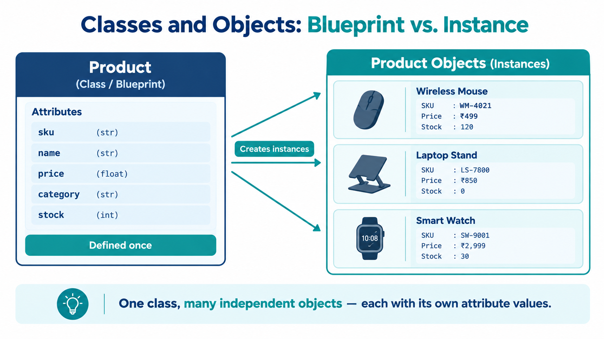

# What Are Classes and Objects
## eCOMMart AI Squad | Week 4

> A class is a blueprint. An object is something built from that blueprint.
> You define the blueprint once and create as many objects from it as you need —
> each independent, each carrying its own data.

---

## What We Will Cover

1. The class as a blueprint — the core mental model
2. Defining a class in Python — syntax from the ground up
3. Creating objects — instantiation
4. Accessing attributes and calling methods
5. Every object is independent
6. Inspecting objects — `type()`, `isinstance()`, `dir()`
7. The class docstring
8. A complete worked example — `Seller`
9. Tasks

---

## 1. The Class as a Blueprint — The Core Mental Model

In the previous folder you designed the eCOMMart platform as a set of objects.
You described what a `Product` has (state) and what it can do (behaviour).
A **class** is how you write that design in Python so the interpreter can
enforce it.
In the previous folder you designed the eCOMMart platform as a set of objects.
You described what a `Product` has (state) and what it can do (behaviour).
A **class** is how you write that design in Python so the interpreter can
enforce it.



The relationship between a class and an object is the same as the relationship
between a **blueprint and a building**:

The relationship between a class and an object is the same as the relationship
between a **blueprint and a building**:

```
Blueprint (class)         Building (object)
─────────────────         ────────────────────────────────
Defined once              Created many times from one blueprint
Describes the structure   Is the actual structure with real values
"Every flat has a         flat_101 = Flat(floor=1, area=850)
 floor number and area"   flat_202 = Flat(floor=2, area=1100)
```

Applied to eCOMMart:

```
Product class             Product objects
─────────────────         ────────────────────────────────
Defined once              Created for every item in the catalog
"Every product has a      mouse = Product("WM-4021", "Wireless Mouse", 499.00, ...)
 sku, name, price,        stand = Product("LS-7800", "Laptop Stand",   850.00, ...)
 stock, and category"     watch = Product("SW-9001", "Smart Watch",   2999.00, ...)
```

The `Product` class is written once. Every product in the catalog is a
separate object created from it — each with its own `sku`, `name`, `price`,
and `stock`. Change the price of `mouse` and `stand` is unaffected.

---

## 2. Defining a Class in Python — Syntax From the Ground Up

```python
class Product:
    """
    Represents a single product listed on the eCOMMart platform.

    Attributes:
        sku      (str):   Unique product identifier, e.g. 'WM-4021'.
        name     (str):   Display name of the product.
        price    (float): Base price in INR.
        category (str):   Product category, e.g. 'Electronics'.
        stock    (int):   Units currently available.
    """

    def __init__(self, sku, name, price, category, stock):
        self.sku      = sku
        self.name     = name
        self.price    = price
        self.category = category
        self.stock    = stock
```

Let us read every line carefully — nothing here is accidental.

```
class Product:
  ↑     ↑
  │     └── Class name. Always CamelCase by Python convention.
  │         Product, CartItem, CustomerAccount — not product, cart_item.
  └── The class keyword. Tells Python: "what follows is a class definition."
```

```
    def __init__(self, sku, name, price, category, stock):
         ↑              ↑    ↑
         │              │    └── Parameters — the data needed to build one object.
         │              │        Passed in when you write Product("WM-4021", ...)
         │              └── self — always the first parameter of every method.
         │                  Refers to the specific object being created.
         └── __init__ — the constructor. Python calls this automatically
             the moment you create a new Product object.
```

```
        self.sku      = sku
          ↑    ↑         ↑
          │    │         └── The value passed in from outside: "WM-4021"
          │    └── The attribute name — how you access it later: mouse.sku
          └── self — "this object". self.sku means "store sku on THIS object."
```

The `__init__` method is covered in full detail in its own file. For now,
understand it as the setup step — it runs once, immediately after the object
is created, and stores the initial values on the object.

---

## 3. Creating Objects — Instantiation

**Instantiation** is the act of creating a specific object from a class.
You do it by calling the class like a function:

```python
mouse = Product("WM-4021", "Wireless Mouse",  499.00, "Electronics", 120)
stand = Product("LS-7800", "Laptop Stand",    850.00, "Accessories",   0)
watch = Product("SW-9001", "Smart Watch",    2999.00, "Wearables",    30)
```

```
Product("WM-4021", "Wireless Mouse", 499.00, "Electronics", 120)
   ↑         ↑            ↑            ↑           ↑          ↑
   │         │            │            │           │          └── stock = 120
   │         │            │            │           └── category = "Electronics"
   │         │            │            └── price = 499.00
   │         │            └── name = "Wireless Mouse"
   │         └── sku = "WM-4021"
   └── Call the class — Python creates a new Product and runs __init__
```

Three objects have now been created. Each one is a completely separate
structure in memory. `mouse`, `stand`, and `watch` are three independent
`Product` objects.

```python
print(type(mouse))   # confirms what kind of object this is
print(type(stand))
```
```
# Output:
<class '__main__.Product'>
<class '__main__.Product'>
```

Both are `Product` objects — but they are different objects. They happen to
be the same type, just as two cars from the same factory are both cars but
are different vehicles.

---

## 4. Accessing Attributes and Calling Methods

Use **dot notation** to reach inside an object.

### Accessing attributes

```python
print(mouse.sku)        # WM-4021
print(mouse.name)       # Wireless Mouse
print(mouse.price)      # 499.0
print(mouse.category)   # Electronics
print(mouse.stock)      # 120

print(stand.name)       # Laptop Stand
print(stand.stock)      # 0
```
```
# Output:
WM-4021
Wireless Mouse
499.0
Electronics
120
Laptop Stand
0
```

```
mouse.price
  ↑    ↑
  │    └── attribute name
  └── the object
```

### Adding methods to the class

Let us extend `Product` with two methods:

```python
class Product:
    """Represents a single product listed on the eCOMMart platform."""

    def __init__(self, sku, name, price, category, stock):
        self.sku      = sku
        self.name     = name
        self.price    = price
        self.category = category
        self.stock    = stock

    def apply_discount(self, discount_pct):
        """
        Returns the price after applying a percentage discount.

        Args:
            discount_pct (float): Discount percentage, e.g. 15 for 15%.

        Returns:
            float: Discounted price in INR.
        """
        if discount_pct < 0 or discount_pct > 100:
            raise ValueError(f"Discount must be between 0 and 100. Got: {discount_pct}")
        return self.price * (1 - discount_pct / 100)

    def check_availability(self, qty_requested):
        """
        Checks whether the requested quantity can be fulfilled.

        Args:
            qty_requested (int): Number of units the customer wants.

        Returns:
            bool: True if stock >= qty_requested, False otherwise.
        """
        return self.stock >= qty_requested
```

### Calling methods

```python
mouse = Product("WM-4021", "Wireless Mouse",  499.00, "Electronics", 120)
stand = Product("LS-7800", "Laptop Stand",    850.00, "Accessories",   0)

# apply_discount — returns the discounted price
sale_price = mouse.apply_discount(15)
print(f"  Mouse sale price (15% off): ₹{sale_price:.2f}")

bulk_price = mouse.apply_discount(25)
print(f"  Mouse bulk price (25% off): ₹{bulk_price:.2f}")

# check_availability — returns True or False
print(f"  Can order 10 mice?   {mouse.check_availability(10)}")
print(f"  Can order 200 mice?  {mouse.check_availability(200)}")
print(f"  Laptop Stand in stock? {stand.check_availability(1)}")
```
```
# Output:
  Mouse sale price (15% off): ₹424.15
  Mouse bulk price (25% off): ₹374.25
  Can order 10 mice?   True
  Can order 200 mice?  False
  Laptop Stand in stock? False
```

```
mouse.apply_discount(15)
  ↑        ↑           ↑
  │        │           └── argument passed to discount_pct
  │        └── method name
  └── the object — Python passes this as self automatically
```

Inside `apply_discount`, `self.price` refers to `mouse.price` — 499.00.
When you call `stand.apply_discount(15)`, `self.price` becomes 850.00.
The same method works correctly for every object because `self` always
points to the object it was called on.

---

## 5. Every Object is Independent

This is one of the most important things to verify early. Objects created
from the same class do not share attribute values. Changing one does not
affect the others.

```python
mouse = Product("WM-4021", "Wireless Mouse",  499.00, "Electronics", 120)
stand = Product("LS-7800", "Laptop Stand",    850.00, "Accessories",   0)
watch = Product("SW-9001", "Smart Watch",    2999.00, "Wearables",    30)

# Modify mouse's stock directly
mouse.stock = 95
mouse.price = 449.00     # price drop

# stand and watch are completely unaffected
print(f"  mouse : ₹{mouse.price:.2f} | stock {mouse.stock}")
print(f"  stand : ₹{stand.price:.2f} | stock {stand.stock}")
print(f"  watch : ₹{watch.price:.2f} | stock {watch.stock}")
```
```
# Output:
  mouse : ₹449.00 | stock 95
  stand : ₹850.00 | stock 0
  watch : ₹2999.00 | stock 30
```

Each object has its own copy of every attribute. `mouse.price` and
`stand.price` are two completely separate variables that happen to share
the same name — exactly the same way `mouse.price` and `stand.price`
would be two different dictionary keys in two different dictionaries.

The class just guarantees that both dictionaries always have the same keys.

---

## 6. Inspecting Objects — `type()`, `isinstance()`, `dir()`

Three built-in tools for understanding any object at runtime.

### `type()` — what class is this object?

```python
mouse = Product("WM-4021", "Wireless Mouse", 499.00, "Electronics", 120)

print(type(mouse))
print(type(mouse.price))
print(type(mouse.stock))
print(type(mouse.check_availability))
```
```
# Output:
<class '__main__.Product'>
<class 'float'>
<class 'int'>
<class 'method'>
```

### `isinstance()` — is this object an instance of a specific class?

`isinstance()` is more useful than `type()` in real code because it handles
inheritance correctly — a child class object will return `True` for both
the child and the parent class.

```python
mouse = Product("WM-4021", "Wireless Mouse", 499.00, "Electronics", 120)

print(isinstance(mouse, Product))    # True
print(isinstance(mouse, str))        # False
print(isinstance(mouse.price, float))# True

# Practical use — validating input before operating on it
def print_product_summary(item):
    if not isinstance(item, Product):
        raise TypeError(f"Expected a Product object, got {type(item).__name__}")
    print(f"  [{item.sku}] {item.name} — ₹{item.price:.2f}")

print_product_summary(mouse)

try:
    print_product_summary({"name": "fake product"})
except TypeError as e:
    print(f"  TypeError: {e}")
```
```
# Output:
  [WM-4021] Wireless Mouse — ₹499.00
  TypeError: Expected a Product object, got dict
```

### `dir()` — what attributes and methods does this object have?

```python
# Filter out Python's internal dunder names to see just your own
public_members = [m for m in dir(mouse) if not m.startswith("_")]
print(public_members)
```
```
# Output:
['apply_discount', 'category', 'check_availability', 'name', 'price', 'sku', 'stock']
```

`dir()` is useful when working with an unfamiliar object from a library
or SDK — it lets you see exactly what you can call on it.

---

## 7. The Class Docstring

Every class should have a docstring immediately after the `class` line.
It describes the class's responsibility, its attributes, and any important
usage notes. This is what an AI agent reads to understand how to instantiate
and use the class.

```python
class Product:
    """
    Represents a single product listed on the eCOMMart B2B platform.

    A Product encapsulates all data and pricing behaviour for one catalog item.
    Use this class wherever product data needs to be validated, priced,
    or displayed consistently.

    Attributes:
        sku      (str):   Unique product identifier, e.g. 'WM-4021'.
        name     (str):   Display name shown to buyers.
        price    (float): Base price in INR before any discounts or GST.
        category (str):   One of: 'Electronics', 'Accessories', 'Wearables',
                          'Home & Kitchen'.
        stock    (int):   Units currently available for sale. 0 = out of stock.

    Example:
        >>> mouse = Product("WM-4021", "Wireless Mouse", 499.00, "Electronics", 120)
        >>> mouse.apply_discount(10)
        449.1
        >>> mouse.check_availability(50)
        True
    """
```

Access the docstring programmatically:

```python
print(Product.__doc__)
```
```
# Output:
    Represents a single product listed on the eCOMMart B2B platform.
    ...
```

---

## 8. A Complete Worked Example — Building a Shopping Cart Item

Now that you understand classes, objects, attributes, and methods, let's bring these concepts together in a practical eCOMMart example.

Imagine a customer adding a product to their shopping cart. The application needs to store the product's details, calculate the subtotal, and prepare the item information for further processing.

Instead of keeping these details in separate variables, we can create a `CartItem` class that groups the data and the operations related to a single cart item.

### 8.1 Define the `CartItem` Class

Create a file named `cart_item.py` and add the following code:

```python
class CartItem:
    def __init__(self, sku, name, price, quantity):
        self.sku = sku
        self.name = name
        self.price = price
        self.quantity = quantity

    def calculate_subtotal(self):
        return self.price * self.quantity

    def to_dict(self):
        return {
            "sku": self.sku,
            "name": self.name,
            "price": self.price,
            "quantity": self.quantity,
            "subtotal": self.calculate_subtotal()
        }
```

Let's understand the important parts of this class.

| Component | Purpose |
|---|---|
| `__init__()` | Initializes a cart item with its product details and quantity. |
| `self.sku` | Stores the product's unique stock-keeping identifier. |
| `self.name` | Stores the product name. |
| `self.price` | Stores the price of one item. |
| `self.quantity` | Stores how many units of the product are in the cart. |
| `calculate_subtotal()` | Calculates the total price for this cart item. |
| `to_dict()` | Returns the item's details as a Python dictionary. |

**Important:** The `to_dict()` method returns a dictionary object. It does not automatically print the dictionary. The calling code can store the returned value in a variable, print it, or pass it to another function.

### 8.2 Create an Object and Call Its Methods

Create another file named `main.py` in the same folder.

```python
from cart_item import CartItem

# Create a cart item object
item = CartItem(
    sku="ECM-101",
    name="Wireless Mouse",
    price=799.00,
    quantity=2
)

# Calculate and display the subtotal
subtotal = item.calculate_subtotal()
print(f"Subtotal: ₹{subtotal:.2f}")

# Convert the cart item into a dictionary
item_data = item.to_dict()
print(item_data)
```

**Expected output:**

```text
Subtotal: ₹1598.00
{'sku': 'ECM-101', 'name': 'Wireless Mouse', 'price': 799.0, 'quantity': 2, 'subtotal': 1598.0}
```

### 8.3 Understand the Flow of Execution

When Python executes `main.py`, the following sequence takes place:

1. **Import the class:** Python makes `CartItem` available from `cart_item.py`.
2. **Create the object:** `CartItem(...)` creates a new object and calls `__init__()` to initialize its attributes.
3. **Calculate the subtotal:** `item.calculate_subtotal()` multiplies the price by the quantity and returns the result.
4. **Convert the object to a dictionary:** `item.to_dict()` creates and returns a dictionary containing the item's details and calculated subtotal.
5. **Display the results:** The `print()` statements display the returned values.

Notice the difference between these two statements:

```python
item.to_dict()
```

This calls the method and returns a dictionary. By itself, it does not display anything in a normal Python script.

```python
print(item.to_dict())
```

This calls the method, receives the returned dictionary, and displays it.

### 8.4 Work with Multiple Objects

A shopping cart can contain multiple products. Each product added to the cart can be represented by a separate `CartItem` object.

Add the following code to `main.py` after the previous example:

```python
cart_items = [
    CartItem("ECM-101", "Wireless Mouse", 799.00, 2),
    CartItem("ECM-102", "USB Keyboard", 1199.00, 1),
    CartItem("ECM-103", "Laptop Stand", 1499.00, 1)
]

cart_total = 0

for item in cart_items:
    subtotal = item.calculate_subtotal()
    cart_total += subtotal

    print(f"{item.name}: ₹{subtotal:.2f}")

print(f"Cart Total: ₹{cart_total:.2f}")
```

**Expected output:**

```text
Wireless Mouse: ₹1598.00
USB Keyboard: ₹1199.00
Laptop Stand: ₹1499.00
Cart Total: ₹4296.00
```

Each object stores its own product details and quantity. Calling `calculate_subtotal()` on one object uses that object's attributes, so the same method works for different products.

This is one of the main advantages of object-oriented programming: you can define a class once and create as many objects as your application needs.

### 8.5 Why This Design Is Useful

This small example demonstrates several important programming principles:

- **Encapsulation:** Product details and related operations are grouped inside the `CartItem` class.
- **Reusability:** The same class can represent different products in the shopping cart.
- **Organization:** Instead of managing separate variables for every product, the application works with objects.
- **Data conversion:** The `to_dict()` method provides a dictionary representation that other parts of the application can use.
- **Separation of responsibilities:** The class manages individual cart items, while `main.py` creates objects, calculates the cart total, and displays the results.

In a larger application, the returned dictionary could be passed to another function or used as part of a process that saves cart information. This example focuses on Python objects and dictionaries; it does not implement database storage or an API.

---

## 9. Hands-on Practice — Applying Classes and Objects

Now it's your turn to apply what you've learned. Complete the following exercises to practise defining classes, creating objects, calling methods, and working with returned values.

### Task 1 — Build a Product Class

**Scenario:** eCOMMart needs a way to represent products available in its online store.

**Your task:** Create a `Product` class with the following attributes:

- `name` — the product name.
- `price` — the product's price.
- `stock` — the number of items available.

Implement these methods:

- `is_available()` — returns `True` if stock is greater than zero; otherwise, returns `False`.
- `apply_discount(discount_pct)` — reduces the product's price by the specified discount percentage and returns the updated price.

**Starter code:**

```python
class Product:
    def __init__(self, name, price, stock):
        # Initialize the product attributes
        self.name = name
        self.price = price
        self.stock = stock

    def is_available(self):
        # Return True if stock is greater than zero
        # TODO: Write your code here
        pass

    def apply_discount(self, discount_pct):
        # Apply the discount to the current price
        # Return the updated price
        # TODO: Write your code here
        pass


# Create a product object
product = Product("Wireless Headphones", 2000, 5)

# Test the methods
print(product.is_available())
print(product.apply_discount(10))
print(product.price)
```

**Expected output after completing the methods:**

```text
True
1800.0
1800.0
```

**Check your understanding:**

1. Which attributes belong to the `product` object?
2. Why does `apply_discount()` use `self.price`?
3. What should `is_available()` return if the stock is zero?

### Task 2 — Build and Inspect a Shopping Cart

**Scenario:** A customer has added three products to their eCOMMart shopping cart. The application must calculate the subtotal for each item and the total for the entire cart.

**Your task:**

1. Reuse the `CartItem` class from Section 8.
2. Create three `CartItem` objects using the product details shown below.
3. Store the objects in a list named `cart_items`.
4. Loop through the list and call `calculate_subtotal()` for each object.
5. Call `to_dict()` for each object, store the returned dictionary in a variable named `item_data`, and print that dictionary.
6. Calculate and print the final cart total.

| Product | SKU | Price | Quantity |
|---|---|---:|---:|
| Wireless Mouse | ECM-101 | ₹799.00 | 2 |
| USB Keyboard | ECM-102 | ₹1,199.00 | 1 |
| Laptop Stand | ECM-103 | ₹1,499.00 | 1 |

**Starter code:**

```python
from cart_item import CartItem

# Create three CartItem objects and store them in a list
cart_items = [
    # TODO: Add the first CartItem object
    # TODO: Add the second CartItem object
    # TODO: Add the third CartItem object
]

cart_total = 0

for item in cart_items:
    # Calculate the current item's subtotal
    subtotal = item.calculate_subtotal()

    # Add the subtotal to the cart total
    cart_total += subtotal

    # Convert the object into a dictionary.
    # to_dict() returns a dictionary, so store the returned
    # value in item_data before printing it.
    item_data = item.to_dict()

    print(item_data)

print(f"Cart Total: ₹{cart_total:.2f}")
```

**Expected final cart total:**

```text
Cart Total: ₹4296.00
```

Your three dictionaries should contain the corresponding product details, quantities, and calculated subtotals.

**Check your understanding:**

1. What does `cart_items` contain: dictionaries or `CartItem` objects?
2. What type of value does `to_dict()` return?
3. Why do we add each subtotal to `cart_total` inside the loop?

### Task 3 — Add a Method to Update Quantity

**Scenario:** A customer changes the quantity of a product in their shopping cart. The application needs to update the quantity while preventing invalid values.

**Your task:** Add an `update_quantity(new_quantity)` method to the `CartItem` class.

The method should:

- Accept the new quantity as an argument.
- Update `self.quantity` if the new quantity is greater than zero.
- Print a helpful message if the new quantity is invalid.
- Leave the existing quantity unchanged when the new quantity is invalid.

**Starter code:**

Add the following method inside your existing `CartItem` class:

```python
def update_quantity(self, new_quantity):
    # Check whether the new quantity is greater than zero.
    # If valid, update self.quantity.
    # Otherwise, print an error message and keep the
    # existing quantity unchanged.

    # TODO: Write your code here
    pass
```

Then test your method in `main.py`:

```python
from cart_item import CartItem

item = CartItem("ECM-101", "Wireless Mouse", 799.00, 2)

print(f"Original quantity: {item.quantity}")

item.update_quantity(4)
print(f"Updated quantity: {item.quantity}")
print(f"Updated subtotal: ₹{item.calculate_subtotal():.2f}")

# Try an invalid quantity
item.update_quantity(0)
print(f"Quantity after invalid update: {item.quantity}")
```

**Expected behaviour:**

```text
Original quantity: 2
Updated quantity: 4
Updated subtotal: ₹3196.00
```

When you try to update the quantity to zero, your method should display an error message and preserve the previous quantity of `4`.

**Check your understanding:**

1. Why should the method validate `new_quantity` before changing the attribute?
2. What happens to the subtotal when the quantity changes?
3. Why does `update_quantity()` need `self`?

### Final Review Checklist

Before moving on, make sure you can:

- [ ] Explain the difference between a class and an object.
- [ ] Define a class with an `__init__()` method.
- [ ] Initialize attributes using `self`.
- [ ] Create multiple objects from the same class.
- [ ] Call methods on objects and use their return values.
- [ ] Explain why `to_dict()` returns a dictionary rather than printing it directly.
- [ ] Use a list and a loop to process multiple objects.
- [ ] Add a method that updates an attribute while validating input.

**Next:** Continue to `02_Creating_Your_First_Class.md` to explore creating and working with your own Python classes in more detail.