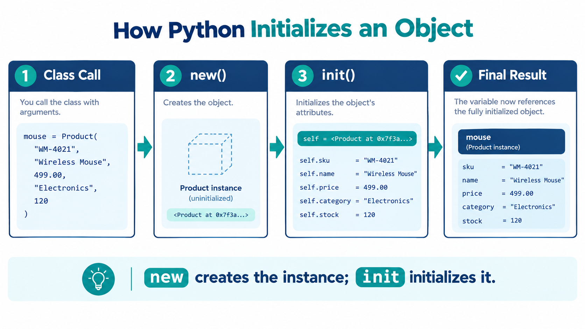

# The `__init__` Method and `self`
## eCOMMart AI Squad | Week 4

> You have been using `__init__` and `self` since the first class you wrote.
> This file goes underneath them — explaining exactly what Python does when
> you call `Product(...)`, why `self` is not a keyword, what `__init__`
> cannot do, and the patterns that make constructors robust in real applications.

---

## What We Will Cover

1. What actually happens when you instantiate a class
2. `self` is not a keyword — the mechanics explained
3. Default parameter values in `__init__`
4. Post-`__init__` validation — raising errors in the constructor
5. Type annotations in `__init__` signatures
6. Attributes created outside `__init__` — and why it is an anti-pattern
7. `__init__` always returns `None` — why this matters
8. A fully annotated, validated constructor — `Order`
9. Tasks

---

## 1. What Actually Happens When You Instantiate a Class

When you write:

```python
mouse = Product("WM-4021", "Wireless Mouse", 499.00, "Electronics", 120)
```

Python executes a two-step process you never see:

```
Step 1 — __new__()
  Python calls Product.__new__(Product) internally.
  This allocates a new, empty object in memory and returns it.
  You almost never write __new__ yourself — Python handles it.

Step 2 — __init__()
  Python takes the object __new__ just created and passes it as self
  to __init__, along with all the arguments you provided.
  __init__ fills in the attributes on that empty object.
```

Visually:

```
Product("WM-4021", "Wireless Mouse", 499.00, "Electronics", 120)
    │
    ├── Step 1: __new__  →  creates an empty Product object  →  <Product at 0x7f3a...>
    │
    └── Step 2: __init__(self=<Product at 0x7f3a...>,
                         sku="WM-4021",
                         name="Wireless Mouse",
                         price=499.00,
                         category="Electronics",
                         stock=120)
                    │
                    ├── self.sku      = "WM-4021"
                    ├── self.name     = "Wireless Mouse"
                    ├── self.price    = 499.00
                    ├── self.category = "Electronics"
                    └── self.stock    = 120

Result: mouse now points to the fully initialised Product object.
```

`__init__` does not *create* the object — `__new__` does.
`__init__` *configures* it. This is why `__init__` receives an already-
existing (but empty) object as `self`, rather than returning a new one.

---

## 2. `self` Is Not a Keyword — The Mechanics Explained

`self` is a **convention**, not a Python keyword. You could name it anything.
Python's only rule is that the first parameter of every instance method
receives the object the method was called on.

```python
class Product:
    def __init__(this_product, sku, name, price):   # 'this_product' works — but don't do this
        this_product.sku   = sku
        this_product.name  = name
        this_product.price = price

    def apply_discount(this_product, pct):
        return this_product.price * (1 - pct / 100)

mouse = Product("WM-4021", "Wireless Mouse", 499.00)
print(mouse.apply_discount(10))
```
```
# Output:
449.1
```

This runs perfectly. The name `this_product` is arbitrary. The convention
of using `self` is universal across every Python codebase — breaking it will
confuse every developer who reads your code, including yourself six months
from now. Always use `self`.

### How Python passes `self` automatically

When you write:

```python
mouse.apply_discount(10)
```

Python translates this internally to:

```python
Product.apply_discount(mouse, 10)
         ↑                ↑    ↑
    the class         the object  your argument
                    passed as self
```

`mouse.apply_discount(10)` and `Product.apply_discount(mouse, 10)` are
identical. The dot notation is syntactic sugar that passes the object
on the left as the first argument automatically.

Verify this yourself:

```python
mouse = Product("WM-4021", "Wireless Mouse", 499.00, "Electronics", 120)

# These two calls are exactly equivalent
result_1 = mouse.apply_discount(15)
result_2 = Product.apply_discount(mouse, 15)

print(result_1)   # 424.15
print(result_2)   # 424.15
print(result_1 == result_2)   # True
```
```
# Output:
424.15
424.15
True
```

Understanding this makes error messages like `TypeError: apply_discount()
takes 1 positional argument but 2 were given` readable: it means you
accidentally called the method as a plain function without an object,
and Python counted `self` as one of the "missing" arguments.

---

## 3. Default Parameter Values in `__init__`

Exactly like regular functions, `__init__` parameters can have default
values. This makes some fields optional at construction time — used when
a value is not yet known or has a sensible starting point.

### Simple defaults — scalars

```python
class Product:
    """
    Attributes:
        sku           (str):   Product identifier.
        name          (str):   Display name.
        price         (float): Base price in INR.
        category      (str):   Product category.
        stock         (int):   Available units. Defaults to 0.
        rating        (float): Average rating 0.0–5.0. Defaults to 0.0.
        is_active     (bool):  Whether the listing is live. Defaults to True.
    """

    def __init__(self, sku, name, price, category,
                 stock=0, rating=0.0, is_active=True):
        self.sku       = sku
        self.name      = name
        self.price     = price
        self.category  = category
        self.stock     = stock
        self.rating    = rating
        self.is_active = is_active
```

```python
# Minimum required — defaults fill in the rest
earbuds = Product("EB-3310", "Earbuds Pro", 1299.00, "Electronics")
print(earbuds.stock)      # 0      ← default
print(earbuds.rating)     # 0.0    ← default
print(earbuds.is_active)  # True   ← default

# Override specific defaults
mouse = Product("WM-4021", "Wireless Mouse", 499.00, "Electronics",
                stock=120, rating=4.5)
print(mouse.stock)        # 120
print(mouse.rating)       # 4.5
print(mouse.is_active)    # True  ← still uses default
```
```
# Output:
0
0.0
True
120
4.5
True
```

**Rule: Required parameters always before optional ones.**

```python
# ✅ Required first, optional after
def __init__(self, sku, name, price, category, stock=0, rating=0.0):

# ❌ SyntaxError — optional before required
def __init__(self, sku, name, stock=0, price, category):
```

### The mutable default trap — never use `[]` or `{}` as a default

This is one of the most common bugs in Python OOP. It looks right but
produces shared state across all instances:

```python
# ❌ WRONG — all instances share the SAME list object
class Seller:
    def __init__(self, name, skus_listed=[]):   # dangerous
        self.name        = name
        self.skus_listed = skus_listed          # all sellers point to the same list

s1 = Seller("TechPro")
s2 = Seller("GadgetZone")

s1.skus_listed.append("WM-4021")

print(s1.skus_listed)   # ['WM-4021']   ← expected
print(s2.skus_listed)   # ['WM-4021']   ← WRONG — s2 is polluted
```
```
# Output:
['WM-4021']
['WM-4021']
```

The default `[]` is created **once when the class is defined**, not once
per object. Every instance that uses the default points to the same list.

**Fix: always use `None` as the default, then assign inside `__init__`:**

```python
# ✅ CORRECT — each instance gets its own fresh list
class Seller:
    def __init__(self, name, skus_listed=None):
        self.name        = name
        self.skus_listed = skus_listed if skus_listed is not None else []

s1 = Seller("TechPro")
s2 = Seller("GadgetZone")

s1.skus_listed.append("WM-4021")

print(s1.skus_listed)   # ['WM-4021']
print(s2.skus_listed)   # []           ← correctly independent
```
```
# Output:
['WM-4021']
[]
```

The same rule applies to `dict` and `set` defaults.

---

## 4. Post-`__init__` Validation — Raising Errors in the Constructor

`__init__` is the right place to reject invalid data before it is stored
on the object. An object that is allowed to be created with a negative
price or an empty SKU will cause hard-to-trace bugs later. Fail loudly
at construction time instead.

```python
class Product:
    """
    Attributes:
        sku      (str):   Non-empty product identifier.
        name     (str):   Non-empty display name.
        price    (float): Must be > 0.
        category (str):   Must be one of the allowed categories.
        stock    (int):   Must be >= 0.
    """

    ALLOWED_CATEGORIES = {"Electronics", "Accessories", "Wearables", "Home & Kitchen"}

    def __init__(self, sku, name, price, category, stock=0):
        # --- Validate before storing ---
        if not isinstance(sku, str) or not sku.strip():
            raise ValueError(f"SKU must be a non-empty string. Got: {sku!r}")

        if not isinstance(name, str) or not name.strip():
            raise ValueError(f"Name must be a non-empty string. Got: {name!r}")

        if not isinstance(price, (int, float)) or price <= 0:
            raise ValueError(f"Price must be a positive number. Got: {price!r}")

        if category not in self.ALLOWED_CATEGORIES:
            raise ValueError(
                f"Category {category!r} is not allowed. "
                f"Choose from: {sorted(self.ALLOWED_CATEGORIES)}"
            )

        if not isinstance(stock, int) or stock < 0:
            raise ValueError(f"Stock must be a non-negative integer. Got: {stock!r}")

        # --- Store only after all validation passes ---
        self.sku      = sku.strip().upper()
        self.name     = name.strip()
        self.price    = float(price)
        self.category = category
        self.stock    = stock
```

Test the guards:

```python
# Valid product — works fine
mouse = Product("WM-4021", "Wireless Mouse", 499.00, "Electronics", 120)
print(f"  Created: {mouse.name} [{mouse.sku}] ₹{mouse.price:.2f}")

# Invalid inputs — each should raise a clear, specific error
test_cases = [
    ("",       "Wireless Mouse", 499.00, "Electronics", 120),   # empty SKU
    ("WM-001", "",               499.00, "Electronics", 120),   # empty name
    ("WM-001", "Wireless Mouse", -50.00, "Electronics", 120),   # negative price
    ("WM-001", "Wireless Mouse", 499.00, "Food & Grocery", 120),# bad category
    ("WM-001", "Wireless Mouse", 499.00, "Electronics", -5),    # negative stock
]

for args in test_cases:
    try:
        p = Product(*args)
    except ValueError as e:
        print(f"  ValueError: {e}")
```
```
# Output:
  Created: Wireless Mouse [WM-4021] ₹499.00
  ValueError: SKU must be a non-empty string. Got: ''
  ValueError: Name must be a non-empty string. Got: ''
  ValueError: Price must be a positive number. Got: -50.0
  ValueError: Category 'Food & Grocery' is not allowed. Choose from: ['Accessories', 'Electronics', 'Home & Kitchen', 'Wearables']
  ValueError: Stock must be a non-negative integer. Got: -5
```

Notice: validation runs first, then assignment. If any check fails,
`__init__` raises immediately — the object is never created.
There is no half-built `Product` floating around with some attributes
set and others missing.

Also notice `self.sku = sku.strip().upper()` — `__init__` can normalise
data as it stores it. Trimming whitespace and uppercasing the SKU means
the object always holds clean, consistent data regardless of what the
caller passed in.

---

## 5. Type Annotations in `__init__` Signatures

Python supports optional **type annotations** — hints that document what
type each parameter expects. They do not enforce types at runtime, but
they make the class contract explicit and are read by editors, linters,
and AI tools.

```python
from datetime import datetime

class Order:
    """
    Represents a confirmed purchase on the eCOMMart platform.

    Attributes:
        order_id    (str):      Unique order reference, e.g. 'ORD-20241201-00142'.
        customer_id (str):      The placing customer's ID.
        items       (list):     List of CartItem objects in this order.
        placed_at   (datetime): When the order was placed.
        status      (str):      Current order status.
        grand_total (float):    Final amount charged including GST and delivery.
    """

    def __init__(
        self,
        order_id    : str,
        customer_id : str,
        items       : list,
        placed_at   : datetime,
        grand_total : float,
        status      : str = "PENDING",
    ) -> None:
        self.order_id    = order_id
        self.customer_id = customer_id
        self.items       = items
        self.placed_at   = placed_at
        self.grand_total = grand_total
        self.status      = status
```

```
def __init__(self, order_id: str, ...) -> None:
                            ↑              ↑
                   type hint for      return type annotation
                   the parameter      __init__ always returns None
```

The `-> None` annotation on `__init__` is the Python convention for
documenting that the constructor returns nothing (which it must — see
the next section). Editors like VS Code use these annotations to
provide accurate autocomplete and catch type mismatches before you run.

---

## 6. Attributes Created Outside `__init__` — An Anti-Pattern

Python does not stop you from adding attributes to an object after it
is created — anywhere in your code. This is an anti-pattern because it
makes the object's structure unpredictable.

```python
# ❌ Anti-pattern — attributes scattered across methods and call sites
class Product:
    def __init__(self, sku, name, price):
        self.sku   = sku
        self.name  = name
        self.price = price
        # stock is NOT set here

    def update_stock(self, qty):
        self.stock = qty          # attribute created here, not in __init__

mouse = Product("WM-4021", "Wireless Mouse", 499.00)

# Before update_stock is called, accessing mouse.stock crashes
try:
    print(mouse.stock)
except AttributeError as e:
    print(f"  AttributeError: {e}")

mouse.update_stock(120)
print(mouse.stock)    # 120 — but only after calling update_stock

# Even worse — code outside the class can add arbitrary attributes
mouse.invented_field = "something random"   # Python allows this but it is chaos
```
```
# Output:
  AttributeError: 'Product' object has no attribute 'stock'
  120
```

**The rule: every attribute the object will ever have must be initialised
in `__init__`**, even if the initial value is `None`, `0`, `[]`, or `False`.
This gives every reader of the class a single place to see the complete
structure of any object of that type.

```python
# ✅ Correct — all attributes declared in __init__
class Product:
    def __init__(self, sku, name, price, stock=0):
        self.sku       = sku
        self.name      = name
        self.price     = price
        self.stock     = stock      # always here, even if 0 by default
        self.rating    = 0.0        # not yet rated — but declared
        self.is_active = True       # active by default — but declared
```

---

## 7. `__init__` Always Returns `None`

`__init__` must not return anything except `None` (implicitly, by not
having a `return` statement, or explicitly with `return None`). Attempting
to return a value raises a `TypeError`.

```python
class Product:
    def __init__(self, sku, name, price):
        self.sku   = sku
        self.name  = name
        self.price = price
        return self.name    # ❌ this will crash
```
```python
try:
    p = Product("WM-4021", "Wireless Mouse", 499.00)
except TypeError as e:
    print(f"  TypeError: {e}")
```
```
# Output:
  TypeError: __init__() should return None (not 'str')
```

Why? Because the return value of `Product(...)` is the object created
by `__new__` — Python controls that. `__init__`'s job is to configure
the object, not to produce a new one. If you need a class to control
what gets returned on construction, that requires `__new__` — an advanced
topic well outside the scope of this course.

For all practical purposes: **`__init__` never has a `return` statement
except `return None`.**

---

## 8. A Fully Annotated, Validated Constructor — `Order`

Bringing together every concept from this file into one production-quality
`__init__`:

```python
from datetime import datetime

class Order:
    """
    Represents a confirmed purchase record on the eCOMMart platform.

    An Order is created from a Cart at checkout. Once created, its items
    and pricing are immutable — only the status field changes over time.

    Attributes:
        order_id     (str):      Unique reference, format 'ORD-YYYYMMDD-NNNNN'.
        customer_id  (str):      Placing customer's ID.
        customer_name(str):      Customer's display name for receipts.
        items        (list):     Snapshot of CartItem objects at checkout time.
        subtotal     (float):    Pre-discount, pre-GST total.
        discount_amt (float):    Total discount applied. Must be >= 0.
        gst_amt      (float):    Total GST charged. Must be >= 0.
        delivery_fee (float):    Delivery charge. Must be >= 0.
        grand_total  (float):    Final amount charged.
        placed_at    (datetime): Timestamp of order placement.
        status       (str):      One of PENDING, CONFIRMED, SHIPPED,
                                 DELIVERED, CANCELLED.
        delivered_at (datetime): Set when order is delivered. None until then.
    """

    VALID_STATUSES = {"PENDING", "CONFIRMED", "SHIPPED", "DELIVERED", "CANCELLED"}

    def __init__(
        self,
        order_id      : str,
        customer_id   : str,
        customer_name : str,
        items         : list,
        subtotal      : float,
        discount_amt  : float,
        gst_amt       : float,
        delivery_fee  : float,
        placed_at     : datetime,
        status        : str = "PENDING",
    ) -> None:

        # --- Validate identity fields ---
        if not isinstance(order_id, str) or not order_id.strip():
            raise ValueError(f"order_id must be a non-empty string. Got: {order_id!r}")
        if not isinstance(customer_id, str) or not customer_id.strip():
            raise ValueError(f"customer_id must be a non-empty string. Got: {customer_id!r}")
        if not isinstance(customer_name, str) or not customer_name.strip():
            raise ValueError(f"customer_name must be a non-empty string. Got: {customer_name!r}")

        # --- Validate items ---
        if not isinstance(items, list) or len(items) == 0:
            raise ValueError("items must be a non-empty list of CartItem objects.")

        # --- Validate financial fields ---
        for field_name, value in [
            ("subtotal",     subtotal),
            ("discount_amt", discount_amt),
            ("gst_amt",      gst_amt),
            ("delivery_fee", delivery_fee),
        ]:
            if not isinstance(value, (int, float)) or value < 0:
                raise ValueError(
                    f"{field_name} must be a non-negative number. Got: {value!r}"
                )

        # --- Validate status ---
        if status not in self.VALID_STATUSES:
            raise ValueError(
                f"Status {status!r} is invalid. "
                f"Must be one of: {sorted(self.VALID_STATUSES)}"
            )

        # --- Validate timestamp ---
        if not isinstance(placed_at, datetime):
            raise TypeError(
                f"placed_at must be a datetime object. Got: {type(placed_at).__name__}"
            )

        # --- Store (all validation passed) ---
        self.order_id      = order_id.strip().upper()
        self.customer_id   = customer_id.strip()
        self.customer_name = customer_name.strip()
        self.items         = items
        self.subtotal      = float(subtotal)
        self.discount_amt  = float(discount_amt)
        self.gst_amt       = float(gst_amt)
        self.delivery_fee  = float(delivery_fee)
        self.grand_total   = float(subtotal - discount_amt + gst_amt + delivery_fee)
        self.placed_at     = placed_at
        self.status        = status
        self.delivered_at  = None    # declared here — set later by deliver()

    def get_item_count(self) -> int:
        """Returns total number of line items in this order."""
        return len(self.items)

    def print_receipt(self) -> None:
        """Prints a formatted order receipt."""
        print("=" * 52)
        print(f"  eCOMMart Order Receipt")
        print("=" * 52)
        print(f"  Order ID     : {self.order_id}")
        print(f"  Customer     : {self.customer_name} [{self.customer_id}]")
        print(f"  Placed at    : {self.placed_at.strftime('%d %b %Y %H:%M')}")
        print(f"  Status       : {self.status}")
        print(f"  {'─' * 48}")
        for item in self.items:
            print(f"    {item.product.name:<28} × {item.quantity}  "
                  f"₹{item.get_line_total():>8.2f}")
        print(f"  {'─' * 48}")
        print(f"  Subtotal     : ₹{self.subtotal:>10.2f}")
        print(f"  Discount     : ₹{self.discount_amt:>10.2f}")
        print(f"  GST (18%)    : ₹{self.gst_amt:>10.2f}")
        print(f"  Delivery     : ₹{self.delivery_fee:>10.2f}")
        print(f"  {'─' * 48}")
        print(f"  Grand Total  : ₹{self.grand_total:>10.2f}")
        print("=" * 52)
```

### Using the `Order` class

```python
from datetime import datetime

# Assume Product and CartItem from previous files are defined

mouse  = Product("WM-4021", "Wireless Mouse",  499.00, "Electronics", 120)
watch  = Product("SW-9001", "Smart Watch",    2999.00, "Wearables",    30)

item_mouse = CartItem(mouse, 2)
item_watch = CartItem(watch, 1).apply_promotion(10)

subtotal     = sum(i.get_line_subtotal() for i in [item_mouse, item_watch])
discount_amt = subtotal * 0.10           # GOLD tier: 10% loyalty discount
gst_amt      = (subtotal - discount_amt) * 0.18
delivery_fee = 0.0                       # free delivery above ₹500

order = Order(
    order_id      = "ORD-20241201-00142",
    customer_id   = "CUST-00142",
    customer_name = "Priya Sharma",
    items         = [item_mouse, item_watch],
    subtotal      = subtotal,
    discount_amt  = discount_amt,
    gst_amt       = gst_amt,
    delivery_fee  = delivery_fee,
    placed_at     = datetime(2024, 12, 1, 14, 30),
)

order.print_receipt()
print(f"\n  Item count  : {order.get_item_count()}")
print(f"  Delivered   : {order.delivered_at}")
```
```
# Output:
====================================================
  eCOMMart Order Receipt
====================================================
  Order ID     : ORD-20241201-00142
  Customer     : Priya Sharma [CUST-00142]
  Placed at    : 01 Dec 2024 14:30
  Status       : PENDING
  ────────────────────────────────────────────────────
    Wireless Mouse               × 2    ₹   1,766.46
    Smart Watch                  × 1    ₹   3,114.16
  ────────────────────────────────────────────────────
  Subtotal     : ₹   3,688.20
  Discount     : ₹     368.82
  GST (18%)    : ₹     597.49
  Delivery     : ₹       0.00
  ────────────────────────────────────────────────────
  Grand Total  : ₹   3,916.87
====================================================

  Item count  : 2
  Delivered   : None
```

---

## 9. Tasks

### Task 1 — The Mutable Default Bug

The class below has the mutable default anti-pattern. Your tasks:

1. Run it and demonstrate the bug by showing that two separate `Cart`
   objects share the same `items` list
2. Fix the class using the `None` pattern
3. Prove the fix works by repeating the same test

```python
class Cart:
    def __init__(self, customer_id, items=[]):   # ← bug here
        self.customer_id = customer_id
        self.items       = items

    def add_item(self, item_name):
        self.items.append(item_name)

# Demonstrate the bug
cart_a = Cart("CUST-001")
cart_b = Cart("CUST-002")

cart_a.add_item("Wireless Mouse")
cart_a.add_item("USB Hub")

# What does cart_b.items contain? Why?
print(f"cart_a.items : {cart_a.items}")
print(f"cart_b.items : {cart_b.items}")    # expected: []  actual: ?
```

---

### Task 2 — Build a Validated `Customer` Constructor

Extend the `Customer` class from the previous file's Task 1 with a
fully validated `__init__`. Requirements:

- `customer_id`: non-empty string, must start with `"CUST-"`
- `name`: non-empty string, at least 2 characters
- `email`: must contain exactly one `@` and at least one `.` after the `@`
- `phone`: string of exactly 10 digits
- `membership_tier`: one of `{"STANDARD", "SILVER", "GOLD", "PLATINUM"}`
- `total_spent`: float, must be `>= 0`

Test with at least four invalid inputs that each trigger a different
`ValueError`, and two valid customers to confirm they construct correctly.

---

### Task 3 — Annotate an Existing Class

Take the `Seller` class from `01_What_Are_Classes_and_Objects.md` and:

1. Add type annotations to every parameter in `__init__`
2. Add `-> None` return annotation to `__init__` and `-> None` or the
   correct return type to every other method
3. Add post-init validation for:
   - `rating` must be between 0.0 and 5.0
   - `gst_number` must be exactly 15 characters
   - `seller_id` must start with `"SEL-"`

Run the annotated class with one valid seller and three invalid ones
to confirm all guards fire correctly.

---

## Summary

| Concept | Key rule |
|---|---|
| `__new__` vs `__init__` | `__new__` creates, `__init__` configures |
| `self` is a convention | Any name works — always use `self` |
| How `self` is passed | `mouse.method(x)` → `Class.method(mouse, x)` |
| Default mutable arguments | Never `def __init__(self, items=[])` — use `None` then assign |
| Post-init validation | Validate first, assign after — raise `ValueError` on bad input |
| Type annotations | `param: type` hints, `-> None` on `__init__` |
| Attributes outside `__init__` | Anti-pattern — declare everything in `__init__` |
| `__init__` return value | Always `None` — returning anything else raises `TypeError` |

> The constructor is the front door of your class.
> Everything that enters the object's state passes through it.
> A well-written `__init__` makes it impossible to create an object
> in an invalid state — and that guarantee propagates through
> every method that runs on it afterwards.

---

*Next: `04_Instance_Attributes_and_Class_Attributes.md`*
