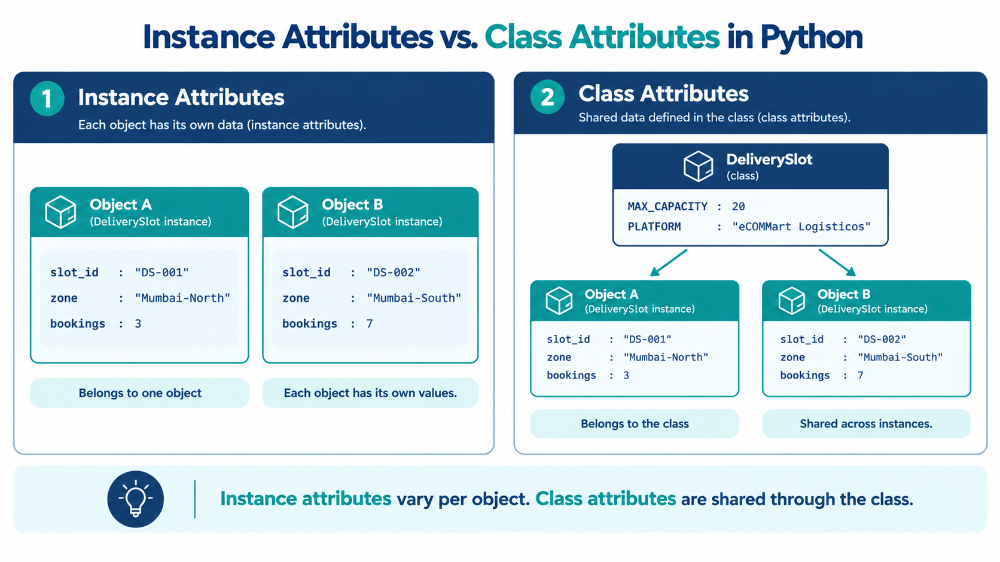

# Instance Attributes and Class Attributes
## eCOMMart AI Squad | Week 4

> Every attribute you have written so far using `self.` belongs to one specific
> object. But Python also lets you define attributes that belong to the class
> itself — shared across every object of that type. Knowing when each is
> appropriate, and what breaks when you confuse them, is the focus of this file.

---

## What We Will Cover

1. The difference — instance vs class attribute, precisely
2. Where each lives in memory
3. Class attributes as shared constants
4. Class attributes as shared mutable state — counters and registries
5. Attribute lookup order — how Python resolves `self.attr`
6. Shadowing — when an instance attribute hides a class attribute
7. Mutating a class attribute through an instance — the trap
8. `__class__` — accessing the class from inside an instance
9. A complete worked example — `DeliverySlot`
10. Tasks

---

## 1. The Difference — Precisely

```
Instance attribute:  defined inside __init__ using self.attr = value
                     belongs to one specific object
                     each object has its own independent copy

Class attribute:     defined directly inside the class body, outside any method
                     belongs to the class itself
                     shared across every instance of that class
```

```python
class DeliverySlot:

    MAX_CAPACITY = 20          # class attribute — same for every slot ever created

    def __init__(self, slot_id, zone, date):
        self.slot_id  = slot_id    # instance attribute — unique to this slot
        self.zone     = zone       # instance attribute — unique to this slot
        self.date     = date       # instance attribute — unique to this slot
        self.bookings = 0          # instance attribute — each slot tracks its own count
```

`MAX_CAPACITY` is set once at the class level. Every `DeliverySlot` object
shares it — if eCOMMart changes the policy to 25 slots per window, one
line changes and every slot in the system reflects it immediately.

`slot_id`, `zone`, `date`, and `bookings` are set per-object in `__init__`.
Slot A and Slot B have different values for all four.

---


## 2. Where Each Lives in Memory

Python stores attributes in dictionaries. Every object has its own `__dict__`.
The class also has its own `__dict__`.

```python
class DeliverySlot:
    MAX_CAPACITY = 20
    PLATFORM     = "eCOMMart Logistics"

    def __init__(self, slot_id, zone, date):
        self.slot_id  = slot_id
        self.zone     = zone
        self.date     = date
        self.bookings = 0

slot_a = DeliverySlot("DS-001", "Mumbai-North", "2024-12-05")
slot_b = DeliverySlot("DS-002", "Mumbai-South", "2024-12-05")

# Instance __dict__ — only the instance attributes
print("slot_a.__dict__:", slot_a.__dict__)
print("slot_b.__dict__:", slot_b.__dict__)

# Class __dict__ — class attributes live here
print("\nDeliverySlot class attrs:")
print("  MAX_CAPACITY:", DeliverySlot.MAX_CAPACITY)
print("  PLATFORM    :", DeliverySlot.PLATFORM)
```
```
# Output:
slot_a.__dict__: {'slot_id': 'DS-001', 'zone': 'Mumbai-North', 'date': '2024-12-05', 'bookings': 0}
slot_b.__dict__: {'slot_id': 'DS-002', 'zone': 'Mumbai-South', 'date': '2024-12-05', 'bookings': 0}

DeliverySlot class attrs:
  MAX_CAPACITY: 20
  PLATFORM    : eCOMMart Logistics
```

`MAX_CAPACITY` and `PLATFORM` do not appear in either `slot_a.__dict__`
or `slot_b.__dict__`. They live in `DeliverySlot.__dict__` — one shared
location, not duplicated per instance.

---

## 3. Class Attributes as Shared Constants

The safest and most common use of class attributes is as **constants**
that apply uniformly to every instance. You have already seen this
pattern (`GST_RATE`, `ALLOWED_CATEGORIES`, `VALID_STATUSES`) — now
understand why it is placed at the class level instead of inside `__init__`.

```python
class DeliverySlot:
    """
    Represents one timed delivery window on the eCOMMart logistics network.

    Class Attributes:
        MAX_CAPACITY  (int):  Maximum bookings allowed per slot across all zones.
        BASE_FEE      (float): Standard delivery charge in INR.
        EXPRESS_FEE   (float): Express delivery surcharge in INR.
        ZONE_PREFIXES (dict):  Maps city code prefixes to city names.
    """

    MAX_CAPACITY  = 20
    BASE_FEE      = 60.0
    EXPRESS_FEE   = 120.0
    ZONE_PREFIXES = {
        "MUM": "Mumbai",
        "BLR": "Bangalore",
        "DEL": "Delhi",
        "PUN": "Pune",
        "HYD": "Hyderabad",
    }

    def __init__(self, slot_id, zone_code, date, is_express=False):
        if zone_code not in self.ZONE_PREFIXES:
            raise ValueError(
                f"Unknown zone code {zone_code!r}. "
                f"Valid zones: {list(self.ZONE_PREFIXES)}"
            )
        self.slot_id    = slot_id
        self.zone_code  = zone_code
        self.city       = self.ZONE_PREFIXES[zone_code]   # looked up from class attr
        self.date       = date
        self.is_express = is_express
        self.bookings   = 0

    def get_fee(self):
        """Returns the delivery fee for this slot type."""
        return self.EXPRESS_FEE if self.is_express else self.BASE_FEE

    def get_remaining_capacity(self):
        """Returns how many more bookings this slot can accept."""
        return self.MAX_CAPACITY - self.bookings

    def is_full(self):
        """Returns True if this slot has reached maximum capacity."""
        return self.bookings >= self.MAX_CAPACITY
```

```python
slot_mum = DeliverySlot("DS-MUM-001", "MUM", "2024-12-10")
slot_blr = DeliverySlot("DS-BLR-001", "BLR", "2024-12-10", is_express=True)

print(f"  {slot_mum.slot_id} | {slot_mum.city} | Fee: ₹{slot_mum.get_fee():.2f} | "
      f"Remaining: {slot_mum.get_remaining_capacity()}")
print(f"  {slot_blr.slot_id} | {slot_blr.city} | Fee: ₹{slot_blr.get_fee():.2f} | "
      f"Remaining: {slot_blr.get_remaining_capacity()}")

# Access class attribute via the class name — most explicit, clearest intent
print(f"\n  Platform max capacity per slot: {DeliverySlot.MAX_CAPACITY}")
```
```
# Output:
  DS-MUM-001 | Mumbai    | Fee: ₹60.00  | Remaining: 20
  DS-BLR-001 | Bangalore | Fee: ₹120.00 | Remaining: 20

  Platform max capacity per slot: 20
```

Notice `self.ZONE_PREFIXES[zone_code]` — accessing a class attribute via
`self` inside a method. Python finds it on the class because it is not
in the instance's `__dict__`. Either `self.ZONE_PREFIXES` or
`DeliverySlot.ZONE_PREFIXES` works inside the class — `ClassName.attr`
is the more explicit form and the preferred one for class attributes.

---

## 4. Class Attributes as Shared Mutable State — Counters and Registries

Class attributes are also used when you need state that spans **all**
instances — a counter of how many objects have been created, or a
registry of all active instances.

```python
class DeliverySlot:

    MAX_CAPACITY   = 20
    BASE_FEE       = 60.0
    EXPRESS_FEE    = 120.0
    ZONE_PREFIXES  = {
        "MUM": "Mumbai", "BLR": "Bangalore",
        "DEL": "Delhi",  "PUN": "Pune", "HYD": "Hyderabad",
    }

    _total_slots_created  = 0      # tracks all slots ever created
    _active_slots         = []     # registry of all currently active slot objects

    def __init__(self, slot_id, zone_code, date, is_express=False):
        if zone_code not in self.ZONE_PREFIXES:
            raise ValueError(f"Unknown zone code {zone_code!r}.")

        self.slot_id    = slot_id
        self.zone_code  = zone_code
        self.city       = self.ZONE_PREFIXES[zone_code]
        self.date       = date
        self.is_express = is_express
        self.bookings   = 0
        self.is_active  = True

        # Update shared class-level state
        DeliverySlot._total_slots_created += 1     # use ClassName — not self
        DeliverySlot._active_slots.append(self)    # register this instance

    def book(self, order_id):
        """
        Books one unit in this slot for a given order.

        Args:
            order_id (str): The order being assigned to this slot.

        Raises:
            RuntimeError: If the slot is already at full capacity.
        """
        if self.is_full():
            raise RuntimeError(
                f"Slot {self.slot_id} is fully booked "
                f"({self.MAX_CAPACITY}/{self.MAX_CAPACITY})."
            )
        self.bookings += 1
        print(f"  ✅ [{self.slot_id}] Booked for order {order_id} "
              f"({self.bookings}/{self.MAX_CAPACITY} slots used)")

    def deactivate(self):
        """Marks this slot as inactive and removes it from the active registry."""
        self.is_active = False
        if self in DeliverySlot._active_slots:
            DeliverySlot._active_slots.remove(self)

    def get_fee(self):
        return self.EXPRESS_FEE if self.is_express else self.BASE_FEE

    def get_remaining_capacity(self):
        return self.MAX_CAPACITY - self.bookings

    def is_full(self):
        return self.bookings >= self.MAX_CAPACITY

    # ── Class-level queries (read shared state) ──────────────────
    @classmethod
    def get_total_created(cls):
        """Returns how many DeliverySlot objects have ever been created."""
        return cls._total_slots_created

    @classmethod
    def get_active_count(cls):
        """Returns how many slots are currently active."""
        return len(cls._active_slots)

    @classmethod
    def get_slots_for_date(cls, date):
        """
        Returns all active slots for a given date.

        Args:
            date (str): Date string in 'YYYY-MM-DD' format.

        Returns:
            list: Active DeliverySlot objects scheduled for that date.
        """
        return [s for s in cls._active_slots if s.date == date]
```

> ### `@classmethod` — a brief introduction
> A **class method** is decorated with `@classmethod` and receives the
> class itself as its first argument (`cls`) instead of an instance (`self`).
> Use it for operations that belong to the class as a whole rather than
> to any one instance — querying shared state, factory methods, or
> platform-level configuration. Full coverage is beyond this file's scope,
> but you need to read the pattern because it appears wherever class
> attributes are queried from outside the instance.

### Using the counter and registry

```python
# Create several slots across cities and dates
slot_1 = DeliverySlot("DS-MUM-001", "MUM", "2024-12-10")
slot_2 = DeliverySlot("DS-MUM-002", "MUM", "2024-12-10", is_express=True)
slot_3 = DeliverySlot("DS-BLR-001", "BLR", "2024-12-10")
slot_4 = DeliverySlot("DS-DEL-001", "DEL", "2024-12-11")
slot_5 = DeliverySlot("DS-PUN-001", "PUN", "2024-12-11")

print(f"  Total slots created : {DeliverySlot.get_total_created()}")
print(f"  Currently active    : {DeliverySlot.get_active_count()}")

# Book some orders into slot_1
slot_1.book("ORD-20241210-001")
slot_1.book("ORD-20241210-002")
slot_1.book("ORD-20241210-003")

# Query slots for a specific date
dec_10_slots = DeliverySlot.get_slots_for_date("2024-12-10")
print(f"\n  Active slots on 2024-12-10: {len(dec_10_slots)}")
for s in dec_10_slots:
    print(f"    {s.slot_id:<14} | {s.city:<12} | "
          f"{'Express' if s.is_express else 'Standard':<9} | "
          f"{s.bookings}/{s.MAX_CAPACITY} booked | "
          f"₹{s.get_fee():.2f}")

# Deactivate one slot
slot_3.deactivate()
print(f"\n  After deactivating {slot_3.slot_id}:")
print(f"  Currently active: {DeliverySlot.get_active_count()}")
```
```
# Output:
  Total slots created : 5
  Currently active    : 5

  ✅ [DS-MUM-001] Booked for order ORD-20241210-001 (1/20 slots used)
  ✅ [DS-MUM-001] Booked for order ORD-20241210-002 (2/20 slots used)
  ✅ [DS-MUM-001] Booked for order ORD-20241210-003 (3/20 slots used)

  Active slots on 2024-12-10: 3
    DS-MUM-001     | Mumbai       | Standard  | 3/20 booked | ₹60.00
    DS-MUM-002     | Mumbai       | Express   | 0/20 booked | ₹120.00
    DS-BLR-001     | Bangalore    | Standard  | 0/20 booked | ₹60.00

  After deactivating DS-BLR-001:
  Currently active: 4
```

Notice `DeliverySlot._total_slots_created += 1` uses the **class name**,
not `self`. This is intentional and important — Section 7 explains exactly
why using `self` here would produce a bug.

---

## 5. Attribute Lookup Order — How Python Resolves `self.attr`

When you write `self.MAX_CAPACITY` inside a method, Python does not
immediately look it up on the class. It follows a specific lookup chain:

```
Step 1 — Look in the instance's __dict__
          If found there → use it (instance attribute wins)

Step 2 — Look in the class's __dict__
          If found there → use it (class attribute)

Step 3 — Look in parent classes (via MRO — covered in Inheritance)
          If found → use it

Step 4 — AttributeError — the name does not exist anywhere
```

```python
slot = DeliverySlot("DS-MUM-001", "MUM", "2024-12-10")

# MAX_CAPACITY is not in slot.__dict__ — Python finds it on the class
print("In instance __dict__?", "MAX_CAPACITY" in slot.__dict__)   # False
print("Accessed via self    :", slot.MAX_CAPACITY)                 # 20 — from class
print("Accessed via class   :", DeliverySlot.MAX_CAPACITY)         # 20 — same
```
```
# Output:
In instance __dict__? False
Accessed via self    : 20
Accessed via class   : 20
```

---

## 6. Shadowing — When an Instance Attribute Hides a Class Attribute

If you assign to `self.attr` where `attr` is also a class attribute,
Python creates a **new instance attribute** that shadows the class attribute
for that specific object only. The class attribute is unchanged.

```python
slot_a = DeliverySlot("DS-MUM-001", "MUM", "2024-12-10")
slot_b = DeliverySlot("DS-BLR-001", "BLR", "2024-12-10")

print(f"Before — slot_a.MAX_CAPACITY: {slot_a.MAX_CAPACITY}")   # 20 (from class)
print(f"Before — slot_b.MAX_CAPACITY: {slot_b.MAX_CAPACITY}")   # 20 (from class)

# Override MAX_CAPACITY on slot_a only — special high-demand slot
slot_a.MAX_CAPACITY = 35     # creates an instance attribute that shadows the class one

print(f"\nAfter  — slot_a.MAX_CAPACITY: {slot_a.MAX_CAPACITY}")   # 35 (instance)
print(f"After  — slot_b.MAX_CAPACITY: {slot_b.MAX_CAPACITY}")     # 20 (class — unchanged)
print(f"After  — class  MAX_CAPACITY: {DeliverySlot.MAX_CAPACITY}")# 20 (class — unchanged)

# Confirm: slot_a now has its own copy in __dict__
print(f"\n  'MAX_CAPACITY' in slot_a.__dict__: {'MAX_CAPACITY' in slot_a.__dict__}")
print(f"  'MAX_CAPACITY' in slot_b.__dict__: {'MAX_CAPACITY' in slot_b.__dict__}")
```
```
# Output:
Before — slot_a.MAX_CAPACITY: 20
Before — slot_b.MAX_CAPACITY: 20

After  — slot_a.MAX_CAPACITY: 35
After  — slot_b.MAX_CAPACITY: 20
After  — class  MAX_CAPACITY: 20

  'MAX_CAPACITY' in slot_a.__dict__: True
  'MAX_CAPACITY' in slot_b.__dict__: False
```

Shadowing is occasionally intentional — you want one instance to behave
differently from the class default. More often it happens by accident
and causes confusing bugs where changing a class attribute does not seem
to take effect for one object. When you see that symptom, check whether
the instance has accidentally shadowed the class attribute.

---

## 7. Mutating a Class Attribute Through an Instance — The Trap

This is where the most dangerous bug in class attributes lives.
Immutable class attributes (strings, ints, floats) are safe — assigning
via `self` always creates an instance attribute (shadowing, as above).
But **mutable** class attributes (lists, dicts) can be mutated via `self`
without creating a new instance attribute, silently corrupting shared state.

```python
class DeliverySlot:
    _active_slots = []    # shared mutable class attribute

    def __init__(self, slot_id):
        self.slot_id = slot_id

# ❌ Mutating via self — modifies the shared class list
slot_x = DeliverySlot("DS-001")
slot_y = DeliverySlot("DS-002")

slot_x._active_slots.append("DS-001")   # self._active_slots IS the class list
slot_y._active_slots.append("DS-002")   # same list — both see both entries

print(slot_x._active_slots)   # ['DS-001', 'DS-002'] — slot_y's entry is here
print(slot_y._active_slots)   # ['DS-001', 'DS-002'] — slot_x's entry is here
print(DeliverySlot._active_slots)  # ['DS-001', 'DS-002'] — class is modified too
```
```
# Output:
['DS-001', 'DS-002']
['DS-001', 'DS-002']
['DS-001', 'DS-002']
```

`.append()` mutates the list in place. Python does not create a new
instance attribute — it just modifies the shared list directly.
This is why in the full `DeliverySlot` class in Section 4, the registry
is updated using `DeliverySlot._active_slots.append(self)` — the class
name makes the intent explicit: *"I am modifying the class-level list."*

```
Rule:
  self.immutable_class_attr = new_value  → creates instance attr (shadows)
  self.mutable_class_attr.append(x)      → mutates the shared class attr directly
  ClassName.mutable_class_attr.append(x) → same result but intent is clear
  ClassName.immutable_class_attr = x     → modifies the class attr for all instances
```

---

## 8. `__class__` — Accessing the Class From Inside an Instance

Every instance has a `__class__` attribute pointing to the class it
was created from. This lets a method reference its own class without
hard-coding the class name — useful when writing methods that will be
inherited (covered in the Inheritance file).

```python
slot = DeliverySlot("DS-MUM-001", "MUM", "2024-12-10")

print(slot.__class__)                    # <class '__main__.DeliverySlot'>
print(slot.__class__.__name__)           # DeliverySlot
print(slot.__class__.MAX_CAPACITY)       # 20  — same as DeliverySlot.MAX_CAPACITY
print(slot.__class__ is DeliverySlot)    # True
```
```
# Output:
<class '__main__.DeliverySlot'>
DeliverySlot
20
True
```

In practice, you will mostly use `ClassName.attr` directly. `__class__`
becomes important when writing methods meant to work polymorphically
across a class hierarchy — covered in the Inheritance file.

---

## 9. A Complete Worked Example — `DeliverySlot`

The full production-ready class, incorporating everything from this file:

```python
from datetime import date as Date

class DeliverySlot:
    """
    Represents one timed delivery window on the eCOMMart logistics network.

    Each slot has its own zone, date, booking count, and express flag.
    Shared platform configuration (capacity, fees, zones) lives at the
    class level so a single change propagates to every slot in the system.

    Class Attributes:
        MAX_CAPACITY   (int):   Maximum bookings per slot.
        BASE_FEE       (float): Standard delivery fee in INR.
        EXPRESS_FEE    (float): Express delivery fee in INR.
        ZONE_PREFIXES  (dict):  Maps zone code to city name.
        _total_created (int):   Count of all slots ever instantiated.
        _active_slots  (list):  Registry of all currently active slots.

    Instance Attributes:
        slot_id    (str):  Unique slot identifier.
        zone_code  (str):  Zone code, e.g. 'MUM'.
        city       (str):  City name resolved from zone_code.
        date       (str):  Scheduled delivery date 'YYYY-MM-DD'.
        is_express (bool): Whether this is an express slot.
        bookings   (int):  Number of orders booked into this slot.
        is_active  (bool): Whether this slot is open for new bookings.
    """

    MAX_CAPACITY  = 20
    BASE_FEE      = 60.0
    EXPRESS_FEE   = 120.0
    ZONE_PREFIXES = {
        "MUM": "Mumbai",
        "BLR": "Bangalore",
        "DEL": "Delhi",
        "PUN": "Pune",
        "HYD": "Hyderabad",
    }

    _total_created = 0
    _active_slots  = []

    def __init__(
        self,
        slot_id    : str,
        zone_code  : str,
        date       : str,
        is_express : bool = False,
    ) -> None:
        if zone_code not in DeliverySlot.ZONE_PREFIXES:
            raise ValueError(
                f"Unknown zone code {zone_code!r}. "
                f"Valid: {list(DeliverySlot.ZONE_PREFIXES)}"
            )
        if not slot_id.strip():
            raise ValueError("slot_id must be a non-empty string.")

        self.slot_id    = slot_id.strip().upper()
        self.zone_code  = zone_code
        self.city       = DeliverySlot.ZONE_PREFIXES[zone_code]
        self.date       = date
        self.is_express = is_express
        self.bookings   = 0
        self.is_active  = True

        DeliverySlot._total_created += 1
        DeliverySlot._active_slots.append(self)

    # ── Instance query methods ────────────────────────────────────
    def get_fee(self) -> float:
        """Returns the delivery fee for this slot."""
        return DeliverySlot.EXPRESS_FEE if self.is_express else DeliverySlot.BASE_FEE

    def get_remaining_capacity(self) -> int:
        """Returns how many more orders this slot can accept."""
        return DeliverySlot.MAX_CAPACITY - self.bookings

    def is_full(self) -> bool:
        """Returns True if this slot has no remaining capacity."""
        return self.bookings >= DeliverySlot.MAX_CAPACITY

    def utilisation_pct(self) -> float:
        """Returns the percentage of capacity used (0.0–100.0)."""
        return (self.bookings / DeliverySlot.MAX_CAPACITY) * 100

    # ── Instance mutating methods ─────────────────────────────────
    def book(self, order_id: str) -> None:
        """Books one unit for the given order. Raises RuntimeError if full."""
        if not self.is_active:
            raise RuntimeError(f"Slot {self.slot_id} is no longer active.")
        if self.is_full():
            raise RuntimeError(
                f"Slot {self.slot_id} is fully booked ({DeliverySlot.MAX_CAPACITY}"
                f"/{DeliverySlot.MAX_CAPACITY})."
            )
        self.bookings += 1

    def deactivate(self) -> None:
        """Closes this slot for new bookings and removes it from the active registry."""
        self.is_active = False
        if self in DeliverySlot._active_slots:
            DeliverySlot._active_slots.remove(self)

    # ── Class methods (operate on shared state) ───────────────────
    @classmethod
    def get_total_created(cls) -> int:
        """Returns the total number of DeliverySlot objects ever created."""
        return cls._total_created

    @classmethod
    def get_active_count(cls) -> int:
        """Returns how many slots are currently active."""
        return len(cls._active_slots)

    @classmethod
    def get_slots_for_date(cls, date: str) -> list:
        """Returns all active slots scheduled for the given date."""
        return [s for s in cls._active_slots if s.date == date]

    @classmethod
    def get_utilisation_report(cls) -> None:
        """Prints a utilisation summary for all active slots."""
        if not cls._active_slots:
            print("  No active slots.")
            return
        print(f"  {'Slot ID':<16} {'City':<14} {'Date':<12} "
              f"{'Type':<10} {'Used':>5} {'Rem':>5} {'Util%':>7}")
        print(f"  {'─'*70}")
        for s in cls._active_slots:
            slot_type = "Express" if s.is_express else "Standard"
            print(f"  {s.slot_id:<16} {s.city:<14} {s.date:<12} "
                  f"{slot_type:<10} {s.bookings:>5} "
                  f"{s.get_remaining_capacity():>5} "
                  f"{s.utilisation_pct():>6.1f}%")
```

### Putting it all together

```python
# Build the Dec 10 delivery grid
slots = [
    DeliverySlot("DS-MUM-001", "MUM", "2024-12-10"),
    DeliverySlot("DS-MUM-002", "MUM", "2024-12-10", is_express=True),
    DeliverySlot("DS-BLR-001", "BLR", "2024-12-10"),
    DeliverySlot("DS-DEL-001", "DEL", "2024-12-11"),
    DeliverySlot("DS-HYD-001", "HYD", "2024-12-11"),
]

# Simulate bookings
dec10_orders = [
    ("DS-MUM-001", "ORD-00481"), ("DS-MUM-001", "ORD-00482"),
    ("DS-MUM-001", "ORD-00483"), ("DS-MUM-001", "ORD-00484"),
    ("DS-MUM-002", "ORD-00485"), ("DS-MUM-002", "ORD-00486"),
    ("DS-BLR-001", "ORD-00487"),
]

slot_map = {s.slot_id: s for s in slots}
for slot_id, order_id in dec10_orders:
    slot_map[slot_id].book(order_id)

# Platform-level stats
print(f"  Total slots created : {DeliverySlot.get_total_created()}")
print(f"  Currently active    : {DeliverySlot.get_active_count()}")
print(f"\n  Dec 10 active slots : "
      f"{len(DeliverySlot.get_slots_for_date('2024-12-10'))}")

print()
DeliverySlot.get_utilisation_report()

# Deactivate the Hyderabad slot — no orders expected
slot_map["DS-HYD-001"].deactivate()
print(f"\n  After deactivating DS-HYD-001 → active count: "
      f"{DeliverySlot.get_active_count()}")
```
```
# Output:
  Total slots created : 5
  Currently active    : 5
  Dec 10 active slots : 3

  Slot ID          City           Date         Type       Used   Rem  Util%
  ──────────────────────────────────────────────────────────────────────────
  DS-MUM-001       Mumbai         2024-12-10   Standard      4    16   20.0%
  DS-MUM-002       Mumbai         2024-12-10   Express       2    18   10.0%
  DS-BLR-001       Bangalore      2024-12-10   Standard      1    19    5.0%
  DS-DEL-001       Delhi          2024-12-11   Standard      0    20    0.0%
  DS-HYD-001       Hyderabad      2024-12-11   Standard      0    20    0.0%

  After deactivating DS-HYD-001 → active count: 4
```

---

## 10. Tasks

### Task 1 — Promotion Engine with Class-Level Configuration

Build a `PromotionRule` class for eCOMMart's promotional pricing engine.
The platform manages multiple active promotion rules simultaneously.

**Class attributes:**
- `MAX_ACTIVE_RULES = 5` — platform allows at most 5 simultaneous promotions
- `_active_rules = []` — registry of all currently active rules
- `ALLOWED_TYPES = {"FLASH_SALE", "LOYALTY", "BULK", "SEASONAL", "CLEARANCE"}`

**Instance attributes (set in `__init__`):**
- `rule_id` (str), `name` (str), `promotion_type` (str — must be in `ALLOWED_TYPES`),
  `discount_pct` (float — 1.0 to 70.0), `min_order_value` (float — >= 0),
  `is_active` (bool — default `True`)

**Methods:**
- `activate()` — adds to `_active_rules` if `MAX_ACTIVE_RULES` not exceeded,
  raises `RuntimeError` if limit is hit
- `deactivate()` — removes from `_active_rules`
- `applies_to(order_total)` → bool — True if rule is active and order meets minimum
- `calculate_savings(order_total)` → float — discount amount for the given total
- `@classmethod get_active_rules()` — returns list of active rules
- `@classmethod get_rules_by_type(promo_type)` — filters active rules by type

Test with 6 rules where the 6th triggers the `MAX_ACTIVE_RULES` guard.

---

### Task 2 — Shadowing Audit

Run the following code, predict the output for each `print` before
running it, then verify. Write a comment next to each prediction
explaining whether the value comes from the instance or the class.

```python
class SupportTicket:
    PRIORITY_LEVELS = {"LOW": 1, "MEDIUM": 2, "HIGH": 3, "CRITICAL": 4}
    SLA_HOURS       = 24
    _open_count     = 0

    def __init__(self, ticket_id, issue, priority="MEDIUM"):
        self.ticket_id = ticket_id
        self.issue     = issue
        self.priority  = priority
        SupportTicket._open_count += 1

    def get_sla(self):
        return self.SLA_HOURS

ticket_a = SupportTicket("TKT-001", "Payment gateway timeout", "HIGH")
ticket_b = SupportTicket("TKT-002", "Invoice not generated", "LOW")

ticket_a.SLA_HOURS = 4    # override SLA for this critical ticket

print(ticket_a.get_sla())              # predict: ?
print(ticket_b.get_sla())              # predict: ?
print(SupportTicket.SLA_HOURS)         # predict: ?
print(SupportTicket._open_count)       # predict: ?
print("SLA_HOURS" in ticket_a.__dict__)# predict: ?
print("SLA_HOURS" in ticket_b.__dict__)# predict: ?
```

---

### Task 3 — Warehouse Zone Registry

Build a `WarehouseZone` class representing physical storage zones in
eCOMMart's fulfilment centres. Each zone holds inventory; the class
tracks total platform-wide storage utilisation.

**Class attributes:**
- `ZONE_TYPES = {"AMBIENT", "COLD_CHAIN", "HAZMAT", "OVERSIZE"}`
- `_all_zones = []`
- `PLATFORM_STORAGE_LIMIT = 50_000` (total cubic metres across all zones)

**Instance attributes:**
- `zone_id`, `zone_type`, `location` (city), `capacity_m3` (float),
  `used_m3` (float — default 0.0)

**Methods:**
- `store(volume_m3)` — adds volume, raises `ValueError` if it would exceed zone capacity
  OR if platform total would exceed `PLATFORM_STORAGE_LIMIT`
- `release(volume_m3)` — removes volume, raises `ValueError` if releasing more than stored
- `utilisation_pct()` → float
- `@classmethod platform_used_m3()` → total `used_m3` across all zones
- `@classmethod platform_utilisation_pct()` → platform-wide utilisation
- `@classmethod get_zones_by_type(zone_type)` → filtered list

---

## Summary

| Attribute type | Defined | Scope | Access |
|---|---|---|---|
| Instance attribute | Inside `__init__` via `self.attr = val` | One specific object | `obj.attr` |
| Class attribute | Inside class body, outside any method | All instances share it | `ClassName.attr` or `self.attr` |
| Shadowed attribute | `self.attr = val` where `attr` is a class attr | Only that instance | `obj.attr` — hides class version |

| Operation | Effect |
|---|---|
| `ClassName.class_attr = x` | Changes shared value — all instances see new value |
| `self.class_attr = x` | Creates a new instance attribute — shadows class attr for this object only |
| `self.mutable_class_attr.append(x)` | Mutates the shared object — all instances affected |
| `ClassName.mutable_class_attr.append(x)` | Same effect — but intent is explicit |

> Use class attributes for data that is genuinely the same for every
> instance — configuration constants, platform-wide counters, shared
> registries. Use instance attributes for everything specific to one object.
> When in doubt, default to instance attributes — the class attribute
> sharing behaviour is subtle enough to cause bugs that are very hard to trace.

---

*Next: `05_Methods.md`*
