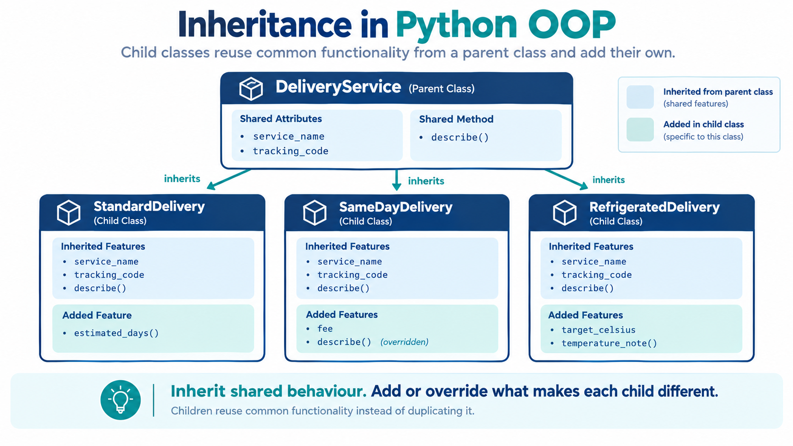
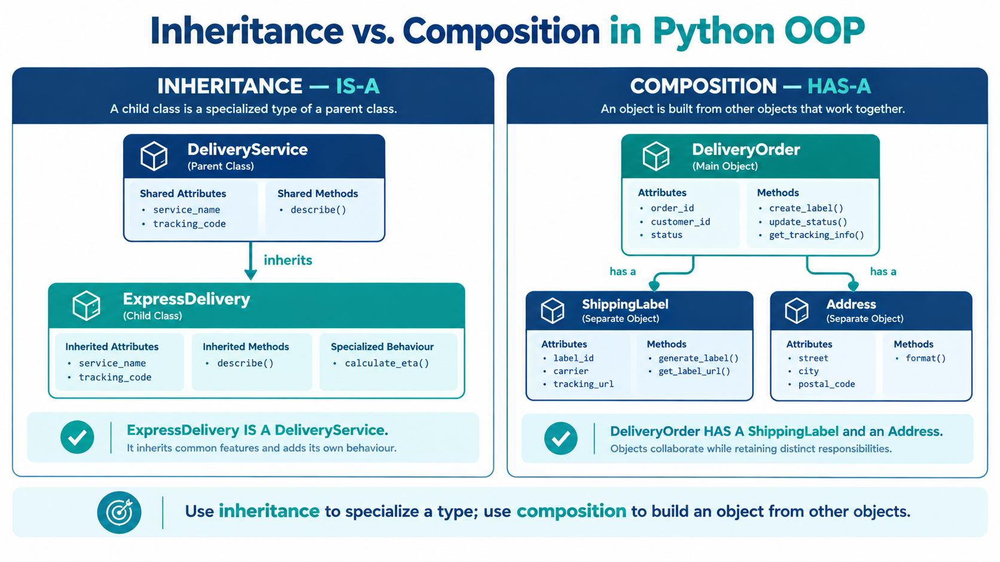

# Inheritance

**eCOMMart AI Squad | Week 4**

> “Reuse the shared behaviour; specialize only what makes each type different.”

## What We Will Cover

1. Why inheritance can reduce repeated code across related classes.
2. How a child class inherits attributes and methods from a parent class.
3. How to extend or override inherited behaviour.
4. How `super()` helps a child class reuse parent initialization and methods.
5. How `isinstance()` and `issubclass()` describe inheritance relationships.
6. How to choose inheritance carefully and avoid deep, confusing class hierarchies.

---

## 1. Why Inheritance?

eCOMMart offers different delivery options, including **standard delivery** and **express delivery**. Both options need a service name, a tracking code, and a way to describe the delivery. However, they differ in delivery estimates and fees.

Without inheritance, each class might repeat the same attributes and methods. Repetition makes maintenance harder: if shared behaviour changes, the same edit may be needed in multiple places.



Inheritance allows a new class to reuse behaviour from an existing class and then add or customize its own behaviour.

```text
                    DeliveryService
                     (parent class)
                           |
                +----------+----------+
                |                     |
                v                     v
        StandardDelivery       ExpressDelivery
          (child class)         (child class)
```

A **parent class** is also called a base class or superclass. A **child class** is also called a derived class or subclass.

Inheritance models an **is-a** relationship: `ExpressDelivery` is a kind of `DeliveryService`. It is not the right tool for every relationship. A delivery order **has an** address, for example, which is usually a composition relationship rather than inheritance.

## 2. Define a Parent Class and a Child Class

Python places the parent class name in parentheses in the child class definition.

```python
class DeliveryService:
    """Represent information shared by eCOMMart delivery options."""

    def __init__(self, service_name, tracking_code):
        """Store the shared delivery details."""
        self.service_name = service_name
        self.tracking_code = tracking_code

    def describe(self):
        """Return a description of the delivery service."""
        return f"{self.service_name} delivery (tracking: {self.tracking_code})"


class StandardDelivery(DeliveryService):
    """Represent eCOMMart's standard delivery option."""

    def estimated_days(self):
        """Return the usual delivery estimate in days."""
        return 4


standard = StandardDelivery("Standard", "ECM-ST-204")

print(standard.describe())
# Output:
# Standard delivery (tracking: ECM-ST-204)

print(standard.estimated_days())
# Output:
# 4
```

`StandardDelivery` does not define `__init__()` or `describe()`. Python uses the inherited versions from `DeliveryService`. The child adds `estimated_days()`.

The object `standard` is an instance of `StandardDelivery`, so it can use both its own method and the methods inherited from `DeliveryService`.

When `standard.describe()` is called, Python looks for `describe()` in `StandardDelivery` first. Because it is not defined there, Python finds and runs the method from `DeliveryService`.

## 3. Inherited Initialization

When a child class does not define its own `__init__()`, it can use the parent's initializer. This is useful when the child needs the same initial fields as the parent.

```python
class ExpressDelivery(DeliveryService):
    """Represent eCOMMart's faster delivery option."""

    def estimated_days(self):
        """Return the usual express delivery estimate in days."""
        return 1


express = ExpressDelivery("Express", "ECM-EX-018")

print(express.describe())
# Output:
# Express delivery (tracking: ECM-EX-018)

print(express.estimated_days())
# Output:
# 1
```

The call `ExpressDelivery("Express", "ECM-EX-018")` works because the child inherits the parent's initializer.

If the child defines its own `__init__()`, Python uses that initializer for child instances. The child must explicitly call the parent initializer if it also needs the parent's setup.

## 4. Extend a Parent with `super()`

`super()` provides a way to call the next implementation in the method resolution order. In a simple parent-child example, it is commonly used to reuse the parent's initializer or method instead of duplicating its code.

Express delivery has an additional fee, so `ExpressDelivery` needs one extra attribute. It can reuse the shared setup from `DeliveryService` and then store its own fee.

```python
class ExpressDelivery(DeliveryService):
    """Represent eCOMMart's express delivery option with an extra fee."""

    def __init__(self, service_name, tracking_code, fee):
        """Initialize shared delivery details and the express fee."""
        super().__init__(service_name, tracking_code)

        if isinstance(fee, bool) or not isinstance(fee, (int, float)):
            raise TypeError("Fee must be numeric.")
        if fee < 0:
            raise ValueError("Fee cannot be negative.")

        self.fee = fee

    def describe(self):
        """Add the express fee to the shared delivery description."""
        base_description = super().describe()
        return f"{base_description}; fee: ₹{self.fee:.2f}"


express = ExpressDelivery("Express", "ECM-EX-041", 149)

print(express.describe())
# Output:
# Express delivery (tracking: ECM-EX-041); fee: ₹149.00
```

The initializer calls `super().__init__(...)` so `DeliveryService` sets up `service_name` and `tracking_code`. The child then validates and stores its additional `fee`.

The overridden `describe()` calls `super().describe()` to reuse the parent's description before adding the fee.

```text
ExpressDelivery.__init__()
          |
          +--> super().__init__()
          |         |
          |         +--> set shared attributes
          |
          +--> validate and store fee

ExpressDelivery.describe()
          |
          +--> super().describe()
          |
          +--> add fee text
```

## 5. Method Overriding

A child class can define a method with the same name as a parent method. The child implementation takes precedence when that method is called on the child instance. This is called **method overriding**.

In this example, standard and express delivery use the same method name, `estimated_days()`, but return different estimates.

```python
class DeliveryService:
    """Represent shared information for a delivery option."""

    def __init__(self, service_name, tracking_code):
        """Store the shared delivery details."""
        self.service_name = service_name
        self.tracking_code = tracking_code

    def estimated_days(self):
        """Return a general delivery estimate."""
        return "Estimate not available"

    def describe(self):
        """Return a description using the delivery estimate."""
        return (
            f"{self.service_name} delivery "
            f"(tracking: {self.tracking_code}); "
            f"estimated time: {self.estimated_days()} day(s)"
        )


class StandardDelivery(DeliveryService):
    """Represent standard delivery."""

    def estimated_days(self):
        """Return the standard delivery estimate."""
        return 4


class ExpressDelivery(DeliveryService):
    """Represent express delivery."""

    def estimated_days(self):
        """Return the express delivery estimate."""
        return 1


standard = StandardDelivery("Standard", "ECM-ST-101")
express = ExpressDelivery("Express", "ECM-EX-102")

print(standard.describe())
# Output:
# Standard delivery (tracking: ECM-ST-101); estimated time: 4 day(s)

print(express.describe())
# Output:
# Express delivery (tracking: ECM-EX-102); estimated time: 1 day(s)
```

Both child classes inherit `describe()`, but each provides its own version of `estimated_days()`. Calling `describe()` therefore produces the appropriate estimate for each delivery option.

Overriding is appropriate when the child is still a valid kind of the parent but needs specialized behaviour. If the child changes the meaning so much that parent code can no longer use it reliably, the inheritance design may be wrong.

## 6. Add Child-Specific Attributes and Methods

A child class can introduce attributes and methods that do not exist in the parent. Parent instances do not automatically receive child-specific behaviour.

For example, express delivery can provide an estimated delivery window in addition to the shared details.

```python
class ExpressDelivery(DeliveryService):
    """Represent express delivery with an extra fee and delivery window."""

    def __init__(self, service_name, tracking_code, fee):
        """Initialize shared details and the express fee."""
        super().__init__(service_name, tracking_code)

        if isinstance(fee, bool) or not isinstance(fee, (int, float)):
            raise TypeError("Fee must be numeric.")
        if fee < 0:
            raise ValueError("Fee cannot be negative.")

        self.fee = fee

    def delivery_window(self):
        """Return the express delivery window."""
        return "Within 1 business day"


express = ExpressDelivery("Express", "ECM-EX-205", 149)

print(express.describe())
# Output:
# Express delivery (tracking: ECM-EX-205)

print(express.delivery_window())
# Output:
# Within 1 business day
```

The child calls the parent initializer for shared state, then stores its own `fee`. The method `delivery_window()` belongs only to `ExpressDelivery`.

## 7. Parent Methods Can Use Child Overrides

When a parent method calls another method that a child overrides, Python dispatches the call to the child's implementation. This enables a shared workflow to call specialized behaviour.

```python
class DeliveryService:
    """Represent shared information for a delivery option."""

    def __init__(self, service_name, tracking_code):
        """Store the shared delivery details."""
        self.service_name = service_name
        self.tracking_code = tracking_code

    def delivery_type(self):
        """Return the general delivery type."""
        return "General"

    def manifest_line(self):
        """Return a manifest line using the current delivery type."""
        return f"{self.delivery_type()} | {self.tracking_code}"


class StandardDelivery(DeliveryService):
    """Represent standard delivery."""

    def delivery_type(self):
        """Return the standard delivery type."""
        return "Standard"


class ExpressDelivery(DeliveryService):
    """Represent express delivery."""

    def delivery_type(self):
        """Return the express delivery type."""
        return "Express"


standard = StandardDelivery("Standard", "ECM-ST-031")
express = ExpressDelivery("Express", "ECM-EX-031")

print(standard.manifest_line())
# Output:
# Standard | ECM-ST-031

print(express.manifest_line())
# Output:
# Express | ECM-EX-031
```

The inherited `manifest_line()` calls `self.delivery_type()`. Because `self` refers to the actual object, Python uses the appropriate child's override.

This pattern is called **dynamic dispatch**. It allows parent code to define a common workflow while subclasses customize one step.

> Each code example in this lesson is a separate demonstration. If you combine snippets into one script, keep only one definition of each class name or merge the methods deliberately. A later class definition with the same name replaces the earlier binding.

## 8. `isinstance()` and `issubclass()`

Inheritance affects type checks.

- `isinstance(object, Class)` checks whether an object is an instance of a class or one of its subclasses.
- `issubclass(Child, Parent)` checks whether a class inherits from another class, directly or indirectly.

```python
class DeliveryService:
    """Represent a general eCOMMart delivery service."""

    def __init__(self, tracking_code):
        """Store a tracking code."""
        self.tracking_code = tracking_code


class ExpressDelivery(DeliveryService):
    """Represent express delivery."""

    def express_label(self):
        """Return an express-service label."""
        return f"EXPRESS: {self.tracking_code}"


express = ExpressDelivery("ECM-EX-050")

print(isinstance(express, ExpressDelivery))
# Output:
# True

print(isinstance(express, DeliveryService))
# Output:
# True

print(issubclass(ExpressDelivery, DeliveryService))
# Output:
# True

standard_service = DeliveryService("ECM-GEN-002")
print(isinstance(standard_service, ExpressDelivery))
# Output:
# False
```

An `ExpressDelivery` object is also a `DeliveryService` object in the inheritance sense. A plain `DeliveryService` instance, however, is not automatically an `ExpressDelivery`.

Use type checks when they answer a meaningful question. Often, code can simply call a shared method and let polymorphism handle the implementation.

## 9. Multiple Inheritance: A Brief Introduction

Python allows a class to inherit from more than one parent. For example, a delivery record might have separate capabilities for tracking and insurance.

```python
class Trackable:
    """Represent an object that can be tracked."""

    def tracking_status(self):
        """Return a generic tracking status."""
        return "Tracking available"


class Insurable:
    """Represent an object that can be insured."""

    def insurance_note(self):
        """Return a generic insurance note."""
        return "Insurance information available"


class PremiumDelivery(Trackable, Insurable):
    """Represent a premium delivery with tracking and insurance."""

    def __init__(self, tracking_code):
        """Store the delivery tracking code."""
        self.tracking_code = tracking_code


premium = PremiumDelivery("ECM-PREM-801")

print(premium.tracking_status())
# Output:
# Tracking available

print(premium.insurance_note())
# Output:
# Insurance information available
```

`PremiumDelivery` inherits methods from both `Trackable` and `Insurable`. This can be useful for combining independent capabilities, but multiple inheritance introduces additional complexity when parent classes define overlapping methods or initialization logic.

Python uses the **method resolution order (MRO)** to determine where it searches for methods. Inspect it with `ClassName.mro()`:

```python
print(PremiumDelivery.mro())
# Output:
# [<class '__main__.PremiumDelivery'>, <class '__main__.Trackable'>,
#  <class '__main__.Insurable'>, <class 'object'>]
```

The exact module label may differ depending on how the code is run. The important point is the order: `PremiumDelivery`, `Trackable`, `Insurable`, and finally `object`.

For beginner designs, prefer one clear parent unless multiple inheritance has a specific and understandable purpose.

## 10. Inheritance vs Composition

Inheritance is appropriate when one type **is a** specialized form of another. Composition is appropriate when one object **has or uses** another object.

```text
Inheritance: is-a

ExpressDelivery
       |
       v
DeliveryService


Composition: has-a

DeliveryOrder
       |
       +------> ShippingAddress
       |
       +------> DeliveryService
```

A delivery order has a shipping address and uses a delivery service; it is not a kind of shipping address or delivery service. Those relationships are better represented by storing references to other objects.



Use inheritance to share and specialize a common interface. Use composition to build an object from other objects that have their own responsibilities. Neither technique is automatically better; choose the relationship that reflects the problem.


## 11. Common Mistakes

### Mistake 1: Repeating parent initialization unnecessarily

If a child can call `super().__init__()`, it usually should not duplicate all the parent's initialization code. Duplication can drift when the parent changes.

### Mistake 2: Forgetting `super()` when the child needs parent setup

If a child defines its own `__init__()` and never initializes the parent, expected parent attributes may be missing.

### Mistake 3: Assuming a child-only method exists on the parent

A method introduced by a child is not automatically available on instances of the parent class.

### Mistake 4: Using inheritance for a has-a relationship

If an order contains a shipping address, the order is not a kind of address. Model ownership or collaboration with composition.

### Mistake 5: Building a deep hierarchy too early

Long inheritance chains make it harder to understand which method runs and where behaviour comes from. Prefer small, clear hierarchies.

### Mistake 6: Overriding a method with an incompatible meaning

A child should remain usable wherever the parent type is expected. If it violates the parent's contract, reconsider the relationship.

### Mistake 7: Forgetting that examples may redefine class names

When separate tutorial snippets use the same class name, running them in a single file can replace an earlier definition. Use unique names or run each snippet in isolation.

## 12. Quick Knowledge Check

1. What is the difference between a parent class and a child class?
2. What does an inherited method allow a child class to do?
3. When should a child call `super().__init__()`?
4. What is method overriding?
5. What is the difference between `isinstance()` and `issubclass()`?
6. Why is a delivery order containing a shipping address usually a composition example?
7. What does the method resolution order determine?
8. Why should an inheritance hierarchy remain understandable and shallow?

## 13. Practice Tasks

Complete these three short tasks. They use the delivery examples from the lesson. Focus on understanding inheritance first; keep the code simple.

### Task 1 — Create an `ExpressDelivery` class

**Goal:** Practise creating a child class and using an inherited method.

1. Create a parent class named `DeliveryService`.
2. In `__init__()`, store `service_name` and `tracking_code`.
3. Add a `describe()` method that returns the service name and tracking code.
4. Create a child class named `ExpressDelivery` that inherits from `DeliveryService`.
5. Create an express delivery object and print its description.

**Starter code:**

```python
class DeliveryService:
    def __init__(self, service_name, tracking_code):
        self.service_name = service_name
        self.tracking_code = tracking_code

    def describe(self):
        return f"{self.service_name} delivery (tracking: {self.tracking_code})"


class ExpressDelivery(DeliveryService):
    pass


express = ExpressDelivery("Express", "ECM-EX-101")
print(express.describe())

# Expected output:
# Express delivery (tracking: ECM-EX-101)
```

Run the starter code first. Notice that `ExpressDelivery` can use the parent's `describe()` method without defining it again.

### Task 2 — Add an express delivery fee with `super()`

**Goal:** Practise using `super()` to reuse the parent's initialization.

1. Add an `__init__()` method to `ExpressDelivery`.
2. Make it accept `service_name`, `tracking_code`, and `fee`.
3. Use `super().__init__(service_name, tracking_code)` to initialize the shared attributes.
4. Store the fee in `self.fee`.
5. Add a method named `display_fee()` that returns the fee.
6. Create an express delivery with a fee of ₹99 and print its description and fee.

**Starter code:**

```python
class DeliveryService:
    def __init__(self, service_name, tracking_code):
        self.service_name = service_name
        self.tracking_code = tracking_code

    def describe(self):
        return f"{self.service_name} delivery (tracking: {self.tracking_code})"


class ExpressDelivery(DeliveryService):
    def __init__(self, service_name, tracking_code, fee):
        # TODO: Call the parent initializer using super()
        # TODO: Store the fee in self.fee
        pass

    def display_fee(self):
        # TODO: Return self.fee
        pass


express = ExpressDelivery("Express", "ECM-EX-102", 99)
print(express.describe())
print("Fee: ₹", express.display_fee())

# Expected output:
# Express delivery (tracking: ECM-EX-102)
# Fee: ₹ 99
```

**Hint:** Replace each `pass` with the required code. The `super()` call should initialize the service name and tracking code, while the child class stores the additional fee.

### Task 3 — Override the delivery estimate

**Goal:** Practise method overriding.

1. Add a method named `estimated_days()` to `DeliveryService` that returns `"4–6 business days"`.
2. Override `estimated_days()` in `ExpressDelivery` so it returns `"1–2 business days"`.
3. Create one standard delivery and one express delivery.
4. Print the estimate for each object.

**Starter code:**

```python
class DeliveryService:
    def __init__(self, service_name, tracking_code):
        self.service_name = service_name
        self.tracking_code = tracking_code

    def estimated_days(self):
        # TODO: Return "4–6 business days"
        pass


class ExpressDelivery(DeliveryService):
    def estimated_days(self):
        # TODO: Return "1–2 business days"
        pass


standard = DeliveryService("Standard", "ECM-ST-103")
express = ExpressDelivery("Express", "ECM-EX-103")

print("Standard:", standard.estimated_days())
print("Express:", express.estimated_days())

# Expected output:
# Standard: 4–6 business days
# Express: 1–2 business days
```

**Hint:** Both classes have a method named `estimated_days()`, but each returns a different estimate. This is method overriding.

## Summary

| Concept | What to remember |
|---|---|
| Inheritance | Reuse and specialize behaviour through a parent-child relationship. |
| Parent/base class | Defines shared behaviour and data. |
| Child/subclass | Inherits parent behaviour and can add or override features. |
| `super()` | Calls the next implementation in the method resolution order. |
| Method overriding | A child provides its own implementation of an inherited method. |
| Dynamic dispatch | A call can use a child's override even when the workflow is inherited. |
| `isinstance()` | Checks whether an object belongs to a class or subclass. |
| `issubclass()` | Checks whether one class inherits from another. |
| Multiple inheritance | Inherits from more than one parent; use only when the design stays clear. |
| Composition | Models a has-a relationship by combining objects. |
| Method resolution order | Determines the sequence Python follows when searching for methods. |

**Next: `09_Composition.md`**