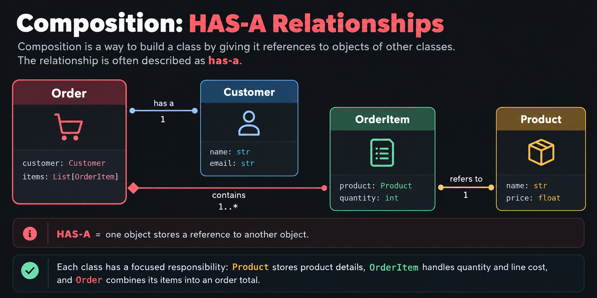
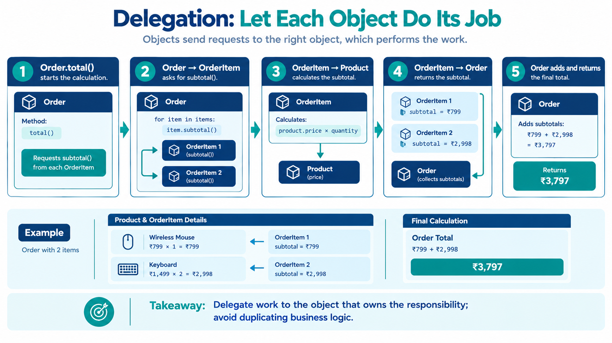
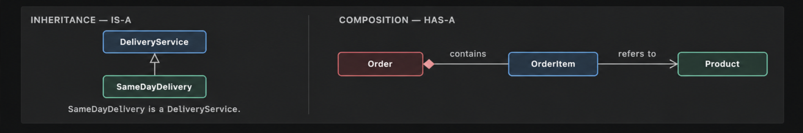

# Composition
## eCOMMart AI Squad | Week 4

*“Build a useful object by giving it the other objects it needs.”*

## What We Will Cover

1. What composition means when designing classes.
2. How a class can store another object as an attribute.
3. How to delegate work to a contained object instead of duplicating its logic.
4. How to initialize and validate objects that depend on other objects.
5. How composition differs from inheritance.
6. How to model a small eCOMMart order using cooperating objects.

---

## 1. Why Composition?

An e-commerce order contains several pieces of information and behaviour. An order has a customer, contains order items, and can calculate a total. A customer is not a kind of order, and an order item is not a kind of order. These objects work together, but they represent different things.

**Composition** is a way to build a class by giving it references to objects of other classes. The relationship is often described as **has-a**:

- An `Order` has a `Customer`.
- An `Order` has one or more `OrderItem` objects.
- An `OrderItem` has a `Product`.


The classes have separate responsibilities. `Product` stores product details, `OrderItem` calculates the cost of a quantity of one product, and `Order` combines its items into an order total.

This makes the design easier to understand and maintain than putting every responsibility into one large class.

## 2. Composition: An Object Inside Another Object

A class can store another object in an attribute just as it can store a string, number, list, or dictionary.

```python
class Product:
    """Represent a product available in the eCOMMart catalogue."""

    def __init__(self, name, price):
        """Initialize the product name and price."""
        if not isinstance(name, str) or not name.strip():
            raise ValueError("Product name must not be empty.")
        if isinstance(price, bool) or not isinstance(price, (int, float)):
            raise TypeError("Price must be a number.")
        if price < 0:
            raise ValueError("Price cannot be negative.")

        self.name = name.strip()
        self.price = float(price)

    def describe(self):
        """Return a short description of the product."""
        return f"{self.name} (₹{self.price:.2f})"


class OrderItem:
    """Represent a quantity of one product in an order."""

    def __init__(self, product, quantity):
        """Store a product object and the quantity ordered."""
        if not isinstance(product, Product):
            raise TypeError("product must be a Product object.")
        if isinstance(quantity, bool) or not isinstance(quantity, int):
            raise TypeError("Quantity must be an integer.")
        if quantity <= 0:
            raise ValueError("Quantity must be greater than zero.")

        self.product = product
        self.quantity = quantity

    def subtotal(self):
        """Return the price of this item multiplied by its quantity."""
        return self.product.price * self.quantity


phone_case = Product("Phone Case", 399)
item = OrderItem(phone_case, 2)

print(item.product.describe())
print(f"Subtotal: ₹{item.subtotal():.2f}")
# Output:
# Phone Case (₹399.00)
# Subtotal: ₹798.00
```

Notice this line:

```python
self.product = product
```

The `OrderItem` object stores a reference to a `Product` object. It does not need to copy the product's name and price into separate attributes. It can access them through `self.product`.

```text
item: OrderItem
   |
   | product
   v
phone_case: Product
   | name  = "Phone Case"
   | price = 399.00
```

The variable `phone_case` and the attribute `item.product` refer to the same product object in this example.

## 3. Let Each Class Have One Clear Responsibility

A common beginner mistake is to put all application behaviour into one class. For example, an order class should not need to store every product's catalogue details itself or repeat the calculation for each product.

A clearer design gives each class a focused job:

| Class | Responsibility |
|---|---|
| `Product` | Stores a product name and unit price. |
| `OrderItem` | Connects a product with a quantity and calculates a subtotal. |
| `Order` | Stores order items and calculates the combined total. |

The `Order` class can ask each `OrderItem` for its subtotal. This is called **delegation**: one object asks another object to perform the work that belongs to it.



```python
class Product:
    """Represent a product with a name and unit price."""

    def __init__(self, name, price):
        """Initialize a product after validating its data."""
        if not isinstance(name, str) or not name.strip():
            raise ValueError("Product name must not be empty.")
        if isinstance(price, bool) or not isinstance(price, (int, float)):
            raise TypeError("Price must be a number.")
        if price < 0:
            raise ValueError("Price cannot be negative.")

        self.name = name.strip()
        self.price = float(price)


class OrderItem:
    """Represent one product and its ordered quantity."""

    def __init__(self, product, quantity):
        """Initialize an item using a Product object and positive quantity."""
        if not isinstance(product, Product):
            raise TypeError("product must be a Product object.")
        if isinstance(quantity, bool) or not isinstance(quantity, int):
            raise TypeError("Quantity must be an integer.")
        if quantity <= 0:
            raise ValueError("Quantity must be greater than zero.")

        self.product = product
        self.quantity = quantity

    def subtotal(self):
        """Calculate the subtotal for this order item."""
        return self.product.price * self.quantity


class Order:
    """Represent an order made by a customer."""

    def __init__(self, order_id, items):
        """Initialize an order with an ID and a list of order items."""
        if not isinstance(order_id, str) or not order_id.strip():
            raise ValueError("Order ID must not be empty.")
        if not isinstance(items, list):
            raise TypeError("items must be a list.")
        if not all(isinstance(item, OrderItem) for item in items):
            raise TypeError("Every item must be an OrderItem object.")

        self.order_id = order_id.strip()
        self.items = list(items)

    def total(self):
        """Return the combined subtotal of every item in the order."""
        return sum(item.subtotal() for item in self.items)


mouse = Product("Wireless Mouse", 799)
keyboard = Product("Keyboard", 1499)
items = [OrderItem(mouse, 1), OrderItem(keyboard, 2)]
order = Order("ECM-ORDER-104", items)

print(f"Order: {order.order_id}")
print(f"Total: ₹{order.total():.2f}")
# Output:
# Order: ECM-ORDER-104
# Total: ₹3797.00
```

The total is calculated as:

```text
Wireless Mouse: ₹799.00 × 1 = ₹799.00
Keyboard:      ₹1499.00 × 2 = ₹2998.00
                                --------
Order total:                     ₹3797.00
```

The `Order` class does not repeat the product-price multiplication. It asks each `OrderItem` to calculate its own subtotal and adds the results.

## 4. Validate Objects at the Boundary

When one object depends on another, validate that dependency when the object is created. For example, `OrderItem` should receive a `Product` object, not a product name string or a dictionary that happens to contain a price.

```python
product = Product("Water Bottle", 299)

valid_item = OrderItem(product, 3)
print(f"Subtotal: ₹{valid_item.subtotal():.2f}")
# Output:
# Subtotal: ₹897.00
```

This is invalid because the first argument is a string rather than a `Product` object:

```python
invalid_item = OrderItem("Water Bottle", 3)
# Output:
# TypeError: product must be a Product object.
```

The class checks its input before storing it. That makes the object's expected structure explicit and helps catch mistakes near where they occur.

Validation should match the class's responsibility. `Product` validates product data, `OrderItem` validates its product reference and quantity, and `Order` validates its ID and collection of items.

## 5. Composition Compared with Inheritance

Composition and inheritance are both useful, but they describe different relationships.

| Question | Composition | Inheritance |
|---|---|---|
| Relationship | Has-a | Is-a |
| Example | An `OrderItem` has a `Product`. | `SameDayDelivery` is a `DeliveryService`. |
| Main purpose | Combine objects with separate responsibilities. | Specialize a type and reuse inherited behaviour. |
| Typical implementation | Store another object in an attribute. | Define a child class using a parent in parentheses. |

Use inheritance when one class really is a specialized form of another class. Use composition when an object needs another object to do its work.

For example, an `Order` is not a kind of `Product`, so making `Order` inherit from `Product` would express the wrong relationship. An order can contain products through its order items instead.




Composition also allows a class to collaborate with different objects without building a deep inheritance hierarchy. The important point is to model the real responsibility and relationship clearly, rather than using a technique simply because it is available.

## 6. Copying a List Does Not Copy Every Object

When a class stores a list of objects, `list(items)` makes a new list, but the objects inside it are still the same objects. This is a **shallow copy**.

```python
first_product = Product("Notebook", 120)
first_item = OrderItem(first_product, 2)
source_items = [first_item]

saved_items = list(source_items)

print(saved_items is source_items)
print(saved_items[0] is source_items[0])
# Output:
# False
# True
```

The list objects are different, but both lists refer to the same `OrderItem` object. This is usually fine when the goal is to keep a separate list container. It does not create independent copies of the products or order items.

For this lesson, remember the distinction:

- A **list copy** creates a new list container.
- It does not automatically create new copies of the objects stored inside it.

Do not introduce copying complexity unless the application needs independent objects. Be clear about whether objects are meant to be shared.

## 7. Follow the Object Relationships

When reading code that uses composition, trace the references one step at a time.

```python
product = Product("Desk Lamp", 1299)
item = OrderItem(product, 2)
order = Order("ECM-ORDER-205", [item])

print(order.items[0].product.name)
print(order.items[0].subtotal())
print(order.total())
# Output:
# Desk Lamp
# 2598.0
# 2598.0
```

The access path `order.items[0].product.name` means:

1. Start with the `order` object.
2. Access its `items` list.
3. Select the first `OrderItem`.
4. Access that item's `product` object.
5. Read the product's `name`.

This is valid, but long chains can make code harder to read. When a calculation or action belongs to an object, prefer calling its method, such as `order.total()`, instead of making unrelated code reach into every internal detail.

## 8. Common Mistakes

### Mistake 1: Passing the wrong kind of object

```python
item = OrderItem({"name": "Mouse", "price": 799}, 1)
```

A dictionary is not a `Product` object. Convert or construct the data into the expected object before passing it to `OrderItem`.

### Mistake 2: Duplicating calculations

If `Order` repeats the product-price multiplication instead of calling `item.subtotal()`, the same business rule can end up in multiple places. Let each class perform its own responsibility.

### Mistake 3: Confusing “has-a” with “is-a”

An order has products; an order is not a product. Choose composition or inheritance based on the relationship being modelled.

### Mistake 4: Assuming a shallow list copy duplicates its contents

`list(items)` creates a new list, not independent copies of every object inside it.

### Mistake 5: Forgetting to validate dependencies

If a class requires a `Product`, check that requirement in `__init__`. Otherwise, invalid values may fail much later when a method tries to access `.price` or `.name`.

---

# Composition Practice Tasks


In these tasks, you will practise composition by creating objects that contain or refer to other objects.

---

## Task 1 — Warehouse Storage

**Goal:** Create a warehouse that contains storage zones.

### Requirements

1. Create a `StorageBin` class with `bin_id` and `capacity` attributes.
2. Create a `StorageZone` class with a `zone_name` attribute and a list to store storage bins.
3. Add an `add_bin()` method to `StorageZone` to add a storage bin.
4. Create a `Warehouse` class with a `warehouse_name` attribute and a list to store storage zones.
5. Add an `add_zone()` method to `Warehouse` to add a storage zone.
6. Create a warehouse named `"North Warehouse"`.
7. Add two zones: `"Electronics"` and `"Accessories"`.
8. Add two bins to Electronics and one bin to Accessories.
9. Print the warehouse name and the number of bins in each zone.

### Expected Output

```text
Warehouse: North Warehouse
Electronics bins: 2
Accessories bins: 1
```

---

## Task 2 — Inventory Record

**Goal:** Create an inventory record that refers to a product and a warehouse.

### Requirements

1. Create a `CatalogItem` class with `item_name` and `unit_price` attributes.
2. Create a `Warehouse` class with a `warehouse_name` attribute.
3. Create an `InventoryRecord` class that stores:
   - A `CatalogItem` object.
   - A `Warehouse` object.
   - The available stock quantity.
4. Add a `stock_value()` method that calculates the total stock value using the quantity and unit price.
5. Create a `"Wireless Mouse"` priced at ₹799.
6. Create a warehouse named `"North Warehouse"`.
7. Create an inventory record for 15 wireless mice.
8. Print the item name, warehouse name, quantity, and stock value.

### Expected Output

```text
Item: Wireless Mouse
Warehouse: North Warehouse
Stock quantity: 15
Stock value: ₹11985.00
```

---

## Task 3 — Business Price List

**Goal:** Create a price list that contains entries for different products.

### Requirements

1. Create a `CatalogItem` class with `item_name` and `unit_price` attributes.
2. Create a `PriceEntry` class that stores a `CatalogItem` object and its listed price.
3. Add a `display_entry()` method to print the product name and listed price.
4. Create a `PriceList` class with a `list_name` attribute and a list to store price entries.
5. Add an `add_entry()` method to add a price entry to the price list.
6. Add a `display_price_list()` method to display the list name and all its entries.
7. Create these two products:
   - Wireless Mouse — ₹799
   - Laptop Stand — ₹1,299
8. Create price entries with business prices of ₹749 for the mouse and ₹1,199 for the laptop stand.
9. Add both entries to a price list named `"Business Customer Price List"`.
10. Display the complete price list.

### Expected Output

```text
Price List: Business Customer Price List
Wireless Mouse: ₹749.00
Laptop Stand: ₹1199.00
```

---

## Quick Reflection

Answer these questions after completing the tasks.

1. What does a **has-a relationship** mean?
2. Which class contains objects of another class in Task 1?
3. Why does `InventoryRecord` store a `CatalogItem` object?
4. How is composition different from inheritance?


## Summary

| Concept | What to remember |
|---|---|
| Composition | Build a class using objects of other classes. |
| Has-a relationship | An object contains or refers to another object. |
| Delegation | Ask the object responsible for a task to perform it. |
| Object reference | An attribute can refer to an existing object. |
| Validation | Check required object types and values when objects are created. |
| Shallow copy | A copied list has a new container but still refers to the same contained objects. |
| Composition vs. inheritance | Composition is has-a; inheritance is is-a. |

*End of `02_Classes_and_Objects`. Continue with the first file in `03_Organizing_Classes` according to the repository's existing file order.*
