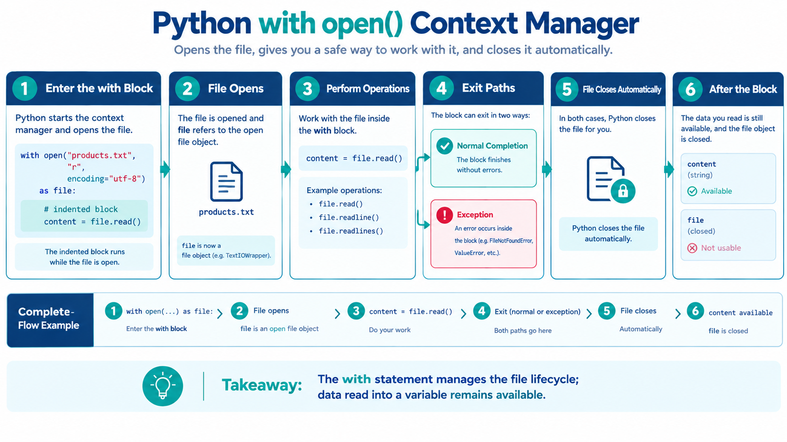

# `with open()` and File Modes
## eCOMMart AI Squad | Week 4

*“A file should be opened for a clear purpose and closed reliably when that work is finished.”*

## What We Will Cover

1. Explain why files need to be closed after use.
2. Use `with open(...)` to manage files safely.
3. Recognise common file modes: `"r"`, `"w"`, and `"a"`.
4. Choose a mode based on whether a task reads, replaces, or adds content.
5. Apply the patterns to eCOMMart text files.

---

## 1. Why File Management Matters

In the previous lessons, you used `open()` to read, write, and append text. Those examples explicitly called `file.close()` when the work was finished.

```python
file = open("products.txt", "r", encoding="utf-8")
content = file.read()
file.close()

print(content)
```

This pattern can work, but it relies on the program reaching `file.close()`. If an exception occurs between opening and closing the file, that line may not run.

Python provides a context manager pattern using `with`. It ensures that the file is closed when the indented block exits, including when an exception occurs inside the block.

## 2. Read a File with `with open()`

```python
with open("products.txt", "r", encoding="utf-8") as file:
    content = file.read()

print(content)
# Output:
# Wireless Mouse
# USB-C Cable
# Desk Lamp
# Travel Mug
```

Read the structure carefully:

- `with` starts the context-managed block.
- `open(...)` opens the file.
- `as file` gives the opened file object the variable name `file`.
- The indented statements use that file object.
- When the block ends, Python closes the file automatically.

The file variable is used inside the block. You can use the text stored in `content` afterwards because `content` is a string, not the open file object.



```text
Enter the with block
        |
        v
Open the file
        |
        v
Read or write inside the block
        |
        v
Leave the block
        |
        v
Python closes the file
```

## 3. Iterate Through Lines Safely

You can iterate over a file directly inside a `with` block. This is useful when processing records line by line.

```python
with open("products.txt", "r", encoding="utf-8") as file:
    for line in file:
        product_name = line.strip()
        if product_name:
            print(product_name)
# Output:
# Wireless Mouse
# USB-C Cable
# Desk Lamp
# Travel Mug
```

The loop processes one line at a time. `strip()` removes the line ending and surrounding whitespace, and the condition skips blank lines.

Do not call `file.close()` inside this block during ordinary use. The `with` statement handles closing when the block finishes.

## 4. Use `with open()` for Writing

The same pattern works when writing. This example creates or replaces a dedicated practice file.

```python
with open("practice_summary.txt", "w", encoding="utf-8") as file:
    file.write("eCOMMart Summary\n")
    file.write("Products checked: 4\n")

print("Summary saved.")
# Output:
# Summary saved.
```

After the block ends, the file is closed. The file `practice_summary.txt` contains:

```text
eCOMMart Summary
Products checked: 4
```

Remember that `"w"` truncates an existing file when it is opened. Use a practice output filename so you do not accidentally overwrite source data.

## 5. Use `with open()` for Appending

Append mode keeps existing content and writes new text at the end.

```python
with open("activity_log.txt", "a", encoding="utf-8") as file:
    file.write("Inventory review completed\n")

print("Log entry added.")
# Output:
# Log entry added.
```

If `activity_log.txt` already contains earlier entries, they remain. If the file does not exist, Python creates it.

Running the code repeatedly adds the same message each time. Append mode preserves the file; it does not automatically prevent duplicate log entries.

## 6. Choose the Correct File Mode

The mode is the second argument to `open()`.

| Mode | Main purpose | Existing file | Missing file |
|---|---|---|---|
| `"r"` | Read | Reads existing content | Raises `FileNotFoundError` |
| `"w"` | Write from the beginning | Truncates existing content | Creates the file |
| `"a"` | Append at the end | Preserves content and adds text | Creates the file |

Choose the mode by answering one question: **What should happen to the existing file content?**

- If you need to inspect existing data, use `"r"`.
- If you intentionally want a fresh output file, use `"w"`.
- If you want to add a new entry while preserving previous entries, use `"a"`.

The mode does not change the meaning of `read()` or `write()`: it determines which operations are permitted and what happens when the file is opened.

## 7. Combine Reading and Writing Carefully

A common beginner task is to read one file and write a summary to a different file. Keep the input and output filenames separate so the program does not replace its source data.

Suppose `products.txt` contains the four sample product names.

```python
product_names = []

with open("products.txt", "r", encoding="utf-8") as source_file:
    for line in source_file:
        name = line.strip()
        if name:
            product_names.append(name)

with open("product_count.txt", "w", encoding="utf-8") as output_file:
    output_file.write(f"Product records: {len(product_names)}\n")

print("Product count saved.")
# Output:
# Product count saved.
```

The generated `product_count.txt` contains:

```text
Product records: 4
```

The first `with` block reads the input and saves the selected values in a list. The second `with` block writes the result to a separate output file. Each file is managed independently.

## 8. File Objects and Text Values Are Different

A file object represents an open file and provides methods such as `read()` and `write()`. The string returned by `read()` is ordinary data in memory.

```python
with open("products.txt", "r", encoding="utf-8") as file:
    content = file.read()

print(type(content).__name__)
print(content.splitlines())
# Output:
# str
# ['Wireless Mouse', 'USB-C Cable', 'Desk Lamp', 'Travel Mug']
```

After the `with` block ends, the file object is closed, but `content` remains available. You can still use string methods such as `splitlines()` because the text is stored in the variable.

## 9. Common Mistakes

### Forgetting indentation

All statements that need the open file must be indented under `with`. A statement outside the block runs after the file has been closed.

### Using the wrong mode

Reading from a file opened with `"w"` is not the intended workflow. Similarly, opening an input file with `"w"` can erase its contents.

### Assuming `"a"` starts a fresh file

Append mode preserves previous content. If a clean report is needed, use `"w"` with a deliberate output filename.

### Using a file after the block

The file object is closed after the block. Read or write inside the block, and keep any data you need afterwards in a variable.

### Omitting the encoding

For text files in these lessons, use `encoding="utf-8"` to make the intended text encoding explicit.

---

## Practice Tasks

Use `products.txt` with the four sample product names from the previous lesson.

### Task 1 — Read Safely

**Goal:** Read a text file with a context manager.

1. Open `products.txt` with `with open(...)` in read mode and UTF-8 encoding.
2. Read the contents into a variable.
3. Leave the block and print the content.
4. Print the type name of the content variable.
5. Confirm that the text remains available after the file is closed.

Expected key output:

```text
Wireless Mouse
USB-C Cable
Desk Lamp
Travel Mug
str
```

### Task 2 — Write a Fresh Report

**Goal:** Use write mode with a context manager.

1. Open `safe_report.txt` in `"w"` mode inside a `with` block.
2. Write the heading `eCOMMart Product Report`.
3. Write `Products listed: 4` on the next line.
4. Leave the block before printing `Report saved.`
5. Inspect the file and confirm that it contains both lines.
6. Explain in a comment why `"w"` should only be used when replacing the output file is acceptable.

Expected output:

```text
Report saved.
```

Expected file content:

```text
eCOMMart Product Report
Products listed: 4
```

### Task 3 — Create a Count File from Input

**Goal:** Read one file and write a summary to another.

1. Read `products.txt` with a `with` block.
2. Count non-empty lines without counting blank lines.
3. Open `product_count.txt` in `"w"` mode using a separate `with` block.
4. Write `Product records: 4` to the output file.
5. Print `Count saved.` after the writing block ends.
6. Reopen `product_count.txt` in read mode and display its content.
7. Explain why the input and output filenames should remain different.

Expected output:

```text
Count saved.
Product records: 4
```

## Summary

| Concept | What to remember |
|---|---|
| `with open(...) as file` | Manages the file's lifetime and closes it when the block exits. |
| Indentation | File operations belong inside the `with` block. |
| `"r"` | Reads an existing file. |
| `"w"` | Creates or truncates a file for writing. |
| `"a"` | Adds text to the end while preserving existing content. |
| Text variable | Data already read into a string remains available after the file closes. |
| Separate input/output paths | Helps prevent accidental loss of source data. |

*Next: `04_Working_with_CSV.md`*