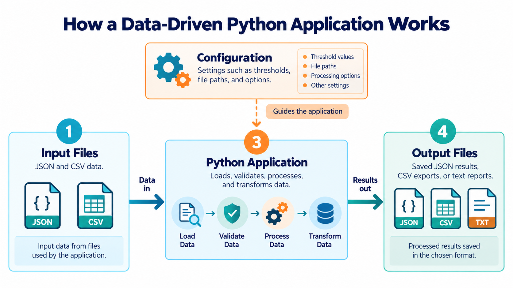

# Loading Configuration from JSON

## eCOMMart AI Squad | Week 4

> “Keep changeable settings in configuration files so you can adjust them without rewriting your application logic.”

## What We Will Cover

1. Understand what application configuration is.
2. Create a JSON configuration file.
3. Load settings into Python using `json.load()`.
4. Use configuration values in an eCOMMart program.
5. Validate required settings and handle common errors.

---

## 1. What Is Application Configuration?

Configuration is a collection of settings that controls how an application behaves. Examples include a store name, a currency label, a delivery fee, and the location where reports are saved.

Instead of placing every changeable value directly in the Python code, an application can read those settings from a JSON file.

Example project structure:

```text
ecommart/
├── app.py
├── config.json
└── data/
    └── products.json
```

The `config.json` file stores settings. The Python program loads those settings when it starts.



## 2. Create a JSON Configuration File

Create a file named `config.json` with this content:

```json
{
    "store_name": "eCOMMart",
    "currency_symbol": "₹",
    "delivery_fee": 49,
    "free_delivery_threshold": 999,
    "catalogue_file": "data/products.json",
    "debug_mode": false
}
```

Notice that:
- Text values are written as JSON strings in double quotes.
- Numeric values are written without quotes.
- JSON uses `true` and `false`, not Python's `True` and `False`.
- Keys and values are separated by a colon, and items by commas.

The file contains data only; it does not contain Python code.

## 3. Load Configuration with `json.load()`

Use Python's built-in `json` module to read the file.

```python
import json

with open("config.json", "r", encoding="utf-8") as file:
    config = json.load(file)

print(config["store_name"])
print(config["delivery_fee"])
print(config["debug_mode"])
```

Output:

```text
eCOMMart
49
False
```

`json.load()` converts the JSON object into a Python dictionary. You can then access the settings using dictionary keys.

This example assumes that `config.json` is in the current working directory and contains valid JSON.

## 4. Use Configuration Values in an Application

A configuration file becomes useful when its values affect program behaviour.

The following example calculates a delivery fee based on the order total.

```python
import json

with open("config.json", "r", encoding="utf-8") as file:
    config = json.load(file)

order_total = 1200

if order_total >= config["free_delivery_threshold"]:
    delivery_fee = 0
else:
    delivery_fee = config["delivery_fee"]

print(f'Store: {config["store_name"]}')
print(f"Order total: {config['currency_symbol']}{order_total}")
print(f"Delivery fee: {config['currency_symbol']}{delivery_fee}")
```

Output:

```text
Store: eCOMMart
Order total: ₹1200
Delivery fee: ₹0
```

Try changing `free_delivery_threshold` in `config.json` and run the program again. The delivery logic remains the same, but its behaviour changes based on the configuration.

## 5. Use Configuration to Locate Data

The configuration can also contain a relative path to a data file.

Suppose the configuration contains:

```json
{
    "catalogue_file": "data/products.json"
}
```

You can use that setting when opening the catalogue:

```python
import json

with open("config.json", "r", encoding="utf-8") as file:
    config = json.load(file)

catalogue_path = config["catalogue_file"]

with open(catalogue_path, "r", encoding="utf-8") as file:
    products = json.load(file)

print(f"Loaded {len(products)} products.")
```

Example output when the catalogue contains three products:

```text
Loaded 3 products.
```

The relative path is resolved from the program's current working directory. Keep your project structure consistent so the configured path points to the intended file.

## 6. Validate Required Settings

A configuration file can be missing a key or contain a value of the wrong type. Check required settings before using them.

```python
import json

with open("config.json", "r", encoding="utf-8") as file:
    config = json.load(file)

required_keys = ["store_name", "delivery_fee", "free_delivery_threshold"]

missing_keys = [
    key for key in required_keys
    if key not in config
]

if missing_keys:
    print(f"Missing settings: {', '.join(missing_keys)}")
else:
    print("Required settings are present.")
```

Output for the sample configuration:

```text
Required settings are present.
```

Checking for key presence is a useful first step. It does not confirm that the values have the correct types or valid ranges.

### Check a Setting's Type and Range

```python
import json

with open("config.json", "r", encoding="utf-8") as file:
    config = json.load(file)

delivery_fee = config.get("delivery_fee")

if not isinstance(delivery_fee, (int, float)) or delivery_fee < 0:
    print("Invalid delivery fee.")
else:
    print("Delivery fee setting is valid.")
```

Output for the sample configuration:

```text
Delivery fee setting is valid.
```

The `isinstance()` check helps ensure the fee is numeric. Because `bool` is a subclass of `int` in Python, a stricter application may also explicitly reject Boolean values for numeric settings.

## 7. Handle Common Configuration Errors

### Missing Configuration File

```python
import json

try:
    with open("config.json", "r", encoding="utf-8") as file:
        config = json.load(file)
except FileNotFoundError:
    print("Configuration file was not found.")
```

Output if the file is missing:

```text
Configuration file was not found.
```

### Invalid JSON

If the file contains malformed JSON, `json.load()` raises `json.JSONDecodeError`.

```python
import json

try:
    with open("config.json", "r", encoding="utf-8") as file:
        config = json.load(file)
except json.JSONDecodeError:
    print("Configuration file contains invalid JSON.")
```

Output if the file's contents are invalid:

```text
Configuration file contains invalid JSON.
```

These are separate error cases: a missing file cannot be opened, while an existing file may contain invalid JSON. In a complete application, handle both cases where appropriate.

## 8. Worked Example: A Config-Driven Delivery Calculator

Use the configuration file from Section 2. The program below loads the settings and calculates the delivery fee.

```python
import json

with open("config.json", "r", encoding="utf-8") as file:
    config = json.load(file)

order_total = 750

if order_total >= config["free_delivery_threshold"]:
    fee = 0
else:
    fee = config["delivery_fee"]

final_total = order_total + fee

print(f'Store: {config["store_name"]}')
print(f"Items total: {config['currency_symbol']}{order_total}")
print(f"Delivery: {config['currency_symbol']}{fee}")
print(f"Final total: {config['currency_symbol']}{final_total}")
```

Output:

```text
Store: eCOMMart
Items total: ₹750
Delivery: ₹49
Final total: ₹799
```

This small example separates **settings** from **program logic**. The same Python code can use a different delivery fee or threshold by loading a different configuration.

## 9. Practice Tasks

Complete the tasks in order. Each task builds on the ideas introduced in this lesson.

### Task 1 — Load Store Settings

Create `store_config.json` with these settings:

```json
{
    "store_name": "eCOMMart",
    "delivery_fee": 39,
    "debug_mode": true
}
```

Load the file and print the store name and delivery fee.

Expected output:

```text
Store: eCOMMart
Delivery fee: ₹39
```

### Task 2 — Calculate Free Delivery

Create `delivery_config.json`:

```json
{
    "delivery_fee": 50,
    "free_delivery_threshold": 1000
}
```

Load the configuration and use it to calculate the delivery fee for an order total of `1200`. Print the fee.

Expected output:

```text
Delivery fee: ₹0
```

### Task 3 — Validate Required Keys

Create `report_config.json` with this content:

```json
{
    "report_folder": "reports",
    "report_filename": "daily_sales.csv"
}
```

Load the configuration and check that both `report_folder` and `report_filename` are present. Print the success message if both keys exist; otherwise, print the missing key names.

Expected output:

```text
Report configuration is complete.
```

## Summary

| Concept | Purpose |
|---|---|
| JSON configuration | Stores changeable application settings |
| `json.load()` | Reads settings from a JSON file |
| Dictionary keys | Access individual settings |
| `dict.get()` | Retrieve a setting with a fallback of `None` by default |
| Required-key checks | Detect missing configuration entries |
| Type and range checks | Catch invalid setting values |
| `FileNotFoundError` | Handle a missing configuration file |
| `json.JSONDecodeError` | Handle malformed JSON |

A configuration file helps separate changeable settings from application logic. Keep configuration values clear, validate important settings, and handle missing or invalid files intentionally.

*Next: `03_Saving_Application_Output.md`*
