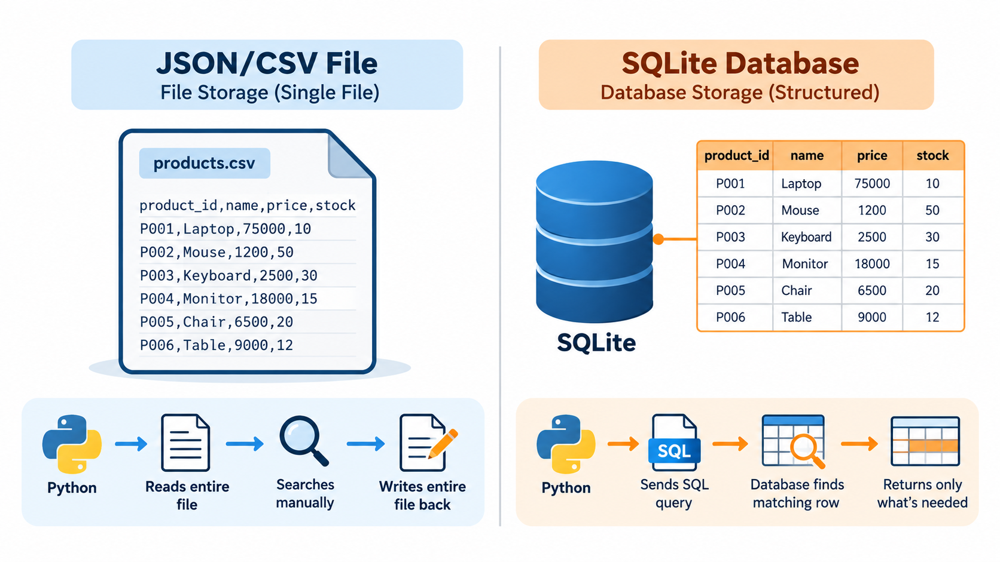
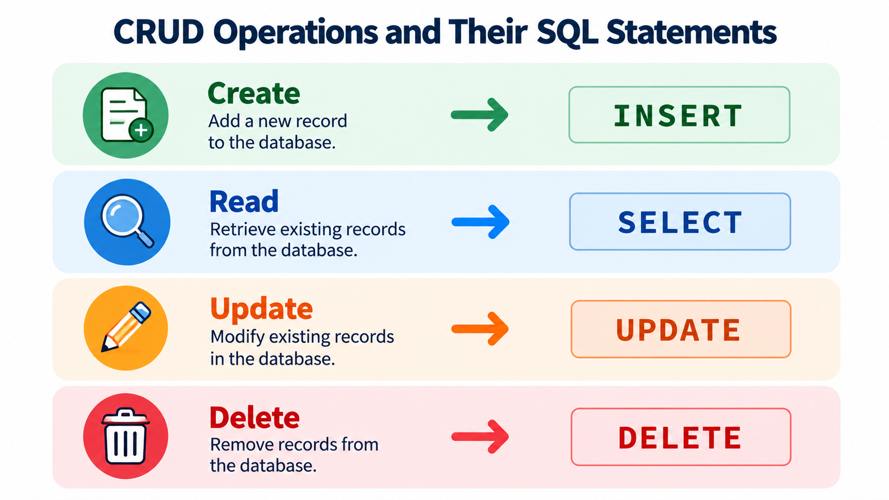

# Files vs. Databases: The eComMART Challenge

## Learning objectives

By the end of this lesson, you will be able to:

- Explain the difference between data stored in a file and data stored in a database.
- Describe why an e-commerce application may outgrow a simple JSON or CSV file.
- Recognize the basic parts of a database table: columns, rows, and records.
- Explain the four common data operations: create, read, update, and delete (CRUD).
- Identify when a file is still a good choice and when a database is more suitable.

## 1. Start with a familiar problem

In Week 4, you worked with the eComMART product catalog. The application needed product information such as a product's name, category, price, and available stock. A file was a reasonable way to store this information while learning Python file handling.

Imagine that eComMART now uses the catalog to support a growing B2B store. Buyers and sales staff need to look up products, stock levels change during the day, and prices may be updated. The application must keep those changes when it closes and opens again.

Consider this small product catalog:

| Product ID | Product name | Category | Price (₹) | Stock |
|---|---|---|---:|---:|
| 101 | Wireless Barcode Scanner | Scanners | 3,499.00 | 24 |
| 102 | Thermal Label Roll | Shipping Supplies | 450.00 | 120 |
| 103 | USB-C Docking Station | Accessories | 6,799.00 | 8 |

These are example records for this lesson. We will keep the same product fields as we explore how a database can store and manage catalog data.

### The challenge

A customer orders five USB-C Docking Stations. The application must change the stock from 8 to 3. Later, a staff member corrects the price of the Wireless Barcode Scanner. When the application is reopened, both changes must still be present.

A file can store these values. The question is not whether files *can* hold the data; they can. The question is how easily and reliably the application can find, change, and manage the data as the catalog grows.

**Think about it:** What would your Python program need to do to change one product in a JSON file without accidentally changing the other products?

A typical approach is to read the file, convert its contents into Python objects, find the right product, change the value, and write the data back to the file. This is workable for small applications, but it becomes harder to manage as more operations and users are involved.

## 2. What is a data file?

A data file stores information in a format that an application can read. In earlier Python work, you may have used JSON or CSV.

### JSON example

JSON represents structured data using objects and arrays. A simplified version of the eComMART catalog could look like this:

```json
[
  {
    "product_id": 101,
    "name": "Wireless Barcode Scanner",
    "category": "Scanners",
    "price": 3499.00,
    "stock": 24
  },
  {
    "product_id": 102,
    "name": "Thermal Label Roll",
    "category": "Shipping Supplies",
    "price": 450.00,
    "stock": 120
  }
]
```

A Python application can load this JSON data, work with it, and save the updated information back to the file.

### CSV example

CSV stores data in rows and columns, making it convenient to inspect in spreadsheet software:

```csv
product_id,name,category,price,stock
101,Wireless Barcode Scanner,Scanners,3499.00,24
102,Thermal Label Roll,Shipping Supplies,450.00,120
103,USB-C Docking Station,Accessories,6799.00,8
```

JSON is useful when the data has a nested structure. CSV is useful for tabular data and for exchanging data with tools such as Excel. Neither format is automatically wrong for an application.

However, a file format mainly defines how information is represented. It does not, by itself, provide the full set of facilities that a database system offers for querying, updating, and coordinating access to data.

## 3. What is a database?

A **database** is an organized collection of data that can be stored, retrieved, and managed. A **database management system (DBMS)** is software that helps an application work with that data.

In this course, we will use **SQLite**, a lightweight database engine that stores a database in a file. Python includes the `sqlite3` module, so we can use SQLite without installing or managing a separate database server.

This is an important distinction: a SQLite database is stored in a file, but it is not the same as a plain JSON or CSV file. SQLite manages structured tables and provides a SQL interface for querying and changing records.

### SQLite is one choice among several

SQLite is not the only database system in use. Other widely used database management systems include **PostgreSQL**, **MySQL**, and **Microsoft SQL Server**. These typically run as a separate server program that applications connect to over a network, which makes them well suited to larger applications or ones with many users accessing the same database at once.

SQLite works differently: the entire database lives in one file on disk, and there is no separate server to install or manage. This makes SQLite an excellent choice for learning, for small applications, and for situations where one program is the main user of the database — exactly the eComMART catalog scenario in this course.

The SQL you learn this week — `SELECT`, `INSERT`, `UPDATE`, `DELETE`, and the table concepts behind them — transfers directly to PostgreSQL, MySQL, and similar systems, with only minor differences in some advanced features. You are not just learning "SQLite" in isolation; you are learning the relational-database foundations that the entire family of SQL databases shares.

For the eComMART catalog, we will begin with one table named `products`.

| product_id | name | category | price | stock |
|---:|---|---|---:|---:|
| 101 | Wireless Barcode Scanner | Scanners | 3499.00 | 24 |
| 102 | Thermal Label Roll | Shipping Supplies | 450.00 | 120 |
| 103 | USB-C Docking Station | Accessories | 6799.00 | 8 |

The table looks familiar because it is arranged in rows and columns. In the next lesson, we will examine those parts more carefully and learn why a product needs a unique identifier.

For now, remember:

- A **table** groups related data, such as products.
- A **column** describes one kind of information, such as `price`.
- A **row** contains the values for one product.
- A **record** is another name for a row of related data.



*A file requires your program to read everything and search manually. A database lets you ask for exactly what you need.*

## 4. Why might eComMART use a database?

Compare what the application needs to do with what each approach offers.

| Requirement | Working directly with a JSON or CSV file | Working with a database |
|---|---|---|
| Store a small product list | A good option | Also possible |
| Find products matching a condition | The program generally reads and checks the data itself | A query can ask for matching records |
| Change one product | The program usually loads, changes, and saves file contents | An update operation can target the intended record |
| Keep structured records consistent | The program must implement many checks itself | The database can enforce defined rules, such as a primary key |
| Manage changes safely | The program must handle interrupted writes and coordination itself | The database provides transaction facilities |
| Exchange data with other tools | JSON and CSV are widely useful interchange formats | Data can be exported when needed |

A database is not automatically the best choice for every task. For a small configuration file, a JSON file may be simpler. For a product catalog that needs reliable queries and repeated record changes, a database can make the application easier to manage.

### A practical way to think about it

A file is like a document containing a list of products. Your program has to open the document and implement the steps needed to find and change the right entry.

A database is more like a managed catalog service: your program can ask for products matching specific conditions and request targeted changes. The database engine handles the underlying data operations according to its rules.

This comparison is an analogy, not a claim that a database automatically understands business rules. We still have to design the table and write the correct queries.

## 5. Four operations every catalog needs

Applications commonly perform four types of data operation. Together, they are known as **CRUD**.

| Operation | Meaning | eComMART example |
|---|---|---|
| **Create** | Add new data | Add a new product to the catalog |
| **Read** | Retrieve existing data | Display products with stock below 10 |
| **Update** | Change existing data | Reduce a product's stock after an order |
| **Delete** | Remove data | Remove a discontinued product from the catalog |



*Each CRUD operation has one matching SQL statement. You'll learn the exact syntax for each in the next module.*

CRUD describes *what* the application needs to do. Later, you will learn the SQL statements used to perform these operations and then call those statements from Python.

For example, the stock change from 8 to 3 is an **update**. Finding all products with stock below 10 is a **read** operation. We will learn how to perform both without rewriting the entire catalog file.

## 6. Where files still fit in an application

Learning databases does not mean abandoning files. Real applications often use both.

An eComMART application might use:

- **SQLite** for product records that need to be searched and updated.
- **JSON** for simple application settings, where appropriate.
- **CSV** for exporting a report that staff can open in Excel.
- **Python code** for the rules that decide how the application behaves.

Choose the format based on the job it needs to do. A database is useful for managing operational records; JSON and CSV remain useful for configuration and data exchange.

## 7. Check your understanding

Try answering these questions before reading the recap.

1. Why might directly editing a JSON file become inconvenient as the product catalog grows?
2. What is the difference between a data file format and a database management system?
3. In the `products` table, what does one row represent?
4. Which CRUD operation changes the stock of the USB-C Docking Station from 8 to 3?
5. Should eComMART necessarily store every application setting in the products database? Explain your answer.

### Suggested answers

1. The application may need to load and rewrite the file, search for the correct record, preserve unrelated records, and handle failures itself. These tasks become harder to maintain as requirements grow.
2. JSON and CSV describe ways to represent data. A database management system provides facilities to store, query, change, and manage data.
3. One row represents one product record.
4. **Update.**
5. No. Different kinds of data have different needs. A small configuration file may still be a suitable choice for simple settings.

## 8. Recap and transition

You have seen why eComMART can begin with file-based data and why a database becomes useful when the application needs to search, change, and manage product records repeatedly.

The key ideas are:

- Files such as JSON and CSV are still useful; they are not being replaced in every situation.
- SQLite stores a database in a file but provides database features beyond plain file reading and writing.
- A table organizes related records into rows and columns.
- CRUD stands for Create, Read, Update, and Delete.

**Next lesson:** `02_Tables_Records_and_Primary_Keys.md`

We will look more closely at tables, rows, columns, and primary keys. You will learn how the database identifies one product reliably before creating the eComMART database.
