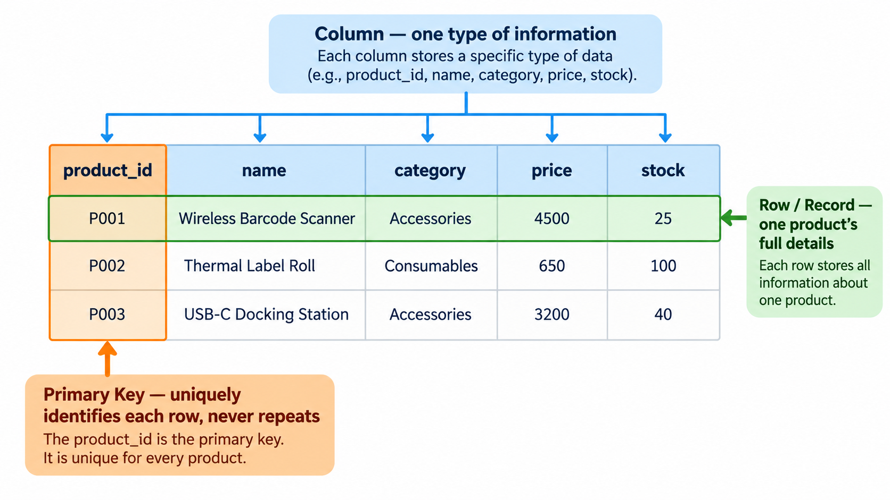
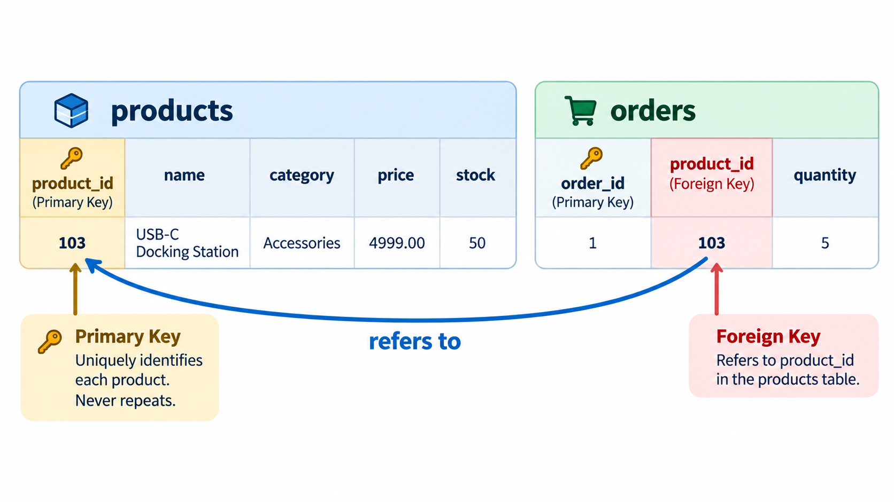

# Tables, Records, and Primary Keys

## Learning objectives

By the end of this lesson, you will be able to:

- Identify tables, columns, rows, and records in a database.
- Explain why each column needs a clear name and a suitable data type.
- Describe the purpose of a primary key.
- Explain why a product name is not always a reliable way to identify a product.
- Recognize how these ideas shape the eComMART `products` table.

## 1. From a product list to a database table

In the previous lesson, we compared files with databases and saw why eComMART might use SQLite to manage its product catalog. We also saw a table containing products. Now we will examine how that table is organized.

Imagine the catalog contains these products:

| product_id | name | category | price | stock |
|---:|---|---|---:|---:|
| 101 | Wireless Barcode Scanner | Scanners | 3499.00 | 24 |
| 102 | Thermal Label Roll | Shipping Supplies | 450.00 | 120 |
| 103 | USB-C Docking Station | Accessories | 6799.00 | 8 |

This table is not just a visual arrangement. Each part has a specific role, and understanding those roles helps us design a database that Python can work with reliably.



*Each column holds one kind of information. Each row is one product record. The primary key column uniquely identifies every row.*

## 2. Columns describe the information we store

A **column** represents one type of information for every product in the table.

In our example:

- `product_id` identifies a product.
- `name` stores the product's display name.
- `category` groups products by type.
- `price` stores the product's price.
- `stock` stores the quantity currently available.

Column names should be meaningful and consistent. For example, using `stock` in one place, `quantity_available` in another, and `qty` elsewhere can make code harder to understand unless those names deliberately represent different concepts. In this course, we will consistently use `stock` for the quantity available in the catalog.

### Columns also have data types

A **data type** describes the kind of value a column is intended to hold. It helps define what the data means and which operations make sense.

| Column | Example value | Intended kind of data |
|---|---|---|
| `product_id` | `101` | Whole-number identifier |
| `name` | `"Wireless Barcode Scanner"` | Text |
| `category` | `"Scanners"` | Text |
| `price` | `3499.00` | Numeric price |
| `stock` | `24` | Whole-number quantity |

SQLite uses a flexible type system, so its storage rules are not exactly the same as those of every other database. For this beginner lesson, focus on choosing values that match the meaning of each column. Later, when we create the table, we will specify suitable SQLite column types and constraints.

A price should not be stored as descriptive text such as `"three thousand rupees"` if the application needs to compare prices numerically. Similarly, stock should be represented as a number so the application can calculate quantities.

## 3. Rows and records represent individual products

A **row** contains the values for one product across the table's columns. A row is also commonly called a **record**.

For example, this row represents one product:

| product_id | name | category | price | stock |
|---:|---|---|---:|---:|
| 103 | USB-C Docking Station | Accessories | 6799.00 | 8 |

All five values belong to the same product. The price and stock values are not separate products; they are attributes of this product.

This distinction matters when we ask the database to change something. If eComMART receives an order for five docking stations, the application must update the stock value belonging to the docking station record—not the stock value of another product.

## 4. Why does a product need an identifier?

Product names are useful to people, but they are not always reliable identifiers.

Suppose eComMART sells two products with similar names:

| product_id | name | category | price | stock |
|---:|---|---|---:|---:|
| 104 | USB-C Cable — 1 m | Accessories | 250.00 | 80 |
| 105 | USB-C Cable — 2 m | Accessories | 390.00 | 55 |

Now imagine the catalog later contains two suppliers' versions of a product with the same display name. If the application tries to identify a product using only its name, it may find more than one match. Names can also change when descriptions are improved.

A dedicated identifier gives each product record a stable way to be referenced. In our table, that identifier is `product_id`.

### What is a primary key?

A **primary key** is a column, or a combination of columns, that uniquely identifies each row in a table. A primary key must be unique and cannot be `NULL`.

For the eComMART catalog, we will use `product_id` as the primary key.

That means:

- Each product record must have an identifier.
- Two product records cannot share the same `product_id`.
- The identifier should not be casually changed just because a product's name or price changes.

A primary key does not have to be a meaningful business value. For example, `101` does not tell a person what the product is; it simply identifies the record. The other columns contain the descriptive information.

## 5. How does this help when changing a product?

Return to the stock example. The USB-C Docking Station has `product_id` `103` and stock `8`. An order reduces its stock by five units.

Conceptually, the application needs to express two things:

1. Which record should change? The product whose `product_id` is `103`.
2. What should change? Its `stock` value should become `3`.

The identifier helps target the correct record. The stock column tells us which value to change. In a later lesson, we will express this operation using SQL.

This is also why the primary key matters when retrieving a single product or deleting a discontinued product. Without a reliable identifier, the application could accidentally affect multiple records that happen to share the same name.

## 6. Preview of the table definition

When we create a database table, we specify its columns and define rules for important fields. Here is a preview of the SQL shape we will use later:

```sql
CREATE TABLE products (
    product_id INTEGER PRIMARY KEY,
    name TEXT NOT NULL,
    category TEXT NOT NULL,
    price REAL NOT NULL,
    stock INTEGER NOT NULL
);
```

For now, read this as a description of the table rather than a command you need to run yet:

- `CREATE TABLE products` names the table we are creating.
- `product_id INTEGER PRIMARY KEY` defines the identifier.
- `TEXT`, `REAL`, and `INTEGER` describe the intended kinds of values.
- `NOT NULL` says a value must be supplied for that column.

We will examine and execute this statement in the SQLite and SQL section. A table definition can also include further rules, such as ensuring a price is not negative. We will add constraints when we are ready to discuss how they protect the catalog's data.

## 7. A look ahead: keys that connect tables

Everything so far has used one table: `products`. This is deliberate — the core Week 5 project stays with a single table so you can learn the foundations clearly. But it helps to see, briefly, what a primary key is *for* beyond identifying a row in its own table: it is also how one table can refer to a row in another table.

**This section is an illustration only.** You do not need to build these tables, and the core eComMART project in this course uses only the `products` table. Nothing here will be tested in the guided practice or the independent challenge.

### Foreign keys: connecting two tables

Imagine eComMART also kept a table of customer orders. An order needs to say *which* product was ordered. Repeating the entire product record inside every order row would be wasteful and error-prone — instead, an order can simply store the `product_id` of the product it refers to:

```sql
CREATE TABLE orders (
    order_id INTEGER PRIMARY KEY,
    product_id INTEGER NOT NULL,
    quantity INTEGER NOT NULL,
    FOREIGN KEY (product_id) REFERENCES products (product_id)
);
```


*The `product_id` in `orders` is not a new, independent value — it points back to the matching product in the `products` table.*

A **foreign key** is a column in one table that refers to the primary key of another table. Here, `orders.product_id` refers to `products.product_id`. This is what lets two separate, independent tables describe one connected idea — "this order is for that product" — without duplicating the product's name, category, and price into every order row.

With this connection in place, a query can combine information from both tables in one request:

```sql
SELECT orders.order_id, products.name, orders.quantity
FROM orders
JOIN products ON orders.product_id = products.product_id;
```

This asks: "for each order, look up the product it refers to using the matching `product_id`, and show the order alongside the product's name." The keyword that combines two tables this way is `JOIN`. You will not need `JOIN` for this course's core project, but you will see it again once your applications grow beyond a single table.

### Composite keys: when one column is not enough

Sometimes a row cannot be uniquely identified by a single column. Suppose eComMART recorded individual line items within an order — which products, and how many of each, belong to order `1`:

```sql
CREATE TABLE order_items (
    order_id INTEGER NOT NULL,
    product_id INTEGER NOT NULL,
    quantity INTEGER NOT NULL,
    PRIMARY KEY (order_id, product_id)
);
```

Neither `order_id` alone nor `product_id` alone uniquely identifies a row here — the same order can contain several products, and the same product can appear in several orders. But the *combination* of `order_id` and `product_id` is unique: order `1` can only have one line item for product `101`. A primary key made of more than one column, like this one, is called a **composite key**.

### Why this matters now

You do not need to design foreign keys or composite keys for the eComMART `products` table — it has neither, by design, so you can focus on CRUD operations and Python integration first. But recognizing these terms matters for two reasons:

- You may see them mentioned in documentation, tutorials, or future courses, and now you will know what they refer to.
- The single-table design in this course is a deliberate simplification, not the full picture of how real applications are usually built. Most real systems use several connected tables, linked by exactly the kind of foreign keys shown above.

## 8. Check your understanding

Try these questions before checking the answers.

1. In the `products` table, what is the difference between a column and a row?
2. Which column identifies a product in our design?
3. Why might searching by product name be less reliable than searching by `product_id`?
4. Why should `stock` be a numeric value rather than a sentence such as `"eight left"`?
5. If two records have the same `product_id`, which primary-key rule has been broken?
6. In the illustrative `orders` table, what does `product_id` do, and what is this kind of column called?
7. Why did the illustrative `order_items` table need a composite key instead of a single-column primary key?

### Suggested answers

1. A column describes one kind of information for all products; a row contains the values for one product.
2. `product_id`.
3. Names can change or be shared by multiple products, while the primary key must uniquely identify one record.
4. A numeric value makes it possible to calculate, compare, increase, and decrease stock reliably.
5. Primary-key values must be unique; duplicate identifiers are not allowed.
6. It refers to the matching row in the `products` table, connecting an order to the product it was for. This kind of column is called a foreign key.
7. Neither `order_id` alone nor `product_id` alone could guarantee a unique row, since an order can contain several products and a product can appear in several orders. Only the combination of the two columns is guaranteed to be unique.

## 9. Recap and transition

A well-organized table makes the data easier for an application to understand and manage.

Remember these relationships:

- **Table:** a group of related records, such as `products`.
- **Column:** one kind of information, such as `price`.
- **Row or record:** the values describing one product.
- **Primary key:** the unique identifier for a record.
- **Foreign key** *(illustration only, not used in the core project)*: a column in one table that refers to the primary key of another table, connecting the two tables.
- **Composite key** *(illustration only, not used in the core project)*: a primary key made of more than one column, used when no single column can uniquely identify a row.

We have now defined the shape of the eComMART product table conceptually. Next, we will prepare the SQLite database file and create the table so that we can begin working with actual database data.

**Next lesson:** `01_Setting_Up_the_eComMART_Database.md` in `02_SQLite_and_SQL/`.
