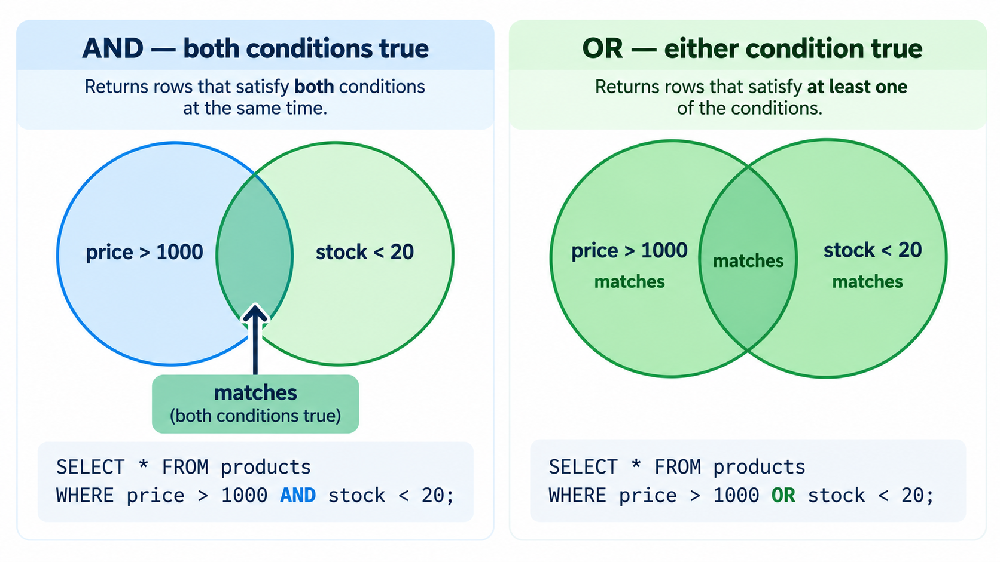

# Retrieving and Filtering Products

## Lesson purpose

In the previous lesson, you learned how to define a table and insert a new eComMART product. Now we will practise asking questions about the data already stored in the database.

A product catalog is useful only when the application can find the records it needs. A warehouse employee might need to see products with low stock, while a sales employee might need to find products in a particular category or below a particular price.

SQL lets us describe these requests directly. In this lesson, you will learn how to select columns, filter rows with `WHERE`, combine conditions, sort results, and verify that a query answers the intended question.

## Learning objectives

By the end of this lesson, you will be able to:

- Explain the purpose of `SELECT`, `FROM`, `WHERE`, `ORDER BY`, and `LIMIT`.
- Retrieve all columns or only selected columns.
- Filter products using comparison operators.
- Combine conditions with `AND` and `OR`.
- Search text using `LIKE`.
- Sort and limit query results.
- Run retrieval queries through Python and inspect the returned records.
- Predict and verify the result of a query.

## 1. Prepare your database

Before beginning, run the setup script from the Week 5 folder:

```bash
python Examples/setup_database.py
```

If your environment uses `python3`, run:

```bash
python3 Examples/setup_database.py
```

The setup script creates `Examples/ecommart.db` and seeds the three sample products if their IDs are not already present. If you completed the previous lesson's insert exercise, your database may also contain the additional product you inserted. That is fine: the queries in this lesson will work with whatever products are present.

Keep using the same database file. If a query unexpectedly returns no records, first verify that the Python example is opening `Examples/ecommart.db` rather than creating or opening another database.

## 2. Ask a question before writing SQL

Before writing a query, describe the information you want in plain language.

For example:

> Show me the names and stock quantities of all products.

That request contains two decisions:

1. Which columns do we want to see? `name` and `stock`.
2. Which table contains those columns? `products`.

The corresponding SQL is:

```sql
SELECT name, stock
FROM products;
```

SQL statements become easier to write when you first identify the requested output and the table that contains it.

## 3. Select all columns or selected columns

### Return all columns

To retrieve every column in the `products` table, use `*`:

```sql
SELECT *
FROM products;
```

The asterisk means “all columns.” It is convenient while exploring a table, but application code often benefits from naming the columns it needs. Explicit column lists make the expected result easier to understand and less dependent on later changes to the table.

### Return selected columns

Suppose the sales team needs only the product name and price:

```sql
SELECT name, price
FROM products;
```

The result includes only those two columns. The query does not delete or change the other data; it only controls which columns appear in the returned result.

### Give the columns a more readable heading

SQL can use an alias to label a result column:

```sql
SELECT name AS product_name, stock AS units_available
FROM products;
```

`AS` provides a temporary name for the output column. It does not rename the actual column in the database.

## 4. Filter rows with `WHERE`

Selecting columns controls **what information is returned**. Filtering controls **which records are returned**.

Imagine the warehouse team wants to find products with fewer than ten units available.

```sql
SELECT product_id, name, stock
FROM products
WHERE stock < 10;
```

The `WHERE` clause checks the condition for each row. Only rows satisfying `stock < 10` appear in the result.

With the original sample catalog, the USB-C Docking Station has stock `8`, so it matches the condition.

### Common comparison operators

| Operator | Meaning | Example |
|---|---|---|
| `=` | Equal to | `category = 'Scanners'` |
| `!=` | Not equal to | `category != 'Scanners'` |
| `<>` | Not equal to (also supported in SQLite) | `category <> 'Scanners'` |
| `>` | Greater than | `price > 3000` |
| `<` | Less than | `stock < 10` |
| `>=` | Greater than or equal to | `stock >= 20` |
| `<=` | Less than or equal to | `price <= 1000` |

Text comparisons use quoted strings. Numeric comparisons use numeric values.

For example:

```sql
SELECT name, price
FROM products
WHERE category = 'Scanners';
```

This returns products whose category is `Scanners`.

### Equality versus assignment

In a SQL condition, `=` tests whether a value is equal to another value. It does not assign a new value.

For example:

```sql
WHERE stock = 8
```

means “return rows whose stock is 8.”

Later, when we study `UPDATE`, you will see an assignment such as `SET stock = 3`. The roles are different: `WHERE` identifies rows, while `SET` specifies the new value.

## 5. Combine conditions with `AND` and `OR`

### Use `AND` when both conditions must be true

Suppose the sales team wants products priced above ₹1,000 that also have fewer than 20 units in stock.

```sql
SELECT name, price, stock
FROM products
WHERE price > 1000 AND stock < 20;
```

A row appears only if both conditions are true.

With the original sample catalog, the USB-C Docking Station costs ₹6,799 and has stock 8, so it matches both conditions.

### Use `OR` when either condition can be true

Suppose the warehouse team wants to review products with very low stock or products with a price above ₹6,000.

```sql
SELECT name, price, stock
FROM products
WHERE stock < 10 OR price > 6000;
```

A product appears if at least one condition is true. A product that meets both conditions still appears once in the result.

### Parentheses make combined logic clearer

When combining `AND` and `OR`, use parentheses to make your intention explicit.

For example:

```sql
SELECT name, category, stock
FROM products
WHERE category = 'Accessories'
  AND (stock < 10 OR stock = 20);
```

This asks for products in the Accessories category whose stock is either below 10 or exactly 20.



*With AND, only rows satisfying every condition appear. With OR, a row appears if it satisfies at least one condition.*
Without parentheses, the order in which conditions are evaluated can produce a different result than a beginner expects. Use parentheses whenever they make the intended grouping clearer.

## 6. Search text with `LIKE`

Sometimes you do not know the complete product name. You may only know that it contains a word or begins with certain letters.

SQL's `LIKE` operator supports simple pattern matching.

### Find names containing `USB`

```sql
SELECT product_id, name
FROM products
WHERE name LIKE '%USB%';
```

The percent sign `%` represents zero or more characters.

- `'%USB%'` matches text with `USB` anywhere in the name.
- `'USB%'` matches text beginning with `USB`.
- `'%Cable'` matches text ending with `Cable`.

### Match exactly one character with `_`

`LIKE` has a second wildcard: the underscore `_`, which stands for exactly one character, no more and no fewer. This is different from `%`, which stands for zero or more characters.

The eComMART catalog already has a product this applies to: `USB-C Docking Station`. The single character between `USB` and `C` is the hyphen `-`.

```sql
SELECT product_id, name
FROM products
WHERE name LIKE 'USB_C%';
```

```text
103  USB-C Docking Station
```

The `_` matched the `-` because it stands for exactly one character. Compare this with using two underscores:

```sql
SELECT product_id, name
FROM products
WHERE name LIKE 'USB__C%';
```

This returns no rows, because `USB__C%` requires exactly two characters between `USB` and `C`, and `USB-C Docking Station` only has one. This is the key difference to remember:

| Wildcard | Matches | Example |
|---|---|---|
| `%` | Zero or more characters | `'USB%'` matches `USB`, `USB-C`, `USB Hub`, and so on |
| `_` | Exactly one character | `'USB_C%'` matches `USB-C`, `USBxC`, but not `USBC` or `USB--C` |

You will use `%` far more often than `_` in everyday queries, but recognizing `_` matters: it is easy to misread as a typo or an unrelated underscore the first time you see it in someone else's SQL.

SQLite's default `LIKE` behavior is case-insensitive for ordinary ASCII letters. Case behavior can differ with non-ASCII characters and database settings, so avoid assuming identical behavior across every database system.

## 7. Sort results with `ORDER BY`

A query does not guarantee that rows will be returned in a meaningful order unless you specify one.

To list the cheapest products first:

```sql
SELECT name, price
FROM products
ORDER BY price ASC;
```

`ASC` means ascending order. For numbers, that means lowest to highest.

To list the most expensive products first:

```sql
SELECT name, price
FROM products
ORDER BY price DESC;
```

`DESC` means descending order.

You can sort using more than one column:

```sql
SELECT name, category, stock
FROM products
ORDER BY category ASC, stock ASC;
```

SQLite sorts by category first. When two products have the same category, it sorts those products by stock.

## 8. Put the clauses together

A SQL query can combine column selection, filtering, sorting, and limiting:

```sql
SELECT product_id, name, price, stock
FROM products
WHERE stock < 30
ORDER BY stock ASC, price DESC
LIMIT 5;
```

Read it in this order:

1. Return `product_id`, `name`, `price`, and `stock`.
2. Read from `products`.
3. Keep only rows whose stock is below 30.
4. Sort by stock from lowest to highest.
5. When stock is equal, sort by price from highest to lowest.
6. Return at most five rows.

`LIMIT` restricts how many rows the query returns — here, at most five, even if more rows match the `WHERE` condition. It is useful when a table contains many records and an application needs only a small number of results. `LIMIT` is applied last, after filtering and sorting, so it always keeps the top rows of the already-sorted result rather than an arbitrary selection.

This is a useful way to answer a real catalog question: “Show me up to five products with the lowest stock, breaking stock ties by showing more expensive products first.”

If two products have the same price at the boundary, the ordering between them may not be predictable unless you add another sort column, such as `product_id`.

## 9. Run a query from Python

SQL can be executed directly in a database tool, but in our project Python will run the queries for the application.

Create `Examples/query_products.py`:

```python
from pathlib import Path
import sqlite3

SCRIPT_DIR = Path(__file__).resolve().parent
DATABASE_PATH = SCRIPT_DIR / "ecommart.db"


def main():
    query = """
        SELECT product_id, name, category, price, stock
        FROM products
        WHERE stock < ?
        ORDER BY stock ASC, product_id ASC
    """
    stock_threshold = 10

    with sqlite3.connect(DATABASE_PATH) as connection:
        rows = connection.execute(query, (stock_threshold,)).fetchall()

    if not rows:
        print("No products matched the stock threshold.")
        return

    print("Products with low stock:")
    for product_id, name, category, price, stock in rows:
        print(
            f"{product_id}: {name} | {category} | "
            f"Price: ₹{price:.2f} | Stock: {stock}"
        )


if __name__ == "__main__":
    main()
```

Run it from the main Week 5 folder:

```bash
python Examples/query_products.py
```

Or, if needed:

```bash
python3 Examples/query_products.py
```

### Understand the Python code

**The query string**

The SQL is stored in a Python triple-quoted string so it can be written over multiple lines. The SQL remains a SQL statement; Python is simply holding the text that it will send to SQLite.

**The placeholder**

```sql
WHERE stock < ?
```

The question mark is a placeholder. The value `stock_threshold` is passed separately:

```python
connection.execute(query, (stock_threshold,))
```

Notice the comma in `(stock_threshold,)`. In Python, that comma makes this a one-item tuple. The query receives the numeric value `10`, not the text `"10"` inserted into the SQL statement.

**Fetching results**

`fetchall()` retrieves all rows returned by the query. In this example, each row is represented as a tuple. The `for` loop unpacks the tuple into five variables, one for each selected column.

**Formatting the output**

`{price:.2f}` displays the price with two digits after the decimal point. It changes the display format, not the stored database value.

**Why use a context manager here?**

The `with sqlite3.connect(...) as connection` form commits or rolls back a transaction depending on whether the block succeeds. A read-only query does not normally need to commit changes, because it does not modify data. The connection context manager does not itself close the connection when the block ends; in these short scripts, the connection is released when its reference is discarded. We will study explicit connection lifecycle management in the Python integration section.

### Expected output

With the original three sample products, the output should include the USB-C Docking Station because its stock is 8:

```text
Products with low stock:
103: USB-C Docking Station | Accessories | Price: ₹6799.00 | Stock: 8
```

If you previously inserted additional products, the output may contain more rows. That is expected if those products also have fewer than ten units in stock.

## 10. Understand `NULL`

Before moving on to common mistakes, it is worth understanding a value you have not met yet: `NULL`.

### What is `NULL`?

`NULL` represents a missing or unknown value. It is not the same as:

- The number `0`.
- An empty string `''`.
- The text `"unknown"` or `"none"`.

`NULL` means the database has no value stored for that field at all.

### Why the eComMART `products` table does not have any

The eComMART `products` table defines every column as `NOT NULL`, and `price` and `stock` also use `CHECK` constraints. This means SQLite will refuse to store a row where `name`, `category`, `price`, or `stock` is missing:

```python
>>> connection.execute(
...     "INSERT INTO products (product_id, name, category, price, stock) "
...     "VALUES (999, 'Test', 'Test', NULL, 5)"
... )
sqlite3.IntegrityError: NOT NULL constraint failed: products.price
```

So you will not encounter a `NULL` value in your own `ecommart.db` while working through this course. That is a deliberate design choice for this table, not a general rule about databases. Many real tables do allow `NULL` for columns where a value is genuinely optional — for example, a `discontinued_date` column that is empty until a product is actually discontinued.

Because `NULL` is common in real-world tables, it is important to understand how it behaves in a `WHERE` clause, even though this particular table will not produce one for you.

### The trap: `=` does not work with `NULL`

This is one of the most common mistakes beginners make in SQL. Suppose a hypothetical table did allow a `NULL` price, and you wrote:

```sql
-- Does NOT find rows where price is NULL, even if some exist:
SELECT *
FROM products
WHERE price = NULL;
```

This query will **never return any rows**, even if the table contains rows where `price` is `NULL`. In SQL, `NULL` represents an unknown value, so asking "is this unknown value equal to `NULL`?" is itself treated as unknown — not true, and not false. A `WHERE` clause only keeps rows where the condition evaluates to true, so a comparison against `NULL` using `=` never matches.

### The correct way: `IS NULL` and `IS NOT NULL`

Use `IS NULL` and `IS NOT NULL` instead of `=` and `!=` when checking for a missing value:

```sql
-- Correct: find rows with no price recorded.
SELECT *
FROM products
WHERE price IS NULL;
```

```sql
-- Correct: find rows that do have a price recorded.
SELECT *
FROM products
WHERE price IS NOT NULL;
```

### Remember

- `NULL` means "missing or unknown," not zero and not an empty string.
- `WHERE column = NULL` never matches anything — this is a common and easy mistake to make.
- Use `WHERE column IS NULL` or `WHERE column IS NOT NULL` to check for a missing value.
- The eComMART `products` table cannot currently contain `NULL` values, because every column is `NOT NULL`. You are learning this concept so you recognize it in other tables you will work with in the future.

## 11. Common mistakes

### Mistake: forgetting `FROM`

Incorrect:

```sql
SELECT name, price;
```

The statement names the columns but does not identify the table to read from.

Correct:

```sql
SELECT name, price
FROM products;
```

### Mistake: using double quotes for ordinary text values

For SQL string values, use single quotes:

```sql
WHERE category = 'Scanners'
```

Double quotes in SQL are generally used for identifiers, such as column or table names, rather than ordinary string literals. Follow the single-quote convention for text values in this course.

### Mistake: using `AND` when you mean `OR`

`AND` requires every condition to be true. `OR` requires at least one condition to be true. Translate the request into plain language before choosing one.

### Mistake: expecting a stable order without `ORDER BY`

The order in which records happen to appear is not a reliable substitute for an explicit sort. Add `ORDER BY` when the order matters.

### Mistake: putting a value directly into SQL text

Avoid constructing SQL like this:

```python
# Avoid this pattern:
query = f"SELECT * FROM products WHERE stock < {stock_threshold}"
```

Use a placeholder instead:

```python
query = "SELECT * FROM products WHERE stock < ?"
rows = connection.execute(query, (stock_threshold,)).fetchall()
```

Parameterized queries separate SQL structure from supplied values and are safer when values come from users.

## 12. Guided practice

Use the existing eComMART database. Before each query, say what result you expect.

### Task A — Select only the names and categories

Write a query that returns `name` and `category` for every product.

**Suggested answer**

```sql
SELECT name, category
FROM products;
```

### Task B — Find products priced below ₹1,000

Return the product ID, name, and price for products whose price is less than `1000`.

**Suggested answer**

```sql
SELECT product_id, name, price
FROM products
WHERE price < 1000;
```

With the original sample catalog, the Thermal Label Roll matches.

### Task C — Find products in Accessories with stock below 20

**Suggested answer**

```sql
SELECT product_id, name, stock
FROM products
WHERE category = 'Accessories' AND stock < 20;
```

With the original sample catalog, the USB-C Docking Station matches.

### Task D — List the three most expensive products

**Suggested answer**

```sql
SELECT product_id, name, price
FROM products
ORDER BY price DESC
LIMIT 3;
```

### Task E — Find products whose names contain `Label`

**Suggested answer**

```sql
SELECT product_id, name
FROM products
WHERE name LIKE '%Label%';
```

### Task F — Try a combined condition

Find products that cost at least ₹1,000 and have stock greater than zero. Sort them from lowest price to highest price.

**Suggested answer**

```sql
SELECT product_id, name, price, stock
FROM products
WHERE price >= 1000 AND stock > 0
ORDER BY price ASC;
```

## 13. Check your understanding

1. What is the difference between selecting columns and filtering rows?
2. What does `WHERE stock < 10` mean?
3. When should you use `AND` rather than `OR`?
4. What does `%` mean in a `LIKE` pattern?
5. What is the difference between `%` and `_` in a `LIKE` pattern?
6. Why is `ORDER BY` important when the order of results matters?
7. What does `LIMIT 3` do?
8. Why does the Python example pass `(stock_threshold,)` separately from the query string?
9. Does a `SELECT` query change the product records?
10. Why does `WHERE price = NULL` never return any rows, even in a table that has `NULL` prices?

### Suggested answers

1. Selecting columns determines which fields are returned; filtering rows determines which records meet a condition.
2. It returns only products whose stock quantity is below ten.
3. Use `AND` when all conditions must be true.
4. It matches zero or more characters.
5. `%` matches zero or more characters, so it can match any length of text, including none. `_` matches exactly one character, no more and no fewer.
6. Without `ORDER BY`, the database does not guarantee a useful row order.
7. It returns at most three rows.
8. It supplies the value as a parameter instead of building SQL by concatenating text.
9. No. `SELECT` retrieves data; it does not update the stored records.
10. `NULL` represents an unknown value, so comparing anything to `NULL` with `=` is itself unknown rather than true. Use `IS NULL` or `IS NOT NULL` instead.

## 14. Recap and transition

You can now write queries that answer practical eComMART catalog questions.

Remember:

- `SELECT` chooses which columns to return.
- `FROM` identifies the table.
- `WHERE` filters records.
- `AND` and `OR` combine conditions.
- `LIKE` performs simple text-pattern matching, using `%` for zero or more characters and `_` for exactly one character.
- `ORDER BY` sorts results.
- `LIMIT` restricts how many rows are returned.
- `NULL` means a missing or unknown value; use `IS NULL` / `IS NOT NULL` to check for it, never `=` or `!=`.
- Python's `sqlite3` module can execute parameterized queries and fetch the results for the application.

**Next lesson:** `04_Updating_and_Deleting_Products.md`

Next, you will learn how to change existing records with `UPDATE` and remove records with `DELETE`. We will pay special attention to the `WHERE` clause, because forgetting it can change or delete more records than intended.
