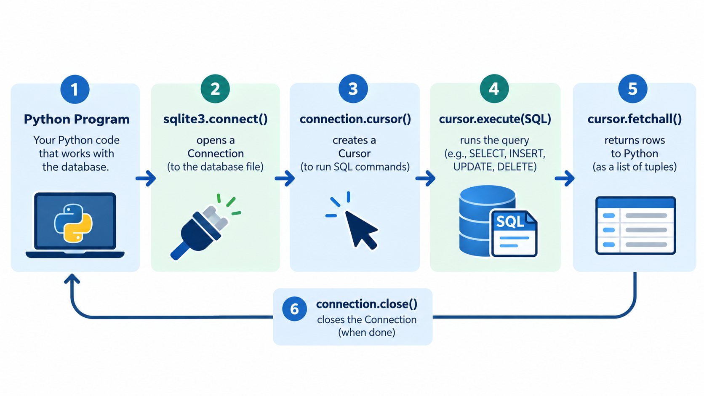

# Connecting Python to SQLite

## Learning objectives

By the end of this lesson, you will be able to:

- Explain how Python can work with a database.
- Import Python's built-in `sqlite3` module.
- Open a connection to the eComMART SQLite database.
- Understand the roles of a connection and a cursor.
- Run a simple query and inspect its result.
- Close database connections reliably.

## 1. From SQL to a Python application

In the previous lessons, you wrote SQL statements to create a table, insert products, retrieve records, update values, and delete rows. SQL describes the database operation. A Python application can send those SQL statements to SQLite and use the results in its own logic.

For eComMART, imagine a small catalog program that needs to show available products. Instead of opening a database tool and typing a query manually, the Python program can:

1. Open the eComMART database file.
2. Send a SQL query to SQLite.
3. Receive the matching rows.
4. Display the product information to the user.
5. Close the database connection when it is finished.

Python includes the `sqlite3` module in its standard library. You do not need to install a separate database server or a third-party package for this lesson.

## 2. Confirm the project files

The earlier setup lesson created the database file `ecommart.db` inside the `Examples` folder. Your course folder should look similar to this:

```text
Week 5/
├── Examples/
│   ├── setup_database.py
│   └── ecommart.db
└── 03_Python_and_SQLite/
    └── 01_Connecting_Python_to_SQLite.md
```

The database file may not appear until you run `setup_database.py`. If it is missing, open a terminal in the `Week 5` folder and run:

```bash
python "Examples/setup_database.py"
```

If your computer uses `python3`, run:

```bash
python3 "Examples/setup_database.py"
```

Use the Python command that works in your environment. If the setup script reports an error, resolve it before continuing.

## 3. Connect to the database

Create a new file named `database_basics.py` inside `Examples`.

```python
from pathlib import Path
import sqlite3

DATABASE_PATH = Path(__file__).resolve().parent / "ecommart.db"

connection = sqlite3.connect(DATABASE_PATH)
print("Connected to the eComMART database.")

connection.close()
print("Connection closed.")
```

Run the script:

```bash
python "Examples/database_basics.py"
```

Expected output:

```text
Connected to the eComMART database.
Connection closed.
```

### Understand each line

**`import sqlite3`**

Loads Python's built-in module for working with SQLite databases.

**`Path(__file__).resolve().parent`**

Finds the folder containing the Python script. Since this script lives in `Examples`, the database path points to `Examples/ecommart.db`. This is more reliable than assuming the terminal is always opened in one particular folder.

**`sqlite3.connect(DATABASE_PATH)`**

Opens a connection to the database file. If the file does not exist, SQLite normally creates a new empty database at that path. That is convenient, but it can also create an accidental empty database if your path is wrong. For that reason, run the setup script first and check that the intended database file exists.

**`connection.close()`**

Closes the connection when you have finished using it. Closing connections is an important habit because it releases database resources.

## 4. What are a connection and a cursor?

Two objects are especially useful when Python works with a database.

| Object | What it does |
|---|---|
| **Connection** | Represents Python's open interaction with the database. It is used to send SQL statements and manage transactions. |
| **Cursor** | Executes SQL statements and lets your program retrieve rows returned by a query. |

You can think of the connection as the open communication channel and the cursor as the tool used to execute a particular SQL operation and read its results.



*Every database operation in this course follows this same sequence: connect, create a cursor, execute SQL, fetch the results, then close the connection.*

## 5. Execute a query and read results

Create or replace `Examples/database_basics.py` with the following complete example:

```python
from pathlib import Path
import sqlite3

DATABASE_PATH = Path(__file__).resolve().parent / "ecommart.db"


def main() -> None:
    connection = sqlite3.connect(DATABASE_PATH)

    try:
        cursor = connection.cursor()

        cursor.execute(
            """
            SELECT product_id, name, category, price, stock
            FROM products
            ORDER BY product_id
            """
        )

        products = cursor.fetchall()

        print("eComMART Product Catalog")
        print("-" * 72)

        for product in products:
            product_id, name, category, price, stock = product
            print(
                f"ID: {product_id} | "
                f"Name: {name} | "
                f"Category: {category} | "
                f"Price: ₹{price:.2f} | "
                f"Stock: {stock}"
            )

    finally:
        connection.close()


if __name__ == "__main__":
    main()
```

Run it:

```bash
python "Examples/database_basics.py"
```

If you have not changed the starter data, the output should contain three products:

```text
eComMART Product Catalog
------------------------------------------------------------------------
ID: 101 | Name: Wireless Barcode Scanner | Category: Scanners | Price: ₹3499.00 | Stock: 24
ID: 102 | Name: Thermal Label Roll | Category: Shipping Supplies | Price: ₹450.00 | Stock: 120
ID: 103 | Name: USB-C Docking Station | Category: Accessories | Price: ₹6799.00 | Stock: 8
```

The spacing and line length may vary slightly if you change the print statements. If you changed or removed sample data in an earlier activity, your output will reflect your current database.

### Walk through the code

1. **Open the connection.** `sqlite3.connect(DATABASE_PATH)` opens the database file.
2. **Create a cursor.** `connection.cursor()` returns a cursor that can execute SQL statements.
3. **Execute SQL.** `cursor.execute(...)` sends the `SELECT` query to SQLite.
4. **Fetch the results.** `cursor.fetchall()` returns all rows from this query as a list of tuples.
5. **Loop over the rows.** Each tuple contains values in the same order as the columns listed in `SELECT`.
6. **Display the data.** An f-string formats the values for a readable catalog.
7. **Close the connection.** The `finally` block ensures the connection is closed even if an error occurs after the connection has opened.

## 6. Understand `fetchall()`, `fetchone()`, and `fetchmany()`

A query may return one row or many rows. SQLite's cursor provides methods to retrieve results.

| Method | What it does | Suitable example |
|---|---|---|
| `fetchone()` | Retrieves the next row, or `None` if no row remains | Find a product by its unique ID |
| `fetchmany(size)` | Retrieves up to `size` next rows | Process a small batch of products |
| `fetchall()` | Retrieves all remaining rows | Display a small catalog |

### Example: retrieve one product

Add this separate example to `database_basics.py` or try it in a new short script:

```python
from pathlib import Path
import sqlite3

DATABASE_PATH = Path(__file__).resolve().parent / "ecommart.db"

with sqlite3.connect(DATABASE_PATH) as connection:
    cursor = connection.execute(
        """
        SELECT product_id, name, price, stock
        FROM products
        WHERE product_id = ?
        """,
        (101,),
    )
    product = cursor.fetchone()

    if product is None:
        print("No product found with ID 101.")
    else:
        product_id, name, price, stock = product
        print(f"{product_id}: {name} | ₹{price:.2f} | Stock: {stock}")
```

Expected output if product 101 exists:

```text
101: Wireless Barcode Scanner | ₹3499.00 | Stock: 24
```

Notice the comma in `(101,)`. This is a one-item tuple in Python. The comma is necessary; `(101)` on its own is simply the integer `101`.

The example also uses `?` as a parameter placeholder. The value `101` is passed separately as `(101,)` instead of being inserted into the SQL string. You will practise parameterized queries in more detail in `03_Parameterized_Queries_and_Transactions.md`.

## 7. A note about connection management

You may see examples that use:

```python
with sqlite3.connect(DATABASE_PATH) as connection:
    # Execute database operations here.
    ...
```

For SQLite, the connection context manager commits a transaction if the block finishes normally and rolls back if an exception escapes the block. **It does not automatically close the connection.** If your code opens a connection this way, close it explicitly when it is no longer needed, or use a small helper/context pattern that guarantees closure.

For a simple beginner script, the `try`/`finally` pattern shown in Section 5 makes the close operation easy to see:

```python
connection = sqlite3.connect(DATABASE_PATH)

try:
    # Execute database operations here.
    pass
finally:
    connection.close()
```

The `pass` keyword is a placeholder that does nothing. Replace it with the database work you need to perform. Do not leave a placeholder in a finished application.

For scripts that modify records, remember that closing a connection is not the same as deciding how to handle a transaction. Successful changes need to be committed; failed operations should be handled safely. The transaction lesson covers this in more detail.

## 8. Common errors and fixes

| Problem | Likely cause | What to check |
|---|---|---|
| `ModuleNotFoundError` for `sqlite3` | Unusual or incomplete Python installation | Check your Python installation; `sqlite3` normally comes with Python |
| `no such table: products` | The file opened is empty or the setup script did not create the table | Run `Examples/setup_database.py` and verify `DATABASE_PATH` |
| The query returns no rows | The table is empty or the condition does not match existing data | Check the database file and run a simple `SELECT` |
| A second `ecommart.db` appears elsewhere | The script used a different relative path | Build the path from `Path(__file__).resolve().parent` |
| `unable to open database file` | The folder or file path is invalid or inaccessible | Confirm the `Examples` folder exists and that you can access it |
| The script crashes before closing the connection | An exception interrupted the code | Put the database work inside `try` and close in `finally` |

## 9. Guided practice

Complete these tasks using the eComMART database.

### Task A — Display only product names

Write a query that selects `name` from `products`, ordered by `product_id`. Print each name on its own line.

### Task B — Find one product

Use `fetchone()` to retrieve product ID `102`, selecting its `product_id`, `name`, and `stock`. If no row is returned, print a helpful message.

### Task C — Count the rows returned

Use a `SELECT product_id FROM products` query and `fetchall()`. Print the number of returned rows with `len(...)`.

### Suggested answers

**Task A**

```python
cursor.execute(
    "SELECT name FROM products ORDER BY product_id"
)

for row in cursor.fetchall():
    print(row[0])
```

Each row is a tuple. Since the query selects one column, `row[0]` is the product name.

**Task B**

```python
cursor.execute(
    """
    SELECT product_id, name, stock
    FROM products
    WHERE product_id = ?
    """,
    (102,),
)

product = cursor.fetchone()

if product is None:
    print("Product not found.")
else:
    print(product)
```

**Task C**

```python
cursor.execute("SELECT product_id FROM products")
products = cursor.fetchall()
print(f"Products found: {len(products)}")
```

For the original three-row starter database, Task C prints `Products found: 3`. Your count may differ if you have added or removed records.

## 10. Knowledge check

1. Which module provides Python's built-in SQLite support?
2. What does `sqlite3.connect(...)` return?
3. What is the difference between a connection and a cursor?
4. What type of structure does `fetchall()` return?
5. Why should a database connection be closed?
6. Does `with sqlite3.connect(...) as connection:` automatically close the connection?

### Answers

1. `sqlite3`.
2. A connection object.
3. The connection manages interaction with the database; a cursor executes SQL statements and retrieves query results.
4. A list containing the returned rows, typically represented as tuples.
5. To release resources and avoid leaving database connections open longer than needed.
6. No. The connection context manager manages transaction commit/rollback, but does not automatically close the connection.

## 11. Lesson recap

- Python can use the built-in `sqlite3` module to work with SQLite.
- `sqlite3.connect(...)` opens a connection to a database file.
- A cursor executes SQL statements and provides access to query results.
- Use `fetchone()`, `fetchmany()`, or `fetchall()` depending on how many rows you need.
- Build the database path deliberately so that your script opens the intended file.
- Close connections reliably and handle transactions intentionally.

## What comes next?

In `02_Executing_Queries_and_Reading_Results.md`, you will practise sending different SQL queries from Python, reading returned values, and using those values in program logic.
