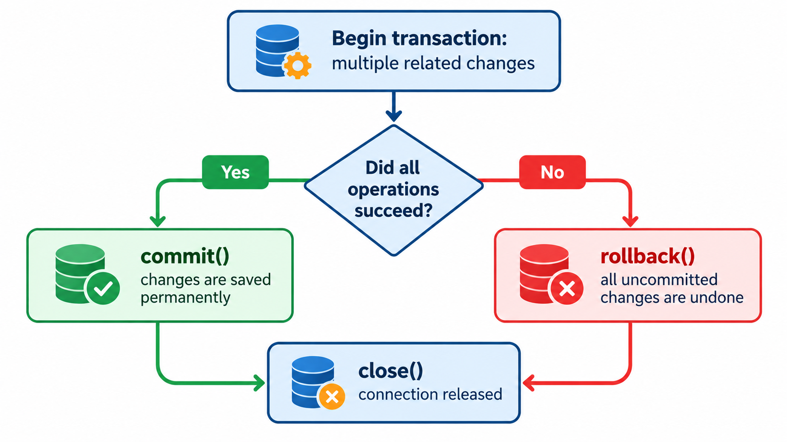

# Parameterized Queries and Transactions

## Learning objectives

By the end of this lesson, you will be able to:

- Explain why Python applications should use parameterized SQL queries.
- Use `?` placeholders with `sqlite3`.
- Recognize the risk of building SQL by joining strings.
- Explain what a transaction is and why it matters.
- Use `commit()` and `rollback()` deliberately.
- Group related database changes so they succeed or fail together.

## 1. Why this matters for eComMART

The eComMART catalog application will eventually accept values such as product names, categories, prices, and stock quantities. Some values may come from a user typing into a form or a program reading an input file.

A database must distinguish between:

- **SQL instructions**, such as `SELECT`, `UPDATE`, and `DELETE`.
- **Values**, such as a product name or a category entered by a user.

If a program mixes user-provided text directly into a SQL statement, the database may interpret parts of that text as SQL instructions. Parameterized queries avoid this by sending the SQL statement and its values separately.

Transactions solve a different problem: they help keep the database consistent when several related changes must be treated as one unit of work.

## 2. Use parameterized queries

### 2.1 The placeholder pattern

With Python's `sqlite3` module, use `?` placeholders for values:

```python
cursor = connection.execute(
    """
    SELECT product_id, name, price
    FROM products
    WHERE category = ?
    """,
    ("Accessories",),
)
```

The SQL statement contains a placeholder. The second argument supplies its value.

Read the code in two parts:

1. The SQL says what operation to perform and where the value belongs.
2. The tuple `("Accessories",)` supplies the value for the placeholder.

Because the tuple contains only one item, it needs a trailing comma. Without the comma, `("Accessories")` is just a string inside parentheses, not a one-item tuple.

### 2.2 More than one parameter

You can use multiple placeholders. Supply values in the same order as the placeholders appear:

```python
cursor = connection.execute(
    """
    SELECT product_id, name, price, stock
    FROM products
    WHERE category = ?
      AND price < ?
    ORDER BY price
    """,
    ("Accessories", 7000),
)
```

The first `?` receives `"Accessories"`. The second receives `7000`.

With the original sample data, the USB-C Docking Station matches because its category is `Accessories` and its price is `6799.00`.

### 2.3 Parameterize an update

Use parameters when changing a record as well:

```python
cursor = connection.execute(
    """
    UPDATE products
    SET stock = ?
    WHERE product_id = ?
    """,
    (5, 103),
)

print(f"Rows affected: {cursor.rowcount}")
```

The first value, `5`, becomes the new stock. The second value, `103`, identifies the product to update.

This statement changes the database. If you are practising, you may use a disposable practice product instead of changing the starter data. After an update, run a `SELECT` query to verify the new value.

### 2.4 Parameterize a delete

```python
cursor = connection.execute(
    "DELETE FROM products WHERE product_id = ?",
    (161,),
)

print(f"Rows affected: {cursor.rowcount}")
```

This deletes only the row with ID `161`, if one exists. Use a disposable practice record for deletion exercises. Do not use an ID unless you have confirmed which record it identifies.

### 2.5 What should be parameterized?

Use placeholders for **values**, including strings, numbers, and values used in conditions. Do not place quotation marks around the placeholder:

```python
# Correct
connection.execute(
    "SELECT * FROM products WHERE name = ?",
    ("Thermal Label Roll",),
)
```

Avoid this form:

```python
# Incorrect: the placeholder is inside SQL quotes,
# so it is treated as literal text rather than a value parameter.
connection.execute(
    "SELECT * FROM products WHERE name = '?'",
    ("Thermal Label Roll",),
)
```

Placeholders also cannot directly replace SQL identifiers such as table names or column names. For this course, keep table and column names fixed in the SQL statement, and parameterize the data values.

## 3. Why string concatenation is unsafe

Consider a catalog search that accepts a product name.

A beginner might be tempted to construct the SQL statement like this:

```python
product_name = input("Enter a product name: ")

sql = (
    "SELECT product_id, name, price "
    "FROM products WHERE name = '" + product_name + "'"
)

cursor = connection.execute(sql)
```

This is unsafe and fragile. If the input contains an apostrophe, the SQL may break. More importantly, specially crafted input may change the meaning of the SQL statement.

For example, input containing SQL syntax can sometimes turn a search condition into a condition that matches more records than intended. This is a form of **SQL injection**: untrusted input changes the structure or meaning of a SQL command.

Use a parameterized query instead:

```python
product_name = input("Enter a product name: ")

cursor = connection.execute(
    """
    SELECT product_id, name, price
    FROM products
    WHERE name = ?
    """,
    (product_name,),
)

for product in cursor:
    print(product)
```

Now the input is treated as a value to compare with `name`, not as part of the SQL statement itself.

**Rule of thumb:** do not build SQL by joining user input into a SQL string. Use placeholders and pass the values separately.

## 4. What is a transaction?

A transaction is a group of database operations treated as one unit. It is useful when one business action requires multiple changes.

Imagine eComMART receives a stock adjustment that affects two product records. If the first update succeeds but the second fails, the database could be left with only half of the intended adjustment.

A transaction allows the application to choose one of two outcomes:

- **Commit:** keep the changes.
- **Rollback:** undo the uncommitted changes made in the transaction.

This supports the idea of **all or nothing** for a group of related changes.

A transaction does not automatically determine whether the business values are correct. Your application still needs to validate the inputs and choose when to commit or roll back.



*A transaction treats a group of changes as all-or-nothing: either every operation succeeds and is committed, or any failure triggers a rollback that undoes the uncommitted work.*

## 5. Understand `commit()` and `rollback()`

### `commit()`

Use `connection.commit()` to make the current transaction's changes permanent.

### `rollback()`

Use `connection.rollback()` to undo the current transaction's uncommitted changes.

The following simplified example shows the pattern:

```python
connection = sqlite3.connect(DATABASE_PATH)

try:
    connection.execute(
        "UPDATE products SET stock = ? WHERE product_id = ?",
        (5, 103),
    )

    connection.commit()
    print("Stock update saved.")

except sqlite3.Error as error:
    connection.rollback()
    print(f"Database operation failed: {error}")

finally:
    connection.close()
```

If the update succeeds, the program commits the change. If a SQLite error is raised, it rolls back the transaction. The `finally` block closes the connection either way.

This example updates product 103's stock to `5`, so do not run it against your starter database unless you intend to make that change. Use the disposable practice record if you want to experiment without changing the sample products.

## 6. Guided example: two stock changes as one unit

For a safe practice activity, first create two disposable products with unused IDs. The examples below use `160` and `161`; choose different unused IDs if either already exists.

### Step 1 — Create two practice products

Run this setup once before the transaction example:

```python
from pathlib import Path
import sqlite3

DATABASE_PATH = Path(__file__).resolve().parent / "ecommart.db"

with sqlite3.connect(DATABASE_PATH) as connection:
    connection.execute(
        """
        INSERT INTO products
            (product_id, name, category, price, stock)
        VALUES (?, ?, ?, ?, ?)
        """,
        (160, "Practice USB Cable", "Accessories", 299.00, 20),
    )
    connection.execute(
        """
        INSERT INTO products
            (product_id, name, category, price, stock)
        VALUES (?, ?, ?, ?, ?)
        """,
        (161, "Practice Network Adapter", "Networking", 899.00, 10),
    )
```

If you see a primary-key error, one of those IDs already exists. Do not delete an unknown row to make room. Choose unused IDs and replace them consistently in the setup and transaction scripts.

The `with sqlite3.connect(...) as connection:` block commits successful inserts and rolls them back if an exception escapes the block. As noted in the previous lesson, this connection context manager does not automatically close the connection; in this short setup script, Python releases the connection when it is no longer referenced. The explicit-close pattern in the next example is clearer for teaching connection lifecycle.

### Step 2 — Update both products in one transaction

Save the following as `Examples/transaction_practice.py`:

```python
from pathlib import Path
import sqlite3

DATABASE_PATH = Path(__file__).resolve().parent / "ecommart.db"


def adjust_practice_stock() -> None:
    connection = sqlite3.connect(DATABASE_PATH)

    try:
        # Check that both practice products exist before changing either.
        for product_id in (160, 161):
            cursor = connection.execute(
                "SELECT product_id FROM products WHERE product_id = ?",
                (product_id,),
            )

            if cursor.fetchone() is None:
                raise ValueError(
                    f"Practice product {product_id} is missing. "
                    "Run the practice setup first."
                )

        # These changes belong to the same transaction.
        connection.execute(
            "UPDATE products SET stock = ? WHERE product_id = ?",
            (18, 160),
        )
        connection.execute(
            "UPDATE products SET stock = ? WHERE product_id = ?",
            (8, 161),
        )

        connection.commit()
        print("Both stock adjustments were saved.")

    except (sqlite3.Error, ValueError) as error:
        connection.rollback()
        print(f"Changes were not saved: {error}")

    finally:
        connection.close()


if __name__ == "__main__":
    adjust_practice_stock()
```

Run it from the Week 5 folder:

```bash
python "Examples/transaction_practice.py"
```

Expected success message:

```text
Both stock adjustments were saved.
```

Then verify the changes:

```sql
SELECT product_id, name, stock
FROM products
WHERE product_id IN (160, 161)
ORDER BY product_id;
```

Expected stock values are `18` for product 160 and `8` for product 161.

### Step 3 — Understand the failure path

If one of the practice records is missing, the example raises a `ValueError` before either stock update occurs. The `except` block calls `rollback()` and displays a message. If a SQLite error occurs during the updates, the transaction is rolled back as well.

To practise the rollback path, you can temporarily change one of the IDs in the initial existence check to an unused ID, run the script, and observe the failure message. Restore the correct ID afterwards. Since the validation runs before the updates, neither stock value should change in that test.

This is a simple demonstration of a transaction. Real applications also validate that the requested stock values are sensible and check that each update affected the intended row.

## 7. A reusable function for safe database changes

This example demonstrates a small helper function that performs one parameterized update and handles common SQLite errors:

```python
from pathlib import Path
import sqlite3

DATABASE_PATH = Path(__file__).resolve().parent / "ecommart.db"


def update_stock(product_id: int, new_stock: int) -> bool:
    if new_stock < 0:
        print("Stock cannot be negative.")
        return False

    connection = sqlite3.connect(DATABASE_PATH)

    try:
        cursor = connection.execute(
            """
            UPDATE products
            SET stock = ?
            WHERE product_id = ?
            """,
            (new_stock, product_id),
        )

        if cursor.rowcount != 1:
            connection.rollback()
            print(f"No product found with ID {product_id}.")
            return False

        connection.commit()
        print(f"Stock updated for product {product_id}.")
        return True

    except sqlite3.Error as error:
        connection.rollback()
        print(f"Could not update stock: {error}")
        return False

    finally:
        connection.close()


if __name__ == "__main__":
    # Prefer an existing disposable practice product for testing.
    update_stock(product_id=160, new_stock=15)
```

Notice the validation before opening the connection. The function rejects negative stock values. It then checks `rowcount` before committing, so it does not report success when no product matched the ID.

In SQLite, `rowcount` is useful for checking how many rows a data-changing statement affected. If the same value is assigned to a matching row, SQLite may still report that the row was matched and processed, even though the stored value looks unchanged. Use it as an affected-row check, not as proof that a value visibly changed.

## 8. Common mistakes and fixes

| Mistake | Why it matters | Better approach |
|---|---|---|
| Joining user input into SQL | Can break queries or enable SQL injection | Use `?` placeholders |
| Putting quotes around `?` | The placeholder is treated as text in the SQL | Write `WHERE name = ?` |
| Supplying parameters in the wrong order | Values may be compared with the wrong columns | Match tuple order to placeholder order |
| Forgetting the comma in a one-value tuple | Python may pass a single value instead of a tuple | Use `("Accessories",)` |
| Assuming an update is permanent before committing | The transaction may still be uncommitted | Commit at the correct point |
| Committing after only the first of several related changes | Later failure may leave a partial business operation saved | Commit after all required operations succeed |
| Calling rollback after a change has already been committed | It cannot undo the already committed change | Keep related work in one transaction and commit once |
| Assuming `with sqlite3.connect(...)` closes the connection | The context manager handles transactions, not connection closure | Close the connection explicitly |

## 9. Guided practice

Complete these tasks in your `Examples` folder. Use the database path pattern from earlier lessons.

### Task A — Parameterized category search

Write a query that accepts a category variable and returns `product_id`, `name`, and `price` for products in that category. Try `"Scanners"` and `"Accessories"`.

### Task B — Safe stock update

Write a function that accepts a product ID and a new stock value. It must:

1. Reject negative stock.
2. Use a parameterized `UPDATE`.
3. Check whether one row was affected.
4. Commit only when the target product exists.
5. Roll back on a database error.
6. Close the connection in `finally`.

Use a disposable practice product to test it.

### Task C — Transaction planning

Imagine a supplier shipment requires adding 10 units to product 160 and 5 units to product 161. Explain why both changes should be committed only after both operations succeed.

### Suggested answer for Task A

```python
category_to_find = "Scanners"

cursor = connection.execute(
    """
    SELECT product_id, name, price
    FROM products
    WHERE category = ?
    ORDER BY product_id
    """,
    (category_to_find,),
)

for product in cursor:
    print(product)
```

For Task B, compare your function with the reusable example in Section 7. For Task C, the reason is that the two updates represent one business operation: committing only one could leave the database showing an incomplete shipment adjustment.

## 10. Knowledge check

1. What does the `?` placeholder do in a parameterized query?
2. Why is string concatenation unsafe for user-provided values?
3. What is SQL injection?
4. What does `commit()` do?
5. What does `rollback()` do?
6. Why might two stock updates belong in one transaction?
7. Does `rollback()` undo changes that have already been committed?

### Answers

1. It marks where a value is supplied separately from the SQL statement.
2. Input can break the query or alter its meaning; it can also create SQL injection risks.
3. It is a security problem in which untrusted input changes the structure or meaning of a SQL command.
4. It makes the current transaction's changes permanent.
5. It undoes uncommitted changes in the current transaction.
6. They may be parts of one business action and should succeed or fail together.
7. No. A rollback cannot undo changes that were already committed.

## 11. Lesson recap

- Use parameterized queries for values instead of joining input into SQL strings.
- Use `?` placeholders with `sqlite3` and supply the values separately.
- A transaction groups related operations into a unit of work.
- Commit after the required operations succeed; roll back if they fail.
- Validate values and check affected-row counts before reporting success.
- Close database connections reliably.

## What comes next?

In `01_Designing_the_Database_Backend.md`, you will begin bringing the database concepts together and plan the data layer for the eComMART product catalog application.
