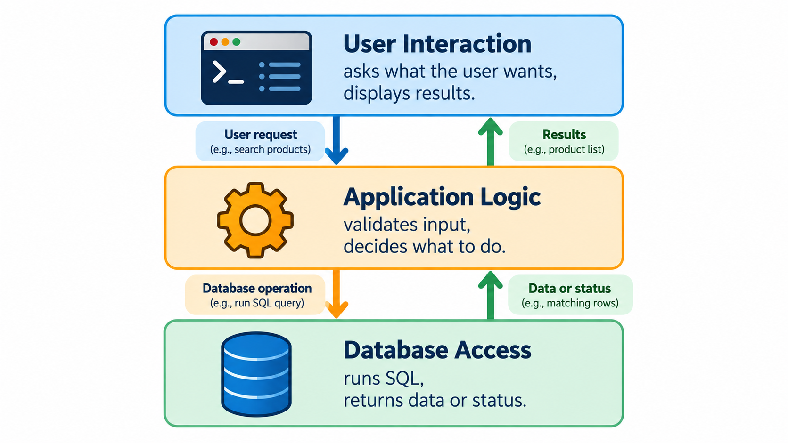

# Designing the Database Backend

## Learning objectives

By the end of this lesson, you will be able to:

- Explain the role of a database backend in a Python application.
- Identify what belongs in the database layer and what belongs in the user-facing part of a program.
- Review the eComMART `products` table and its data fields.
- Plan the basic operations a product catalog needs.
- Organize database access into small, reusable Python functions.
- Describe how the design supports reliable catalog behaviour.

## 1. From individual SQL examples to an application

So far, you have learned how to create a database, write SQL statements, connect Python to SQLite, read query results, and make changes safely. Those skills are useful individually. A real application needs to bring them together in a structure that is understandable and easy to maintain.

Imagine an eComMART employee using a small Python program to manage the product catalog. The employee should be able to:

- View all products.
- Find a product by its ID.
- Add a new product.
- Change a product's details.
- Remove a product that is no longer listed.

The program needs a reliable way to store and retrieve the catalog data. That responsibility belongs to the **database backend**.

In this lesson, *backend* means the part of this small application that handles database access. It does not mean that you need to build a web server or deploy a cloud service.

## 2. What does the database backend do?

A useful way to think about the application is as three responsibilities:

| Responsibility | What it does |
|---|---|
| **1. User interaction** | Asks the user what they want to do and displays messages or product information. |
| **2. Application logic** | Decides what the request means, checks input, and coordinates the required work. |
| **3. Database access** | Opens the database, runs SQL statements, and returns results or reports whether a change succeeded. |



*Keeping these three responsibilities separate — rather than mixing SQL, validation, and print statements together — is what makes the backend easy to test and reuse.*

For a beginner project, these responsibilities do not need to live in separate packages or complex classes. The important idea is to avoid repeating database code everywhere.

For example, if several parts of a program need to find a product by ID, it is better to define one function for that operation than to copy the same connection and SQL code into many places.

## 3. Confirm the data model

The core project uses one table: `products`.

| Column | SQLite type | Purpose | Example |
|---|---|---|---|
| `product_id` | `INTEGER PRIMARY KEY` | Unique identifier for each product | `101` |
| `name` | `TEXT NOT NULL` | Product name | `Wireless Barcode Scanner` |
| `category` | `TEXT NOT NULL` | Catalog category | `Scanners` |
| `price` | `REAL NOT NULL` | Catalog price | `3499.00` |
| `stock` | `INTEGER NOT NULL` | Units available | `24` |

The sample database initially contains:

| `product_id` | `name` | `category` | `price` | `stock` |
|---:|---|---|---:|---:|
| 101 | Wireless Barcode Scanner | Scanners | 3499.00 | 24 |
| 102 | Thermal Label Roll | Shipping Supplies | 450.00 | 120 |
| 103 | USB-C Docking Station | Accessories | 6799.00 | 8 |

Use the same column names in SQL, Python functions, examples, and exercises. Consistent names reduce confusion and make the project easier to follow.

### Why one table is enough for this project

A production commerce system may use separate tables for suppliers, categories, orders, customers, and order items. This week's core build deliberately stays with one `products` table so that learners can focus on the Python-to-database connection and CRUD operations.

You may see other table names in conceptual examples, but they are not required for the project in this lesson.

## 4. Define the operations before writing code

A backend is easier to design when you first list what it must do.

| Operation | Input | Database action | Result returned to the rest of the program |
|---|---|---|---|
| List products | None | `SELECT` all products | A collection of product records |
| Find product | Product ID | `SELECT` one matching product | One record or `None` |
| Add product | Name, category, price, stock | `INSERT` one record | New product ID or success status |
| Update product | Product ID and new details | `UPDATE` the matching record | Success or not found |
| Delete product | Product ID | `DELETE` the matching record | Success or not found |

These are the standard **CRUD** operations:

- **Create** — add a record.
- **Read** — retrieve records.
- **Update** — change a record.
- **Delete** — remove a record.

You already practised each SQL operation. The next step is to make each operation available through a reusable Python function.

## 5. Plan the file structure

For the core build, use a small structure:

```text
Week 5/
└── Examples/
    ├── setup_database.py
    ├── ecommart.db
    ├── database_basics.py
    ├── query_products.py
    └── product_catalog.py
```

- `setup_database.py` creates the database and starter table.
- `ecommart.db` stores the records.
- `database_basics.py` and `query_products.py` are learning examples.
- `product_catalog.py` will become the integrated application.

Keep the database file and the Python scripts in `Examples/`. This allows the scripts to share the same path pattern:

```python
from pathlib import Path

DATABASE_PATH = Path(__file__).resolve().parent / "ecommart.db"
```

If your existing files are in a different location, adapt the path deliberately rather than copying it blindly.

## 6. Design the Python functions

Start with a clear list of functions. This lesson plans the backend; the next lesson implements the CRUD operations.

| Function | Responsibility | Important design choice |
|---|---|---|
| `get_all_products()` | Retrieve all products | Return records so other code can display them |
| `get_product_by_id(product_id)` | Find one product | Return `None` when no row matches |
| `add_product(name, category, price, stock)` | Insert a new product | Validate values and use placeholders |
| `update_product(product_id, name, category, price, stock)` | Change an existing product | Use `WHERE product_id = ?` |
| `delete_product(product_id)` | Remove a product | Confirm the target and check affected rows |

A function should have one clear responsibility. For example, `get_all_products()` should retrieve the records, not also print a menu, ask the user for input, and decide how the whole application should exit.

Keeping retrieval separate from display allows the same data to be used by a terminal interface, a report, or a future graphical interface.

## 7. Decide what a function should return

A function's return value tells the calling code what happened. Plan that behaviour before implementation.

### Reading functions

For `get_all_products()`, a list of tuples is a simple choice because `sqlite3` returns rows in that form by default:

```python
[
    (101, "Wireless Barcode Scanner", "Scanners", 3499.0, 24),
    (102, "Thermal Label Roll", "Shipping Supplies", 450.0, 120),
]
```

The example above is only a shortened illustration; the actual list contains all rows returned by the query.

For `get_product_by_id(product_id)`, return one tuple when the product exists, or `None` when it does not. This gives the calling code a clear way to handle missing products.

### Changing functions

For `add_product(...)`, the function can return the new product ID after the insert succeeds. For update and delete operations, it can return `True` when a matching record is changed or removed and `False` when no matching record exists.

A consistent return convention makes the rest of the program easier to write:

- Read operation: return the requested data.
- Change operation: return a clear success status.
- Missing record: report it through a documented return value.
- Database error: handle it deliberately rather than pretending the operation succeeded.

## 8. Plan validation rules

The database table already requires a non-null name, category, price, and stock. The application should also validate values before sending them to SQLite.

For the beginner catalog, use these straightforward rules:

| Field | Basic validation |
|---|---|
| `product_id` | Use an existing ID when updating or deleting; new IDs are generated by SQLite if the insert omits the ID |
| `name` | Must not be empty or whitespace only |
| `category` | Must not be empty or whitespace only |
| `price` | Must be zero or greater |
| `stock` | Must be zero or greater and should be a whole number |

These are application rules for this course, not a complete inventory policy. A real business might also need rules for discounts, currency, reserved stock, tax, or product status.

Do not rely on user-interface checks alone. If a function can be called from different parts of the program, validate important values inside the function or in a clearly defined validation layer.

## 9. Plan safe database access

Every backend operation should follow a predictable pattern:

1. Build the path to the intended database file.
2. Open a connection.
3. Execute SQL using parameter placeholders for data values.
4. Retrieve rows or check how many rows were affected.
5. Commit successful changes when required.
6. Roll back a failed transaction where appropriate.
7. Close the connection.

For a small application, a function can open and close its own connection. This keeps each operation self-contained and is easy to understand. A larger application may use a shared connection-management strategy, but that extra complexity is not necessary for this project.

### Example pattern for a read operation

This is a design illustration, not the complete backend implementation:

```python
def get_product_by_id(product_id):
    connection = sqlite3.connect(DATABASE_PATH)

    try:
        cursor = connection.execute(
            """
            SELECT product_id, name, category, price, stock
            FROM products
            WHERE product_id = ?
            """,
            (product_id,),
        )

        return cursor.fetchone()

    finally:
        connection.close()
```

This function returns a tuple if the product exists and `None` if no row matches. It uses a placeholder for the product ID and closes the connection even if an error occurs.

Before running this snippet, remember that it depends on the following imports and path definition being present in the same Python file:

```python
from pathlib import Path
import sqlite3

DATABASE_PATH = Path(__file__).resolve().parent / "ecommart.db"
```

## 10. Design the user interaction separately

A simple terminal menu might offer these choices:

```text
eComMART Product Catalog
1. View all products
2. Find a product
3. Add a product
4. Update a product
5. Delete a product
6. Exit

Enter your choice:
```

The menu should collect the user's choice and any required values, then call the relevant backend function. It should not contain a separate copy of every SQL statement.

For example, the flow for finding a product is:

1. Ask the user for a product ID.
2. Convert the input to an integer and handle invalid input.
3. Call `get_product_by_id(product_id)`.
4. If the result is `None`, show a not-found message.
5. Otherwise, display the product details.

This separation makes the application easier to test. You can test the database function without having to interact with the menu each time.

## 11. Testing plan

Before treating the catalog backend as complete, test both successful and unsuccessful operations.

| Test | Expected behaviour |
|---|---|
| List products in a fresh database | The three starter products are returned |
| Find product ID `101` | The Wireless Barcode Scanner record is returned |
| Find an unused product ID | The function returns `None` |
| Add a valid new product | One new record is stored |
| Add a product with an empty name | The application rejects it before inserting |
| Update an existing product | The intended values are changed |
| Update an unused ID | The function reports that no product matched |
| Delete a disposable practice product | Only that record is removed |
| Enter a negative price or stock | The application rejects the value |
| Restart the script and list products | Successfully saved changes remain in the database |

Use a disposable practice record for destructive tests. Do not test deletion against one of the original sample products unless you are prepared to recreate the starter database.

## 12. Common design mistakes

| Mistake | Why it causes problems | Better design |
|---|---|---|
| Putting all SQL in the menu loop | Makes the application difficult to maintain | Put each database operation in a function |
| Repeating connection code inconsistently | Makes resource handling harder to reason about | Use a consistent connection and close pattern |
| Printing inside every database function | Makes returned data harder to reuse | Return data; let the interface decide how to display it |
| Concatenating input into SQL | Can break queries and create injection risks | Use parameterized statements |
| Forgetting `WHERE` in an update or delete | May affect every record | Target the intended product ID and inspect before changing |
| Treating a missing record as a database crash | Makes normal cases harder to handle | Return `None` or a documented status |
| Checking inputs only in the menu | Other callers may bypass validation | Validate at a clearly defined application boundary |
| Testing only successful cases | Leaves common failure paths untested | Test missing IDs, invalid values, and duplicate IDs too |

## 13. Guided design activity

Before implementing the backend, answer these questions.

### Task A — Define the functions

For each operation below, write its function name, parameters, and return value:

1. Retrieve all products.
2. Retrieve one product by ID.
3. Add a product.
4. Update a product.
5. Delete a product.

Use the function plan in Section 6 as a reference, but write the purpose in your own words.

### Task B — Plan the missing-record behaviour

What should happen if the user requests product ID `999`, but no record has that ID?

A good design is to return `None` from the read function and let the user-facing part display a helpful message. For update and delete operations, return a clear status indicating that no record matched.

### Task C — Choose where to validate

Decide where each of these checks should occur:

- Rejecting a blank product name.
- Rejecting negative stock.
- Confirming the product exists before an update.
- Formatting a product's price for display.

Suggested design:

- Validate the name and stock in the application or backend function before saving.
- Use the database result and affected-row count to determine whether a product exists or was changed.
- Format the price in the display layer, keeping presentation separate from database storage.

### Task D — Protect the starter data

Plan how you will test adding, updating, and deleting records without damaging the original examples.

Suggested approach: use a new, unused product ID for a practice record, verify its contents before each change, and delete only that practice record when the exercise is complete.

## 14. Knowledge check

1. What is the purpose of the database backend?
2. Why should database operations be placed in reusable functions?
3. What should `get_product_by_id()` return when the product does not exist?
4. Why should a database function usually return data rather than print it directly?
5. Why are parameterized queries important?
6. Why should destructive tests use a disposable product?
7. Which part of the application should format a price for display?

### Answers

1. It provides a consistent way for the application to read and change stored data.
2. Reusable functions reduce duplication, make the code easier to maintain, and support testing.
3. `None`, or another clearly documented missing-record result.
4. Returning data allows different parts of the application to decide how to display or process it.
5. They separate SQL instructions from data values and help prevent SQL injection.
6. It protects the starter records and avoids accidentally deleting useful data.
7. The display or presentation part of the application.

## 15. Lesson recap

- The database backend handles database access for the application.
- The core eComMART project uses one `products` table with consistent field names.
- Define the operations and their return values before implementing them.
- Keep database access separate from menu interaction and display formatting.
- Validate input, parameterize SQL, check affected rows, and close connections reliably.
- Test successful operations as well as missing-record and invalid-input cases.

## What comes next?

In `02_Implementing_Product_CRUD_Operations.md`, you will turn this design into a working Python module with functions for creating, reading, updating, and deleting eComMART products.
