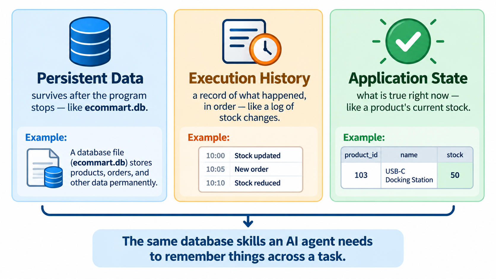

# Preparing for Agentic AI

## Learning objectives

By the end of this lesson, you will be able to:

- Explain what an AI agent is, at a beginner level, and why it needs memory.
- Connect the idea of "persistent data" from this week to an agent's memory.
- Explain what "execution history" means and why a log of past actions is useful.
- Explain what "application state" means and give an eComMART example.
- Describe, at a conceptual level, how the database skills from this week form a foundation for understanding agent memory later in the course.

## 1. Why this lesson is here

You have just built a working eComMART product catalog backend. It stores products in SQLite, reads them back reliably, and keeps changes after the program closes and restarts.

That same idea — a program that remembers things between runs — is also one of the central ideas behind **AI agents**: AI systems that take actions over time rather than answering a single question and stopping.

This lesson does not teach you to build an agent. It uses the database concepts you already have — persistence, records, and reliable reads and writes — to explain three ideas you will meet again when agents are covered later in the course: **persistent data**, **execution history**, and **application state**.

## 2. What is an AI agent, briefly?

A simple AI assistant might answer one question and have no memory of it afterward. An **agent**, by contrast, usually needs to:

- Remember what it has already done.
- Keep track of information across multiple steps or multiple runs.
- Decide what to do next based on what happened before.

For any of that to work reliably, the agent needs somewhere to store information that survives between steps — the same underlying problem this week's lessons have been solving for the eComMART catalog.

You do not need to know how an agent decides what to do next. This lesson only focuses on where it keeps what it remembers.

## 3. Persistent data: the foundation you already built

**Persistence** means that saved data remains available after a program ends and is started again. You met this idea directly in `03_Error_Handling_and_Persistence.md`.

For eComMART, persistence means:

- A product added on Monday is still there on Tuesday.
- Closing the Python program does not erase committed records.
- Opening `ecommart.db` again gives you the same data you left behind.

An agent needs exactly this same property, just applied to different information. Instead of product records, an agent might need to persist things such as:

| eComMART stores | An agent might instead store |
|---|---|
| A product's name, category, price, stock | A fact it learned, or a user's stated preference |
| The current stock level after an order | The current step in a multi-step task |
| A product record that exists until deleted | A memory that exists until no longer needed |

The mechanism is the same one you already know: open a connection, run a parameterized `INSERT` or `UPDATE`, commit, and close. What changes for an agent is *what* gets stored, not *how* storage and retrieval work.

## 4. Execution history: a log of what already happened

**Execution history** means keeping a record of the steps a program has already taken, not just the latest state.

Your `products` table only stores the *current* stock, price, and category for each product. It does not, by itself, record that "on Monday, stock was reduced from 8 to 3" or "on Tuesday, the price was corrected." Once an `UPDATE` runs, the earlier value is gone unless something was designed to keep it.

An agent usually needs the opposite of this: it needs a record of what it has *done*, not only its current state. For example, an agent working through a multi-step task might need to know:

- Which steps it has already completed.
- What it tried, and whether it succeeded or failed.
- What order the steps happened in.

### A small thought experiment

Imagine eComMART wanted to keep a history of stock changes, not just the current stock value. One way to do this with the tools you already have is a second table that records one row per change, rather than overwriting a single value:

```sql
CREATE TABLE IF NOT EXISTS stock_change_log (
    log_id INTEGER PRIMARY KEY,
    product_id INTEGER NOT NULL,
    change_amount INTEGER NOT NULL,
    reason TEXT NOT NULL,
    changed_at TEXT NOT NULL
);
```

Each row would be a historical record: "product 103 changed by -5 units, reason: customer order, at this timestamp." The `products` table still holds the current stock; this new table would hold the *history* of how it got there.

You are not required to build this table. It is shown so you can see that execution history is not a new technology — it is the same `CREATE TABLE`, `INSERT`, and `SELECT` skills you already have, applied to a different question: not "what is true right now?" but "what happened, in what order?"

An agent's execution history works the same way: a sequence of recorded steps it can look back on, built from the same persistence foundation as any other stored data.

## 5. Application state: what the program currently believes to be true

**Application state** is the current set of values a program is working with at a given moment — what it currently "believes" about the world, based on what has been stored or computed so far.

For eComMART, the application's state includes things like:

- Which products currently exist.
- Each product's current price and stock.
- Whether the last operation succeeded or failed.

You have already been managing state carefully all week, often without using that word for it:

- `get_product_by_id()` returns the current state of one product, or `None` if no such state exists.
- `update_product()` changes the application's state and reports whether the change actually happened.
- The validation rules in `validate_product()` protect the state from becoming inconsistent, such as a negative stock value.

An agent also has state: for example, the information it has gathered so far, or where it is in a multi-step task. Just like the eComMART catalog, that state has to live somewhere between steps. If it is only held in a Python variable, it disappears when the program stops — the exact problem files vs. databases introduced in Week 5's first lesson. If it is stored in a database, it can be reloaded reliably the next time the program runs.

## 6. Connecting the three ideas

These three ideas work together, and you have already practised all of them this week:

| Idea | What it answers | What you already built that demonstrates it |
|---|---|---|
| Persistent data | Will this still be here later? | `ecommart.db` keeps products after the program closes and restarts |
| Execution history | What happened, and in what order? | The stock-change-log idea in Section 4; your own error-handling and commit/rollback logic recording what succeeded |
| Application state | What is true right now? | `get_all_products()`, `get_product_by_id()`, and the validated values in the `products` table |

An AI agent needs all three for the same underlying reason your eComMART catalog needed them: without reliable storage, nothing can be trusted to still be true the next time the program runs.



*These three ideas are not new skills — they're the same persistence, logging, and state-reading patterns you already practised this week, pointed at a different kind of information.*

## 7. What this does and does not prepare you for

This lesson does **not** teach you how an agent decides what action to take, how it calls tools, or how it reasons about a task. Those are separate topics for later in the course.

What this week's database work does give you is the foundation underneath all of that:

- How to store something so it survives after the program stops (persistence).
- How to design a table that records a sequence of events rather than only a current value (a basis for execution history).
- How to read, validate, and update the current state of a system reliably (application state).

When agent memory is covered later in the course, you will recognize the underlying pattern: a database, a schema, and the same `CREATE`, `INSERT`, `SELECT`, `UPDATE` operations you practised this week, applied to what an agent needs to remember instead of what a product catalog needs to remember.

## 8. Check your understanding

1. What is the difference between "application state" and "execution history"?
2. Why can't a Python variable alone serve as an agent's persistent memory?
3. In the stock-change-log example, why does it use a separate table instead of adding a column to `products`?
4. Which eComMART function already represents a question about "current state"? Which would be closer to a question about "history"?
5. Why does this lesson say the agent-memory foundation is "the same skills, applied to a different question," rather than a new set of skills?

### Suggested answers

1. Application state is what is currently true (such as a product's current stock). Execution history is a record of what happened over time (such as each change that led to that stock level).
2. A Python variable's value disappears when the program process ends, the same reason eComMART could not safely rely on an in-memory list for its catalog.
3. The `products` table is designed to hold one current row per product. A history needs one row per *event*, so a separate table avoids overwriting earlier values when a new change happens.
4. `get_product_by_id()` answers a state question ("what is true about this product right now?"). A query against the proposed `stock_change_log` table would answer a history question ("what changes happened to this product over time?").
5. Because persistence, state, and history are all implemented with the same core tools you already practised this week: tables, primary keys, parameterized `INSERT`/`UPDATE`/`SELECT`, and reliable commit/rollback. What changes later is the kind of information being stored, not the underlying database skills.

## 9. Lesson recap

- An AI agent needs memory that survives between steps, for the same reason eComMART needed a database instead of only Python variables.
- Persistent data is data that remains available after a program restarts — the core idea behind this week's SQLite work.
- Execution history is a record of what already happened, often modeled as one row per event rather than a single overwritten value.
- Application state is what a program currently believes to be true, built from validated, reliably stored records.
- The database skills from this week — schema design, CRUD operations, parameterized queries, and transactions — are the same skills that later support understanding how an agent remembers information across a task.

## What comes next?

In `05_Practice_and_Review/01_Guided_SQL_Practice.md`, you will review this week's SQL skills with a structured set of exercises using the eComMART `products` table.
