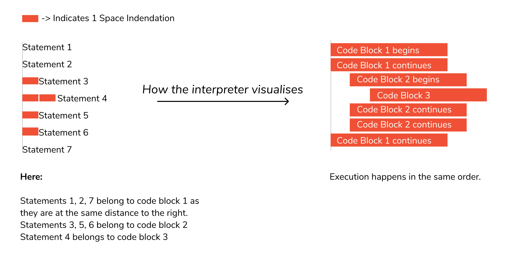
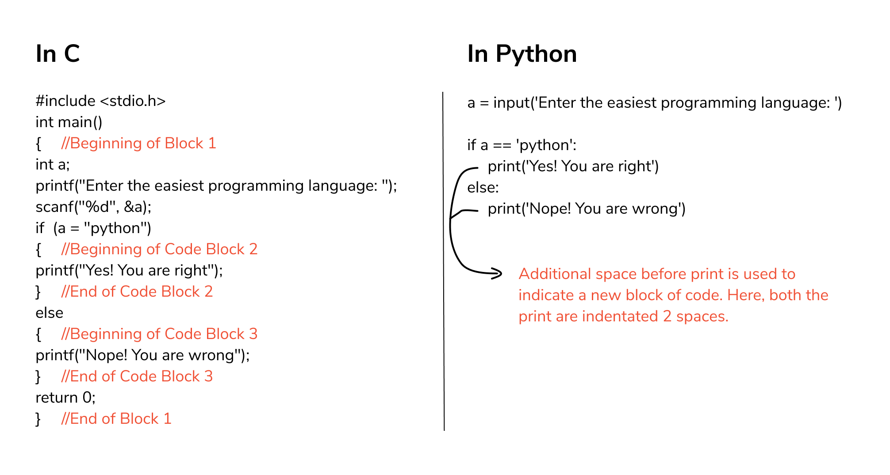

# Python Hello, World

**Python** is easy to learn and code and can be execute with python **interpreter**. We can also use Python **interactive shell** to test python code immediately. A simple hello world example is given below. Write below code in a file and save with **.py** extension. Python source file has **.pyextension**.

### Writing the “Hello, World!” Program

Now that we have Python up and running, we can write our first Python program.

Let's create a very simple program called **`Hello World`**. A "**Hello, World!**" is a simple program that outputs **`Hello, World!`** on the screen. Since it's a very simple program, it's often used to introduce a new programming language to beginners.

```python
print("Hello, World!")

```


Congratulations! You just wrote your first program in Python.

As you can see, this was a pretty easy task. This is the beauty of Python programming language.


### Let’s break down the different components of the code.

1. **`print()`** is a function that tells the computer to perform an action. We know it is a function because it uses parentheses. print() tells Python to display or output whatever we put in the parentheses. By default, this will output to the current terminal window.

2. Some functions, like the **print()** function, are **built-in functions** included in Python by default. These built-in functions are always available for us to use in programs that we create. We can also define **our own functions** that we construct ourselves through other elements.

3. Inside the parentheses of the **`print()`** function is a sequence of characters — **Hello, World!** — that is enclosed in quotation marks **`'`** or **`"`**. Any characters that are inside of quotation marks are called a **string**.

4. Once we are done writing our program, **save** the file and we can exit notepad.

Once you exit out of notpad you’ll return to your shell or cmd.  

### Running the “Hello, World!” Program

The hello.py program that you just created will cause your terminal to produce the following output:

```
# Output:
Hello, World!
```


```python
print("Hello, World!")
```


**Congratulations!** You have written the “Hello, World!” program in **Python 3**.
Since the program ran, you can now confirm that **Python 3** is properly installed and that the program is **syntactically correct**.

### How to print blank lines

Sometimes you need to print one blank line in your Python program. Following are an example to perform this task.

#### Example:

Let us print 8 blank lines. You can type:

```
# Output:
print (9 * "\n")
```

or

```
# Output:
print ("\n\n\n\n\n\n\n\n\n")
```


```python
print ("Hello World!")
print (9 * "\n")
print(print ("Hello World!"))
```


```python
print(print ("Jan\nFeb\nMar\nApr\nMay\nJun\nJul\nAug\nSep\nOct\nNov\nDec"))
```


```python
print ("I want \\n to be printed.")
print("I'm very *happy*")
```


```python
print(print ("Hello\tWorld!") # \t is equal to 4 spaces)
```


```python
print ("""
Routine:
\t- Eat
\t- Study
\t- Sleep\n\t- Repeat
print("""))
```


### Print end command

By default, python's **`print()`** function ends with a newline. This function comes with a parameter called **`end`**. The default value of this parameter is **`\n`**, i.e., the new line character. You can end a print statement with any character or string using this parameter. This is available in only in **Python 3+**

#### Example 1:

```python
print ("Welcome to", end = ' ')
print ("Python", end = '!')`
```

```
# Output:
Welcome to Python!
```


```python
print ("Welcome to", end = ' ')
print(print ("Python", end = '!'))
```


#### Example 2:

```python
print("Python" , end = '@')
```

```
# Output:
Python@
```


```python
print("Python " , end = '@') # ends the output with '@'.
```


```python
print(print ('_M'*9))
```


```python
print("Hello " * 6)
```


## Indentation in Python

Python uses **indentation** (spaces at the beginning of a line) to define blocks of code. This is unique to Python — most other languages use curly braces `{ }` instead.





---

### **Task: eCOMMart — Your First Product Banner**

#### **Task 1: String Concatenation**
eCOMMart needs to display a welcome banner for each product category.

**Instructions:**
- Define `store = "eCOMMart"` and `category = "Electronics"`.
- Use the `+` operator to print: `Welcome to eCOMMart's Electronics section!`


#### **Task 2: Dynamic Product Card**
Print a formatted product listing for eCOMMart using variables and string formatting.

**Instructions:**
- Define variables: `product_name`, `price` (float), `discount` (int, as a %), `seller_city`.
- Calculate the discounted price.
- Print output like:
```python
Product  : Wireless Mouse
Price    : ₹499.00
Discount : 10%
You Pay  : ₹449.10
print(Sold by  : TechPro — Mumbai)
```


