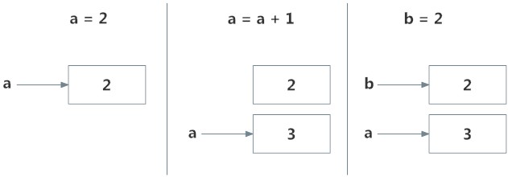

# Nested Statements and Scope

When you create a variable in Python, it is stored in a **namespace** and has a **scope** — the scope determines which parts of your code can see and use that variable name.

Understanding scope is essential for writing functions that behave predictably and for avoiding subtle bugs where two variables with the same name interfere with each other.

**What we will cover:**

1. The thought experiment — which `x` does Python use?
2. The LEGB rule
3. Local scope
4. Enclosing function scope
5. Global scope
6. Built-in scope — and why you should never shadow these
7. Local variables inside functions — before and after
8. The `global` statement
9. `globals()` and `locals()`
10. Exercise — eCOMMart Tax Calculator

---

## 1. The Thought Experiment

Look at this code — what do you think the two `print` statements will output?

```python
x = 25

def printer():
    x = 50
    return x

print(x)          # which x?
print(printer())  # which x?
```
```
# Output:
25
50
```

`print(x)` sees `25` — the global `x`. `print(printer())` sees `50` — the local `x` inside `printer`. They are two completely separate variables that happen to share the same name.

This is scope in action.

---

## 2. The LEGB Rule




Python resolves variable names by searching through up to four scopes in this order — stopping at the first match:

```
┌─────────────────────────────────────────────────────────────┐
│                     LEGB Search Order                       │
│                                                             │
│   L  →  Local         Inside the current function           │
│   E  →  Enclosing     Inside any outer (enclosing) function │
│   G  →  Global        At the top level of the module        │
│   B  →  Built-in      Python's pre-defined names            │
│                                                             │
│   Python checks L first, then E, then G, then B.           │
│   It uses the first match it finds.                         │
└─────────────────────────────────────────────────────────────┘
```

---

## 3. Local Scope

Variables assigned **inside a function** are local — they exist only while the function runs and are invisible outside it.

```python
# x is local inside this lambda
f = lambda x: x**2

print(f(5))
print(f(12))
```
```
# Output:
25
144
```

```python
def apply_discount(cart_total):
    discount_rate = 0.10        # local to apply_discount
    discounted    = cart_total * (1 - discount_rate)
    return discounted

print(apply_discount(1500))
```
```
# Output:
1350.0
```

```python
# discount_rate does not exist outside the function
try:
    print(discount_rate)
except NameError as e:
    print(f"NameError: {e}")
```
```
# Output:
NameError: name 'discount_rate' is not defined
```

```
apply_discount(1500)
    discount_rate = 0.10    ← exists only inside this call
    discounted    = 1350.0
    return 1350.0           ← discount_rate is gone after this
```

---

## 4. Enclosing Function Scope

When a function is **nested inside another function**, the inner function can see variables from the outer (enclosing) function's scope — even without them being passed as arguments:

```python
def process_order(order_id):
    status = 'pending'               # enclosing scope

    def update_status():
        print(f"Order {order_id}: {status}")   # sees order_id and status

    update_status()

process_order('ORD-1001')
process_order('ORD-1002')
```
```
# Output:
Order ORD-1001: pending
Order ORD-1002: pending
```

```
process_order('ORD-1001')
    order_id = 'ORD-1001'    ← enclosing scope
    status   = 'pending'     ← enclosing scope

    update_status()
        ↑ can see order_id and status from enclosing scope
        ↑ doesn't need them passed as arguments
```

> This is the **E** in LEGB — the inner function looks outward to its enclosing function before checking the global scope.

---

## 5. Global Scope

Variables assigned at the **top level of a module** (outside any function or class) are global:

```python
TAX_RATE = 0.18          # global — visible everywhere in this file

def calculate_gst(price):
    return round(price * TAX_RATE, 2)   # reads global TAX_RATE

print(f"GST on ₹499  : ₹{calculate_gst(499)}")
print(f"GST on ₹2999 : ₹{calculate_gst(2999)}")
print(f"TAX_RATE is  : {TAX_RATE}")
```
```
# Output:
GST on ₹499  : ₹89.82
GST on ₹2999 : ₹539.82
TAX_RATE is  : 0.18
```

> Functions can **read** global variables freely. To **change** a global variable from inside a function, you need the `global` statement (see Section 8).

---

## 6. Built-in Scope — Don't Shadow These

Python's built-in names (`len`, `print`, `range`, `sum`, `input`, `open`, …) are always available. They live in the **B** layer of LEGB — the last resort:

```python
print(len)                     # the real built-in function
print(len([1, 2, 3, 4, 5]))    # works correctly
```
```
# Output:
<built-in function len>
5
```

**Never assign a variable the same name as a built-in:**

```python
# WRONG — this shadows the built-in len
len = 5
try:
    print(len([1, 2]))    # TypeError — len is now 5, not a function
except TypeError as e:
    print(f"TypeError: {e}")
finally:
    del len               # remove the shadowing variable
```
```
# Output:
TypeError: 'int' object is not callable
```

```python
# After del len, the built-in is accessible again
print(f"len restored: {len([1, 2, 3])}")
```
```
# Output:
len restored: 3
```

```
Common built-ins to never overwrite:
  len   list   dict   set   tuple   type   range
  sum   min    max    print input   open   int
  float str    bool   abs   round   zip    map
```

---

## 7. Local Variables Inside Functions — Before and After

A parameter passed to a function creates a **local copy** inside the function. Changes to that local copy do not affect the original variable outside:

```python
x = 50

def func(x):
    print('x is', x)          # sees the local x (= 50 passed in)
    x = 2                      # changes only the local copy
    print('Changed local x to', x)

func(x)
print('x is still', x)        # global x is unchanged
```
```
# Output:
x is 50
Changed local x to 2
x is still 50
```

```
global x = 50
                 ──→  func(x) creates local x = 50
                           local x = 2  (only inside func)
                 ←──  func returns
global x = 50   (unchanged)
```

---

## 8. The `global` Statement

To **modify** a global variable from inside a function, declare it with `global`. Without this, any assignment inside the function creates a new local variable instead:

```python
platform_fee = 0.02   # global platform fee

def update_platform_fee(new_rate):
    global platform_fee      # tells Python: use the global, not a local
    print(f"Updating platform fee from {platform_fee*100:.1f}% to {new_rate*100:.1f}%")
    platform_fee = new_rate  # now modifies the global

print(f"Before: platform_fee = {platform_fee}")
update_platform_fee(0.025)
print(f"After : platform_fee = {platform_fee}")
```
```
# Output:
Before: platform_fee = 0.02
Updating platform fee from 2.0% to 2.5%
After : platform_fee = 0.025
```

```
Without global:   platform_fee = new_rate  → creates a LOCAL variable
With global:      platform_fee = new_rate  → modifies the GLOBAL variable
```

> **Use `global` sparingly.** Relying on global mutable state makes code hard to test and debug. Prefer passing values as arguments and returning results. Constants (like `TAX_RATE`) are fine as globals.

---

## 9. `globals()` and `locals()`

Python provides two built-in functions to inspect the current scope at runtime:

```python
store_name = "eCOMMart"   # global

def show_scope_info():
    local_var = "I am local"
    print("Local variables:", list(locals().keys()))
    print("store_name in globals:", 'store_name' in globals())

show_scope_info()
```
```
# Output:
Local variables: ['local_var']
store_name in globals: True
```

> These are mainly used for debugging and introspection. Everything in Python is an object — you can assign a function to a variable just like a number. This becomes important in the **decorators** section later in the course.

---

## Exercise: eCOMMart — Employee Tax Calculator

Build a tax calculator using nested `if` statements. The tax rules depend on both salary and age.

**Tax Rules:**

| Age | Salary > ₹10,00,000 | ₹5,00,000–₹10,00,000 | Below ₹5,00,000 |
|---|---|---|---|
| Under 60 | 30% | 20% | 0% |
| 60 and above | 20% | 10% | 0% |

**Instructions:**
- Ask the user for their annual salary and age
- Use nested `if` statements to determine the tax rate
- Calculate and display the tax amount and net income

```python
def calculate_tax(salary, age):
    """
    Calculates income tax and net income based on salary and age.

    Args:
        salary (float): Annual salary in INR.
        age    (int)  : Employee's age.

    Returns:
        tuple: (tax_amount, net_income)
    """
    if age < 60:
        if salary > 1000000:
            tax_rate = 0.30
        elif salary >= 500000:
            tax_rate = 0.20
        else:
            tax_rate = 0.0
    else:
        if salary > 1000000:
            tax_rate = 0.20
        elif salary >= 500000:
            tax_rate = 0.10
        else:
            tax_rate = 0.0

    tax_amount = salary * tax_rate
    net_income = salary - tax_amount
    return tax_amount, net_income


# Get input from user
age    = int(input("Enter your age: "))
salary = float(input("Enter your annual salary (₹): "))

tax, net = calculate_tax(salary, age)

print(f"Your tax amount is ₹{tax:,.1f}")
print(f"Your net income after tax is ₹{net:,.1f}")
```
```
# Expected Output (age=45, salary=₹12,00,000):
Enter your age: 45
Enter your annual salary (₹): 1200000
Your tax amount is ₹360,000.0
Your net income after tax is ₹840,000.0
```

**All cases verified:**

```
Age < 60:
  ₹12,00,000 → 30% → Tax ₹3,60,000 | Net ₹8,40,000
  ₹7,50,000  → 20% → Tax ₹1,50,000 | Net ₹6,00,000
  ₹3,00,000  →  0% → Tax ₹0        | Net ₹3,00,000

Age ≥ 60:
  ₹12,00,000 → 20% → Tax ₹2,40,000 | Net ₹9,60,000
  ₹7,50,000  → 10% → Tax ₹75,000   | Net ₹6,75,000
  ₹3,00,000  →  0% → Tax ₹0        | Net ₹3,00,000
```
